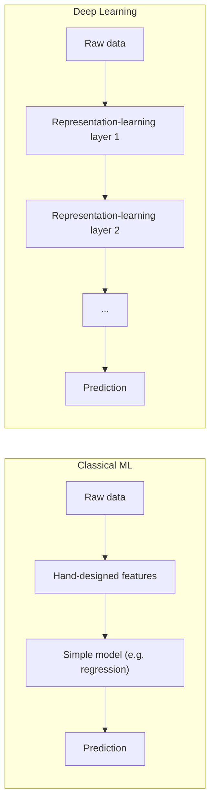
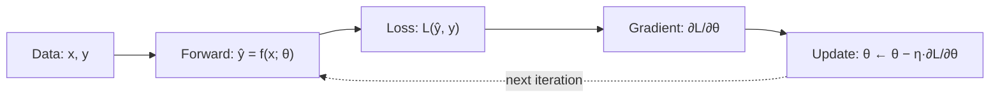

Language: **English (default)** | [Polski](lecture.md)

# Lecture 01: Deep Learning, ML vs DL, tensors, and the basic model-training process

## Learning goals

1. point out how *deep learning* (DL) differs from classical machine learning (ML), and give a concrete example of that difference,
2. define a **tensor** by its four actual properties (rank, shape, data type, device) rather than just as a "generalized matrix",
3. derive the gradient of the MSE loss with respect to a linear model's parameters using the chain rule and verify it numerically with automatic differentiation (*autograd*) in PyTorch,
4. build a training loop from scratch (*forward → loss → backward → parameter update*) that works the same way on CPU and on GPU.

## Why this matters

Every later topic, from MLPs and backpropagation to CNNs and transformers, follows the same pattern. It requires data, a model with parameters, an error measure, and a procedure that gradually improves the parameters. This lecture presents the pattern through an example that can be calculated by hand. More complex models extend the same idea.

This distinction also matters when choosing a solution. Deep learning is not better than classical ML in every case. The decision depends on the amount of data, training time, compute cost, and interpretability requirements. Sometimes these costs are justified, while in other cases a simpler model is the better engineering choice.

## Intuition

### How deep learning differs from classical ML

In classical machine learning, a domain expert analyzes the data and **manually designs features**. For handwritten digit recognition, these might include the number of closed loops, line curvature, or the number of intersection points. The features are then passed to a relatively simple model, such as linear regression, logistic regression, an SVM, or a decision tree. The model learns how to combine them to predict the label.

In deep learning, the split between hand-crafted features and a simple model disappears. The model consists of layers of differentiable transformations that **learn data representations**. The entire system is trained *end-to-end* with the same gradient-based procedure, from raw or lightly processed input to the final prediction.

**Both families of methods use the same mechanism.** An error measure is defined, and the parameters are adjusted to reduce it. The difference lies in *what* is adjusted. Classical ML usually changes a small number of parameters in a model that operates on fixed features. DL often changes many more parameters across multiple layers, which build a useful data representation during training.

Deep learning therefore usually needs more data and compute than classical ML for the same task. The model must learn its features instead of receiving them from an expert. With enough data, this makes it suitable for problems where manual feature design would be impractical, such as raw image, audio, or text processing.

### What a tensor is

In mathematics and physics, a tensor generalizes a scalar, vector, and matrix to an arbitrary number of dimensions, or *rank*. In deep learning libraries, a tensor usually means **a multidimensional array of numbers with a single data type**. Four properties describe it.

- **rank**, the number of dimensions. A scalar has rank 0, a vector rank 1, a matrix rank 2, and a batch of RGB images usually rank 4;
- **shape**, the size of each dimension, such as `(32, 3, 28, 28)` for 32 RGB images of size 28×28;
- **dtype**, such as `float32` or `int64`;
- **device**, the location where the data is stored, such as `cpu` or `cuda` (GPU).

The device property distinguishes a `torch.Tensor` from a plain NumPy array. An operation between two tensors requires both tensors to be on the same device.

## Formal model

A supervised-learning task consists of the following elements.

- A dataset $\{(x_i, y_i)\}_{i=1}^{N}$ contains $N$ examples. Each example is an input and target pair.
- A **model** $f(x; \theta)$ is a function parameterized by a vector $\theta$. Given an input $x$, it returns a prediction $\hat{y} = f(x; \theta)$.
- A **loss function** $\ell(\hat{y}, y)$ measures how much the prediction differs from the target for one example.
- The **dataset loss** is usually the average $L(\theta) = \frac{1}{N}\sum_{i=1}^{N} \ell\big(f(x_i; \theta), y_i\big)$.
- **Training** finds a value $\theta^\*$ that minimizes $L(\theta)$. In practice, the parameters are improved iteratively by moving in a direction that reduces the loss.

The learning mechanism repeats four steps: a forward pass, loss calculation, gradient calculation, and parameter update. The process continues until the loss no longer decreases meaningfully.

In this lecture, $f$ is a **single-variable linear regression** model. Its simplicity makes the entire process suitable for a manual calculation. In lectures 2 and 3, a multilayer network replaces this function, and backpropagation calculates the gradient.

## Mathematics

### Model and loss

Single-variable linear model:

$$\hat{y}_i = w \cdot x_i + b$$

where:

- $x_i$ is the input feature value for example $i$;
- $w$ is the **weight**, a parameter that describes the slope;
- $b$ is the **bias** or intercept, a parameter that describes the offset;
- $\hat{y}_i$ is the model's prediction for example $i$.

The loss function is **Mean Squared Error** (MSE):

$$L(w, b) = \frac{1}{N}\sum_{i=1}^{N} (\hat{y}_i - y_i)^2 = \frac{1}{N}\sum_{i=1}^{N} (w x_i + b - y_i)^2$$

Here, $y_i$ is the observed target for example $i$, and $N$ is the number of examples. Squaring removes the sign of the error and penalizes large errors more heavily than small ones.

### The gradient from the chain rule

Reducing $L$ requires the effect of small changes in $w$ and $b$ to be known. The partial derivatives $\partial L / \partial w$ and $\partial L / \partial b$ describe this effect.

The loss $L$ is a **composition of two functions**. The inner function calculates the linear prediction, and the outer function squares the resulting error. The **chain rule** therefore applies. If $L = g(h(w))$, then $\frac{dL}{dw} = g'(h(w)) \cdot h'(w)$.

For an example $i$, the error is $e_i = \hat{y}_i - y_i$, or the prediction minus the target. Its contribution to the loss is $e_i^2$.

- The outer derivative with respect to $e_i$ is $\frac{\partial (e_i^2)}{\partial e_i} = 2 e_i$.
- For $e_i = w x_i + b - y_i$, the inner derivative with respect to $w$ is $\frac{\partial e_i}{\partial w} = x_i$. Neither $b$ nor $y_i$ depends on $w$.
- The inner derivative with respect to $b$ is $\frac{\partial e_i}{\partial b} = 1$.

Applying the chain rule and averaging over $N$ examples gives:

$$\frac{\partial L}{\partial w} = \frac{1}{N}\sum_{i=1}^{N} 2 e_i \cdot x_i = \frac{2}{N}\sum_{i=1}^{N} (\hat{y}_i - y_i)\, x_i$$

$$\frac{\partial L}{\partial b} = \frac{1}{N}\sum_{i=1}^{N} 2 e_i \cdot 1 = \frac{2}{N}\sum_{i=1}^{N} (\hat{y}_i - y_i)$$

Each operation contributes a local derivative, and the results are multiplied together. The same principle underlies *backpropagation* through a multilayer computational graph, covered in lecture 3. The number of operations increases, but the calculation remains the same.

### The update rule (gradient descent)

The gradient $\big(\frac{\partial L}{\partial w}, \frac{\partial L}{\partial b}\big)$ points in the direction of the **steepest increase** in $L$ near the current point $(w, b)$. Reducing the loss requires a step in the direction *opposite* to the gradient.

$$w \leftarrow w - \eta \frac{\partial L}{\partial w}, \qquad b \leftarrow b - \eta \frac{\partial L}{\partial b}$$

The learning rate $\eta$ is a small positive scalar that controls the step length. A value that is too large can overshoot the minimum and increase the loss. A value that is too small leads to slow convergence. Lecture 4 develops this topic in the context of optimizers. Here, intuition and a short notebook demonstration are sufficient.

## Worked example

The calculation below shows one gradient-descent step by hand. It provides a reference for checking the notebook results. The data contains no noise and follows $y = 2x + 1$ exactly.

| $i$ | $x_i$ | $y_i$ |
|---|---|---|
| 1 | 1 | 3 |
| 2 | 2 | 5 |
| 3 | 3 | 7 |

The initial values are $w = 0$, $b = 0$, $N = 3$, and $\eta = 0.1$.

**Predictions and errors.** For every example, $\hat{y}_i = 0 \cdot x_i + 0 = 0$. Therefore, $e_1 = 0 - 3 = -3$, $e_2 = 0 - 5 = -5$, and $e_3 = 0 - 7 = -7$.

**Initial loss**

$$L = \frac{1}{3}\big((-3)^2 + (-5)^2 + (-7)^2\big) = \frac{9 + 25 + 49}{3} = \frac{83}{3} \approx 27.667$$

**Gradients**

$$\frac{\partial L}{\partial w} = \frac{2}{3}\big((-3)(1) + (-5)(2) + (-7)(3)\big) = \frac{2}{3}(-34) \approx -22.667$$

$$\frac{\partial L}{\partial b} = \frac{2}{3}(-3 - 5 - 7) = \frac{2}{3}(-15) = -10$$

**Update**

$$w \leftarrow 0 - 0.1 \cdot (-22.667) = 2.2667, \qquad b \leftarrow 0 - 0.1 \cdot (-10) = 1.0$$

**Loss after one step.** With the new values $w = 2.2667$ and $b = 1.0$, the predictions are $3.2667$, $5.5333$, and $7.8$. The corresponding errors are $0.2667$, $0.5333$, and $0.8$. Therefore,

$$L_{\text{new}} = \frac{0.0711 + 0.2844 + 0.64}{3} \approx 0.332$$

One step reduced the loss from $\approx 27.667$ to $\approx 0.332$. The large decrease follows from the lack of noise and the appropriate data scale. The notebook confirms that PyTorch's `.backward()` method produces the same gradient values as the formulas above. With noisy data, the loss does not reach zero. It settles at a level determined by the noise variance.

## Experiment

The notebook [`examples.en.ipynb`](examples.en.ipynb) presents the same mechanism on noisy synthetic data described by $y = a_{\text{true}} x + b_{\text{true}} + \varepsilon$.

1. generates synthetic data with a fixed random seed (reproducibility),
2. creates the parameters `w`, `b` as tensors with `requires_grad=True`,
3. in the training loop, computes the prediction (*forward*) and MSE loss, calls `loss.backward()`, then **manually** updates `w` and `b` inside `torch.no_grad()` without using `optim`,
4. **compares the autograd gradient with the formula derived above**. The difference should be on the order of float32 numerical error,
5. plots the fitted line against the data at several stages of training and the loss curve across iterations,
6. briefly demonstrates what happens when $\eta$ is too large (the loss increases/oscillates instead of decreasing).

The notebook runs on CPU, and `torch.device("cuda" if torch.cuda.is_available() else "cpu")` selects the device automatically. The same code therefore runs unchanged on a machine with a GPU.

## Observations

- The loss falls fastest at the start of training and then slows down. The convex loss curve flattens near the minimum. This trajectory is typical of linear regression with MSE.
- The learned $w$ and $b$ approach $a_{\text{true}}$ and $b_{\text{true}}$ but do not match them exactly. The data contains noise, and the model only has access to a noisy sample of the underlying function.
- The loss does not reach zero even after many iterations. This **irreducible error** comes from the noise. Even a perfect model cannot predict values that are random by definition.
- The manually calculated gradient and the gradient returned by `autograd` agree up to numerical error. The result confirms that automatic differentiation follows the derived formula.
- When $\eta$ is too large, the loss increases or oscillates. The update steps move past the minimum.

## Common misconceptions

❌ The gradient $\partial L/\partial \theta$ assigns a share of the prediction error to each parameter.

✅ The gradient describes the direction and rate of the *local* increase in loss after a small parameter change. It points in the direction of the function's steepest increase at the current point. The minus sign in the update rule moves the parameters in the opposite direction.

❌ Deep learning is just "ML with more layers".

✅ The difference lies in **representation learning**. In DL, the model builds useful features during *end-to-end* training instead of receiving them from an expert. Multiple layers are a consequence of this approach, not its complete definition.

❌ A tensor in PyTorch is just another name for a matrix or a NumPy array.

✅ A tensor generalizes a scalar, vector, and matrix to an arbitrary rank. It also carries information about its device (`device`) and, optionally, the computational graph used for automatic differentiation (`requires_grad`). Mathematically, a matrix is a rank-2 tensor. The difference lies in the additional information stored by the framework.

❌ More training iterations/epochs always means a better model.

✅ In a convex problem without excess parameters, longer training usually helps until it reaches the irreducible error. In models with many parameters, however, prolonged training can cause *overfitting*. The model starts fitting the noise in the training data, and its performance on new data declines. Lecture 5 covers this behavior.

## Engineering implications

- **Device-agnostic code** uses `torch.device(...)` and `.to(device)`. The same pattern supports much larger models trained on a GPU. This example makes it possible to check the pattern without an expensive training run.
- **Reproducibility** requires, among other things, a fixed random seed such as `torch.manual_seed`. It allows the same result to be produced again. This does not guarantee full determinism on every platform because some GPU operations may behave differently. For CPU and a problem of this size, the result remains stable.
- **The learning rate as a hyperparameter** changes the behavior of the same training loop. Depending on $\eta$, training may converge or diverge. Selecting the learning rate and other hyperparameters is a regular part of model development. Lecture 4 returns to this topic.
- **Numerical precision** affects computation speed and memory use. PyTorch uses the 32-bit `float32` type by default, while NumPy defaults to `float64`. This trade-off becomes more significant as the number of model parameters grows.
- **Data scale** determines how training is organized. This loop processes the entire dataset at once using *full-batch gradient descent*. Larger datasets are divided into *mini-batches* and loaded with a `DataLoader` because they do not fit in memory as a single tensor.

## What to remember

- ML and DL reduce an error measure by adjusting parameters. DL also learns data representations instead of relying only on hand-designed features.
- A tensor is a multidimensional array described by its rank, shape, data type, and device. It may also store the operation history required for automatic differentiation.
- The MSE gradient for linear regression follows from a two-step application of the chain rule. It is a simplified version of the backpropagation introduced in lecture 3.
- `autograd` returns the same values as a manual derivation. The notebook verifies this numerically.
- A training loop always includes a forward pass, loss and gradient calculations, and a parameter update.

## Questions for students

1. Why can the loss start increasing instead of decreasing when the learning rate $\eta$ is too large? How does the interpretation of the gradient as the direction of steepest increase explain this behavior?
2. How does a tensor in PyTorch *actually* differ from a NumPy array, and how is it mathematically the same?
3. The data in the experiment contains noise, so the loss does not reach zero. Does this indicate a weak model? Why or why not?
4. In what type of task might classical ML with hand-designed features be a better engineering choice than deep learning? What argument other than limited data supports that choice?

## References

- Goodfellow, I., Bengio, Y., Courville, A. (2016). *Deep Learning*. MIT Press. https://www.deeplearningbook.org/. Chapter 1 provides broader historical context and definitions of ML and DL.
- PyTorch Contributors. *torch.Tensor* documentation. https://pytorch.org/docs/stable/tensors.html
- PyTorch Contributors. *Autograd mechanics* documentation. https://pytorch.org/docs/stable/notes/autograd.html

Full entries are available in [`references/references.bib`](../../references/references.bib).
