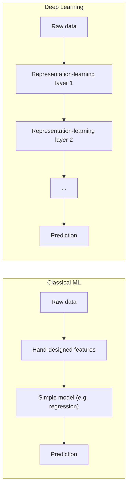
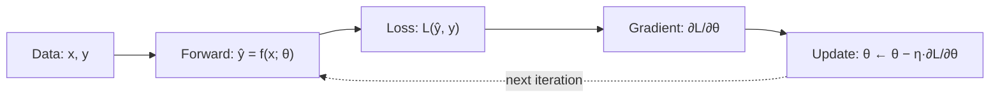

Language: **English (default)** | [Polski](lecture.md)

# Lecture 01: Deep Learning, ML vs DL, tensors, and the basic model-training process

## Learning goals

After this lecture, you should be able to:

1. point out how *deep learning* (DL) differs from classical machine learning (ML), and give a concrete example of that difference,
2. define a **tensor** by its four actual properties (rank, shape, data type, device) rather than just as a "generalized matrix",
3. derive the gradient of the MSE loss with respect to a linear model's parameters — step by step, using the chain rule — and verify it numerically against automatic differentiation (*autograd*) in PyTorch,
4. build a training loop from scratch (*forward → loss → backward → parameter update*) that works the same way on CPU and on GPU.

## Why this matters

Every later lecture in this course — MLPs, backpropagation, optimizers, CNNs, transformers — is a variant of the same skeleton: we have data, a model with parameters, an error measure, and a procedure that iteratively improves the parameters. If you understand this skeleton here, on an example simple enough to compute by hand, every later, more complex model will be the same story continued, not new magic.

This is also an important engineering distinction: deep learning is not "better ML in every case" — it is a specific set of trade-offs (amount of data, training time, compute cost, interpretability) that sometimes wins and sometimes loses against a simpler model. Knowing when to reach for which is part of an engineer's craft, not just an academic curiosity.

## Intuition

### How deep learning differs from classical ML

In classical machine learning, the typical process looks like this: a domain expert analyzes the data and **manually designs features** — e.g. for handwritten digit recognition, these might be: the number of closed loops, the curvature of lines, the number of intersection points. These features feed into a relatively simple model (linear/logistic regression, SVM, decision tree), which learns how to combine them to predict the label well.

In deep learning, this split between "hand-crafted features" and "simple model" disappears. The model consists of many layers of differentiable transformations that **learn their own data representations** — and this entire stack of layers is trained *end-to-end* by the same gradient-based procedure, from raw (or lightly processed) input data all the way to the prediction.

Important: **both families of methods share the same mechanism** — define an error measure, adjust parameters to reduce that error. The difference is in *what* gets adjusted: in ML, usually a small number of parameters of a simple model operating on fixed, predetermined features; in DL — usually very many parameters, spread across many layers, which work out a useful data representation themselves during training.

Practical consequence: deep learning usually needs more data and more compute than classical ML for the same task, because the model has to "invent" features itself rather than receive them ready-made from an expert. In exchange, given enough data, it often handles problems where hand-designing features is practically infeasible (raw images, raw audio, raw text).

### What a tensor is

In mathematics and physics, a tensor is an object that generalizes a scalar, vector, and matrix to an arbitrary number of dimensions (*rank*). In deep learning libraries (PyTorch, but also NumPy for arrays), the word "tensor" effectively means: **a multi-dimensional array of numbers of one data type**, described by:

- **rank** — the number of dimensions (scalar: rank 0, vector: rank 1, matrix: rank 2, e.g. a batch of RGB images: rank 4),
- **shape** — the size of each dimension, e.g. `(32, 3, 28, 28)` for 32 RGB images of size 28×28,
- **dtype** — e.g. `float32`, `int64`,
- **device** — where the data physically lives in memory: `cpu` or `cuda` (GPU).

That last one — device — is something a plain NumPy array doesn't have, and it's a practical difference that will stay with us throughout the course: a `torch.Tensor` knows which device it "lives" on, and an operation between two tensors requires them to be on the same device.

## Formal model

We formalize the supervised-learning task as follows:

- we have a dataset $\{(x_i, y_i)\}_{i=1}^{N}$ — $N$ examples, each an (input, target) pair,
- we have a **model** $f(x; \theta)$ — a function parameterized by a parameter vector $\theta$, which for input $x$ returns a prediction $\hat{y} = f(x; \theta)$,
- we have a **loss function** $\ell(\hat{y}, y)$ — a number saying how much the prediction differs from the target, for one example,
- the **loss on the dataset** is usually the average: $L(\theta) = \frac{1}{N}\sum_{i=1}^{N} \ell\big(f(x_i; \theta), y_i\big)$,
- **training** means finding $\theta^\*$ that minimizes $L(\theta)$ — in practice we don't "solve" this outright, but **iteratively** improve $\theta$, step by step, in a direction that decreases $L$.

That last point is the entire "learning mechanism": repeat (*forward* → compute the loss → compute the loss's gradient with respect to the parameters → update the parameters), until the loss stops decreasing meaningfully.

In this lecture, $f$ will be the simplest possible model — **single-variable linear regression** — exactly so that this whole scheme can be computed by hand, before in lectures 2 and 3 $f$ becomes a multi-layer network, and the gradient-computing procedure becomes backpropagation.

## Mathematics

### Model and loss

Single-variable linear model:

$$\hat{y}_i = w \cdot x_i + b$$

where:

- $x_i$ — the input feature's value for example $i$,
- $w$ — the **weight**, a parameter describing the slope,
- $b$ — the **bias** (intercept), a parameter describing the offset,
- $\hat{y}_i$ — the model's prediction for example $i$.

As the loss function, we take **Mean Squared Error** (MSE):

$$L(w, b) = \frac{1}{N}\sum_{i=1}^{N} (\hat{y}_i - y_i)^2 = \frac{1}{N}\sum_{i=1}^{N} (w x_i + b - y_i)^2$$

where $y_i$ is the true (observed) target value for example $i$, and $N$ is the number of examples. Squaring does two jobs: it removes the sign of the error (we don't care whether we erred high or low) and it penalizes large errors more heavily than small ones.

### The gradient — step by step with the chain rule

To decrease $L$, we need to know how $L$ changes with a small change in $w$ and with a small change in $b$ — these are the partial derivatives $\partial L / \partial w$ and $\partial L / \partial b$.

$L$ is a **composition of two functions**: the outer function "square it" and the inner function "compute the linear prediction". This is exactly the situation where the **chain rule** from calculus applies: if $L = g(h(w))$, then $\frac{dL}{dw} = g'(h(w)) \cdot h'(w)$.

For one example $i$, let $e_i = \hat{y}_i - y_i$ (the error, i.e. prediction minus target) be the inner function in the sense of "squaring": the loss term is $e_i^2$.

- Outer derivative (with respect to $e_i$): $\frac{\partial (e_i^2)}{\partial e_i} = 2 e_i$.
- Inner derivative (with respect to $w$): $e_i = w x_i + b - y_i$, so $\frac{\partial e_i}{\partial w} = x_i$ (since $b$ and $y_i$ don't depend on $w$, and we differentiate $w x_i$ with respect to $w$).
- Inner derivative (with respect to $b$): $\frac{\partial e_i}{\partial b} = 1$.

Combining via the chain rule and averaging over $N$ examples (the constant $\frac{1}{N}$ factors out of the sum):

$$\frac{\partial L}{\partial w} = \frac{1}{N}\sum_{i=1}^{N} 2 e_i \cdot x_i = \frac{2}{N}\sum_{i=1}^{N} (\hat{y}_i - y_i)\, x_i$$

$$\frac{\partial L}{\partial b} = \frac{1}{N}\sum_{i=1}^{N} 2 e_i \cdot 1 = \frac{2}{N}\sum_{i=1}^{N} (\hat{y}_i - y_i)$$

This two-step line of reasoning — "compute the local derivative of each step, multiply them together" — is, in miniature, exactly what lecture 3 will call *backpropagation* on a computational graph with many layers. Here we only have two steps (square, then a linear function); there, there will be many more, but the principle doesn't change.

### The update rule (gradient descent)

The gradient $\big(\frac{\partial L}{\partial w}, \frac{\partial L}{\partial b}\big)$ points in the direction of the **steepest increase** of $L$ near the current $(w, b)$. To decrease the loss, we take a step in the direction *opposite* to the gradient:

$$w \leftarrow w - \eta \frac{\partial L}{\partial w}, \qquad b \leftarrow b - \eta \frac{\partial L}{\partial b}$$

where $\eta$ (the *learning rate*) is a small positive scalar controlling the step length. Too large an $\eta$ can make the steps "overshoot" the minimum and the loss start increasing; too small, and training will converge, but very slowly. We'll develop this topic fully in lecture 4 (optimizers); here, intuition plus one short notebook demonstration is enough.

## Worked example

Let's compute one gradient-descent step by hand, so the notebook can be checked "on paper". Data (noise-free, exactly from the relation $y = 2x + 1$):

| $i$ | $x_i$ | $y_i$ |
|---|---|---|
| 1 | 1 | 3 |
| 2 | 2 | 5 |
| 3 | 3 | 7 |

Start: $w = 0$, $b = 0$, $N = 3$, $\eta = 0.1$.

**Predictions and errors** ($\hat{y}_i = 0 \cdot x_i + 0 = 0$ for all): $e_1 = 0 - 3 = -3$, $e_2 = 0 - 5 = -5$, $e_3 = 0 - 7 = -7$.

**Initial loss:**

$$L = \frac{1}{3}\big((-3)^2 + (-5)^2 + (-7)^2\big) = \frac{9 + 25 + 49}{3} = \frac{83}{3} \approx 27.667$$

**Gradients:**

$$\frac{\partial L}{\partial w} = \frac{2}{3}\big((-3)(1) + (-5)(2) + (-7)(3)\big) = \frac{2}{3}(-34) \approx -22.667$$

$$\frac{\partial L}{\partial b} = \frac{2}{3}(-3 - 5 - 7) = \frac{2}{3}(-15) = -10$$

**Update:**

$$w \leftarrow 0 - 0.1 \cdot (-22.667) = 2.2667, \qquad b \leftarrow 0 - 0.1 \cdot (-10) = 1.0$$

**Loss after one step** (with the new $w = 2.2667$, $b = 1.0$): the predictions are $3.2667$, $5.5333$, $7.8$, the errors are $0.2667$, $0.5333$, $0.8$, so

$$L_{\text{new}} = \frac{0.0711 + 0.2844 + 0.64}{3} \approx 0.332$$

One step reduced the loss from $\approx 27.667$ to $\approx 0.332$ — because the data is noise-free and well-scaled. In the notebook you'll see that PyTorch (`.backward()`) gives the same gradient values as the formulas above, and that for noisy data the loss won't drop to zero, only to the level set by the noise's variance.

## Experiment

The notebook [`examples.en.ipynb`](examples.en.ipynb) implements exactly this mechanism on synthetic, noisy data ($y = a_{\text{true}} x + b_{\text{true}} + \varepsilon$):

1. generates synthetic data with a fixed random seed (reproducibility),
2. creates the parameters `w`, `b` as tensors with `requires_grad=True`,
3. in the training loop: computes the prediction (*forward*), the MSE loss, calls `loss.backward()`, then **manually** (without `optim`) updates `w` and `b` under `torch.no_grad()`,
4. **verifies the autograd gradient against the formula derived above** — the difference should be on the order of float32 numerical error,
5. plots: (a) the fitted line against the data at a few points during training, (b) the loss curve as a function of iteration,
6. briefly demonstrates what happens when $\eta$ is too large (the loss increases/oscillates instead of decreasing).

The whole notebook runs on CPU; the device is chosen automatically (`torch.device("cuda" if torch.cuda.is_available() else "cpu")`), so the same code will work unchanged on a machine with a GPU.

## What we observe

- The loss drops fastest at the start of training, then more and more slowly (the loss curve is convex and "flattens out" near the minimum) — a typical trajectory for a convex problem like linear regression with MSE.
- The learned $w$, $b$ get close to $a_{\text{true}}$, $b_{\text{true}}$, but **not exactly** — because the data contains noise, and the model has no access to the "true" function, only to a noisy sample of it.
- The loss doesn't drop to zero even after very many iterations — this isn't a bug, it's **irreducible error** caused by noise in the data: even a perfect model can't predict noise, which is by definition unpredictable.
- The gradient computed by hand from the formula and the gradient from `autograd` are (up to numerical error) identical — this is **empirical proof** that autograd does "the same thing" we derived on paper, not something magical.
- With too large an $\eta$, the loss increases or oscillates across iterations instead of consistently decreasing — the update steps "overshoot" the minimum.

## Common misconceptions

❌ The gradient $\partial L/\partial \theta$ tells us "how wrong we were" for each parameter.

✅ The gradient tells us in which direction, and how strongly, the loss *locally* increases if we slightly increase that parameter. It's the direction of steepest increase of the function at that point — nothing more. That's why we update with a minus sign: we move in the direction opposite to the gradient.

❌ Deep learning is just "ML with more layers".

✅ The key difference is **representation learning**: in DL, the model works out useful data features itself during end-to-end training, instead of receiving them from an expert. The number of layers is a consequence of this approach, not its definition — a single-layer model could also be "deep learning" in spirit (though in practice DL is associated with multi-layer models).

❌ A tensor in PyTorch is just another name for a matrix or a NumPy array.

✅ A tensor generalizes a scalar/vector/matrix to an arbitrary rank, and — practically important — carries information about its device (`device`) and (optionally) about the computational graph for automatic differentiation (`requires_grad`). Mathematically, a matrix is a rank-2 tensor; the difference is in what the framework additionally "knows" about this object.

❌ More training iterations/epochs always means a better model.

✅ In this lecture, on a convex problem with no excess parameters, longer training generally helps (up to the limit set by the irreducible noise error). But already in lecture 5 you'll see that for models with many parameters, training too long leads to *overfitting* — the model starts "memorizing" the training data's noise, and its quality on new data drops.

## Engineering implications

- **Device-agnostic code** (`torch.device(...)`, `.to(device)`) isn't "just in case" here — it's the same pattern we'll use to train much larger models on GPU in later lectures. Better to get used to it on an example that runs instantly on CPU anyway.
- **Reproducibility** via setting a random seed (`torch.manual_seed`) lets others (and ourselves, next week) reproduce the same result. This doesn't guarantee full determinism on every platform/hardware (e.g. some GPU operations can differ), but for CPU and this problem's scale, the result will be stable.
- **Learning rate as an engineering hyperparameter**: the same training loop with a different $\eta$ gives completely different behavior (convergence vs. divergence). In practice, choosing $\eta$ (and other hyperparameters) is one of the main axes of an ML engineer's work — we'll come back to this systematically in lecture 4.
- **Numerical precision**: PyTorch's default data type is `float32` (32-bit), not `float64` as in NumPy by default — a deliberate trade-off between precision and memory/speed that becomes important once a model has millions of parameters.
- **Scale**: this training loop operates on the entire dataset at once (so-called *full-batch* gradient descent). For larger datasets this isn't done, for memory reasons — hence *mini-batches* and `DataLoader`, which we'll meet once the datasets in the labs stop fitting "for free" into a single tensor.

## What to remember

- ML and DL solve the same task (reduce an error measure by adjusting parameters); DL differs in that it learns data representations itself, instead of receiving hand-designed features.
- Tensor = multi-dimensional array + rank/shape/dtype + **device** (+ optionally, a history of operations for autograd).
- The MSE loss's gradient for linear regression is derived via a two-step chain rule — a miniature version of the backpropagation from lecture 3.
- `autograd` computes exactly what can be derived by hand — the notebook shows this numerically, not just declaratively.
- A training loop is always: forward → loss → gradient → update, no matter how complicated the model is.

## Questions for students

1. Why can the loss start increasing instead of decreasing when the learning rate $\eta$ is too large? Refer to the interpretation of the gradient as the direction of steepest increase.
2. How does a tensor in PyTorch *actually* differ from a NumPy array, and how is it mathematically the same?
3. The data in the experiment contains noise, so the loss doesn't drop to zero. Does this mean the model is "weak"? Justify your answer.
4. Give an example of a task where classical ML with hand-designed features might be a better engineering choice than deep learning — and justify it with an argument other than "not enough data".

## References

- Goodfellow, I., Bengio, Y., Courville, A. (2016). *Deep Learning*. MIT Press. https://www.deeplearningbook.org/ -- chapter 1 for broader historical context and the ML vs. DL definitions.
- PyTorch Contributors. *torch.Tensor* documentation. https://pytorch.org/docs/stable/tensors.html
- PyTorch Contributors. *Autograd mechanics* documentation. https://pytorch.org/docs/stable/notes/autograd.html

Full bibliography entries: [`references/references.bib`](../../references/references.bib).
