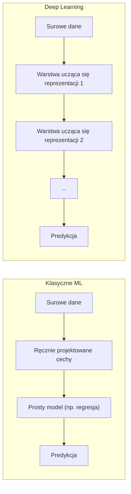
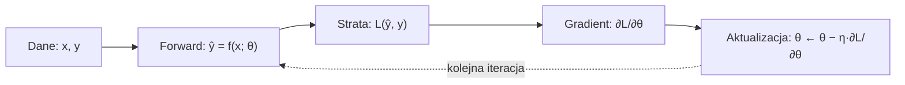

Język: [English](lecture.en.md) | **Polski**

# Wykład 01: Deep Learning, ML vs DL, tensory i podstawowy proces trenowania modelu

## Cele wykładu

Po tym wykładzie powinieneś/powinnaś umieć:

1. wskazać, czym *deep learning* (DL) różni się od klasycznego uczenia maszynowego (ML), i podać konkretny przykład tej różnicy,
2. zdefiniować **tensor** przez cztery jego faktyczne własności (rangę, kształt, typ danych, urządzenie), a nie tylko jako "uogólnioną macierz",
3. wyprowadzić gradient funkcji straty MSE względem parametrów modelu liniowego — krok po kroku, z regułą łańcuchową — i zweryfikować go numerycznie za pomocą automatycznego różniczkowania (*autograd*) w PyTorch,
4. zbudować od zera pętlę treningową (*forward → strata → backward → aktualizacja parametrów*), która działa tak samo na CPU, jak i na GPU.

## Dlaczego to jest ważne

Każdy kolejny wykład tego kursu — MLP, backpropagation, optymalizatory, CNN, transformery — jest wariantem tego samego szkieletu: mamy dane, model z parametrami, miarę błędu i procedurę, która iteracyjnie poprawia parametry. Jeśli ten szkielet zrozumiesz tutaj, na przykładzie tak prostym, że można go policzyć na kartce, każdy kolejny, bardziej złożony model będzie tej samej historii ciągiem, a nie nową magią.

Jest to też ważne inżynierskie rozstrzygnięcie: deep learning nie jest "lepszym ML we wszystkich przypadkach" — to konkretny zestaw kompromisów (ilość danych, czas treningu, koszt obliczeniowy, interpretowalność), który czasem wygrywa, a czasem przegrywa z prostszym modelem. Umiejętność rozpoznania, kiedy sięgnąć po który, jest częścią warsztatu inżyniera, nie tylko akademicką ciekawostką.

## Intuicja

### Czym różni się deep learning od klasycznego ML

W klasycznym uczeniu maszynowym typowy proces wygląda tak: ekspert domenowy analizuje dane i **ręcznie projektuje cechy** (*features*) — np. dla rozpoznawania cyfr pisanych ręcznie mogą to być: liczba zamkniętych pętli, krzywizna linii, liczba punktów przecięcia. Te cechy trafiają do relatywnie prostego modelu (regresja liniowa/logistyczna, SVM, drzewo decyzyjne), który uczy się, jak je kombinować, by dobrze przewidywać etykietę.

W deep learning ten podział na "ręczne cechy" i "prosty model" zanika. Model składa się z wielu warstw różniczkowalnych przekształceń, które **same uczą się własnych reprezentacji danych** — a cały ten stos warstw jest trenowany *end-to-end* tą samą procedurą gradientową, od surowych (lub mało przetworzonych) danych wejściowych aż do predykcji.

Ważne: **obie rodziny metod łączy ten sam mechanizm** — zdefiniuj miarę błędu, dostosowuj parametry, żeby ten błąd zmniejszyć. Różnica jest w tym, *co* jest dostosowywane: w ML zwykle niewielka liczba parametrów prostego modelu działającego na z góry ustalonych cechach; w DL — zwykle bardzo wiele parametrów, rozmieszczonych w wielu warstwach, które same wypracowują sobie użyteczną reprezentację danych w trakcie treningu.

Konsekwencja praktyczna: deep learning potrzebuje zwykle więcej danych i więcej obliczeń niż klasyczne ML dla tego samego zadania, bo model musi "wymyślić" cechy sam, a nie dostać je gotowe od eksperta. W zamian, przy wystarczającej ilości danych, często radzi sobie z problemami, w których ręczne zaprojektowanie cech jest w praktyce niewykonalne (surowy obraz, surowy dźwięk, surowy tekst).

### Czym jest tensor

W matematyce i fizyce tensor to obiekt, który uogólnia skalar, wektor i macierz na dowolną liczbę wymiarów (*rang*, ang. *rank*). W bibliotekach do deep learningu (PyTorch, ale też NumPy dla tablic) słowo "tensor" oznacza praktycznie: **wielowymiarową tablicę liczb o jednym typie danych**, opisaną przez:

- **rangę** (*rank*) — liczbę wymiarów (skalar: ranga 0, wektor: ranga 1, macierz: ranga 2, np. batch obrazów RGB: ranga 4),
- **kształt** (*shape*) — rozmiar każdego wymiaru, np. `(32, 3, 28, 28)` dla 32 obrazów RGB 28×28,
- **typ danych** (*dtype*) — np. `float32`, `int64`,
- **urządzenie** (*device*) — gdzie fizycznie leżą dane w pamięci: `cpu` albo `cuda` (GPU).

To ostatnie — urządzenie — jest czymś, czego nie ma zwykła tablica NumPy, i to jest praktyczna różnica, która będzie nam towarzyszyć przez cały kurs: `torch.Tensor` wie, na jakim urządzeniu "żyje", i operacja między dwoma tensorami wymaga, by były na tym samym urządzeniu.

## Formalny model

Zadanie uczenia nadzorowanego formalizujemy tak:

- mamy zbiór danych $\{(x_i, y_i)\}_{i=1}^{N}$ — $N$ przykładów, każdy to para (wejście, cel),
- mamy **model** $f(x; \theta)$ — funkcję parametryzowaną wektorem parametrów $\theta$, która dla wejścia $x$ zwraca predykcję $\hat{y} = f(x; \theta)$,
- mamy **funkcję straty** $\ell(\hat{y}, y)$ — liczbę mówiącą, jak bardzo predykcja różni się od celu dla jednego przykładu,
- **strata na zbiorze danych** to zwykle średnia: $L(\theta) = \frac{1}{N}\sum_{i=1}^{N} \ell\big(f(x_i; \theta), y_i\big)$,
- **trening** to znalezienie $\theta^\*$, które minimalizuje $L(\theta)$ — w praktyce nie "rozwiązujemy" tego od razu, ale **iteracyjnie** poprawiamy $\theta$, krok po kroku, w kierunku, który zmniejsza $L$.

Ten ostatni punkt to cały "mechanizm uczenia": powtarzaj (*forward* → policz stratę → policz gradient straty względem parametrów → zaktualizuj parametry), aż strata przestanie się istotnie zmniejszać.

W tym wykładzie $f$ będzie najprostszym możliwym modelem — **regresją liniową jednej zmiennej** — właśnie żeby cały ten schemat dało się policzyć na kartce, zanim w wykładzie 2 i 3 $f$ stanie się siecią wielowarstwową, a procedura liczenia gradientu — backpropagation.

## Matematyka

### Model i strata

Model liniowy jednej zmiennej:

$$\hat{y}_i = w \cdot x_i + b$$

gdzie:

- $x_i$ — wartość cechy wejściowej dla przykładu $i$,
- $w$ — **waga** (*weight*), parametr opisujący nachylenie,
- $b$ — **bias** (wyraz wolny), parametr opisujący przesunięcie,
- $\hat{y}_i$ — predykcja modelu dla przykładu $i$.

Jako funkcję straty bierzemy **błąd średniokwadratowy** (*Mean Squared Error*, MSE):

$$L(w, b) = \frac{1}{N}\sum_{i=1}^{N} (\hat{y}_i - y_i)^2 = \frac{1}{N}\sum_{i=1}^{N} (w x_i + b - y_i)^2$$

gdzie $y_i$ to prawdziwa (obserwowana) wartość celu dla przykładu $i$, a $N$ — liczba przykładów. Podnoszenie do kwadratu ma dwa zadania: usuwa znak błędu (nie obchodzi nas, czy pomyliliśmy się w górę czy w dół) i silniej karze duże błędy niż małe.

### Gradient — krok po kroku z regułą łańcuchową

Żeby zmniejszać $L$, potrzebujemy wiedzieć, jak $L$ zmienia się przy małej zmianie $w$ i przy małej zmianie $b$ — to są pochodne cząstkowe $\partial L / \partial w$ i $\partial L / \partial b$.

$L$ jest **złożeniem dwóch funkcji**: funkcji zewnętrznej "podnieś do kwadratu" i funkcji wewnętrznej "policz predykcję liniową". To jest dokładnie sytuacja, w której działa **reguła łańcuchowa** (*chain rule*) znana z rachunku różniczkowego: jeśli $L = g(h(w))$, to $\frac{dL}{dw} = g'(h(w)) \cdot h'(w)$.

Dla jednego przykładu $i$, niech $e_i = \hat{y}_i - y_i$ (błąd, czyli predykcja minus cel) będzie funkcją wewnętrzną w sensie "podnoszenia do kwadratu": składnik straty to $e_i^2$.

- Pochodna zewnętrzna (po $e_i$): $\frac{\partial (e_i^2)}{\partial e_i} = 2 e_i$.
- Pochodna wewnętrzna (po $w$): $e_i = w x_i + b - y_i$, więc $\frac{\partial e_i}{\partial w} = x_i$ (bo $b$ i $y_i$ nie zależą od $w$, a $w x_i$ różniczkujemy po $w$).
- Pochodna wewnętrzna (po $b$): $\frac{\partial e_i}{\partial b} = 1$.

Łącząc regułą łańcuchową i uśredniając po $N$ przykładach (stała $\frac{1}{N}$ wychodzi przed sumę):

$$\frac{\partial L}{\partial w} = \frac{1}{N}\sum_{i=1}^{N} 2 e_i \cdot x_i = \frac{2}{N}\sum_{i=1}^{N} (\hat{y}_i - y_i)\, x_i$$

$$\frac{\partial L}{\partial b} = \frac{1}{N}\sum_{i=1}^{N} 2 e_i \cdot 1 = \frac{2}{N}\sum_{i=1}^{N} (\hat{y}_i - y_i)$$

To dwuetapowe rozumowanie — "policz lokalną pochodną każdego kroku, pomnóż je przez siebie" — jest w miniaturze dokładnie tym, co w wykładzie 3 nazwiemy *backpropagation* na grafie obliczeniowym z wieloma warstwami. Tu mamy tylko dwa kroki (kwadrat, potem liniowa funkcja), tam będzie ich znacznie więcej, ale zasada się nie zmienia.

### Reguła aktualizacji (spadek gradientu)

Gradient $\big(\frac{\partial L}{\partial w}, \frac{\partial L}{\partial b}\big)$ wskazuje kierunek **najszybszego wzrostu** $L$ w okolicy aktualnego $(w, b)$. Żeby zmniejszać stratę, robimy krok w kierunku *przeciwnym* do gradientu:

$$w \leftarrow w - \eta \frac{\partial L}{\partial w}, \qquad b \leftarrow b - \eta \frac{\partial L}{\partial b}$$

gdzie $\eta$ (*learning rate*, współczynnik uczenia) to mały dodatni skalar kontrolujący długość kroku. Zbyt duże $\eta$ może sprawić, że kroki "przeskoczą" minimum i strata zacznie rosnąć; zbyt małe — że trening będzie zbieżny, ale bardzo wolno. To zagadnienie w pełni rozwiniemy w wykładzie 4 (optymalizatory); tutaj wystarczy nam intuicja i jedna krótka demonstracja w notebooku.

## Przykład rozwiązany

Policzmy jeden krok spadku gradientu ręcznie, żeby można było zweryfikować notebook "na kartce". Dane (bez szumu, dokładnie z relacji $y = 2x + 1$):

| $i$ | $x_i$ | $y_i$ |
|---|---|---|
| 1 | 1 | 3 |
| 2 | 2 | 5 |
| 3 | 3 | 7 |

Start: $w = 0$, $b = 0$, $N = 3$, $\eta = 0.1$.

**Predykcje i błędy** ($\hat{y}_i = 0 \cdot x_i + 0 = 0$ dla wszystkich): $e_1 = 0 - 3 = -3$, $e_2 = 0 - 5 = -5$, $e_3 = 0 - 7 = -7$.

**Strata początkowa:**

$$L = \frac{1}{3}\big((-3)^2 + (-5)^2 + (-7)^2\big) = \frac{9 + 25 + 49}{3} = \frac{83}{3} \approx 27{,}667$$

**Gradienty:**

$$\frac{\partial L}{\partial w} = \frac{2}{3}\big((-3)(1) + (-5)(2) + (-7)(3)\big) = \frac{2}{3}(-34) \approx -22{,}667$$

$$\frac{\partial L}{\partial b} = \frac{2}{3}(-3 - 5 - 7) = \frac{2}{3}(-15) = -10$$

**Aktualizacja:**

$$w \leftarrow 0 - 0{,}1 \cdot (-22{,}667) = 2{,}2667, \qquad b \leftarrow 0 - 0{,}1 \cdot (-10) = 1{,}0$$

**Strata po jednym kroku** (z nowymi $w = 2{,}2667$, $b = 1{,}0$): predykcje to $3{,}2667$, $5{,}5333$, $7{,}8$, błędy to $0{,}2667$, $0{,}5333$, $0{,}8$, więc

$$L_{\text{nowa}} = \frac{0{,}0711 + 0{,}2844 + 0{,}64}{3} \approx 0{,}332$$

Jeden krok zmniejszył stratę z $\approx 27{,}667$ do $\approx 0{,}332$ — bo dane są bez szumu i dobrze "skalowane". W notebooku zobaczysz, że PyTorch (`.backward()`) da te same wartości gradientu co powyższe wzory, i że dla danych z szumem strata nie spadnie do zera, tylko do poziomu wyznaczonego przez wariancję szumu.

## Eksperyment

Notebook [`examples.ipynb`](examples.ipynb) implementuje dokładnie ten mechanizm na syntetycznych danych z szumem ($y = a_{\text{true}} x + b_{\text{true}} + \varepsilon$):

1. generuje dane syntetyczne z ustalonym ziarnem losowości (reprodukowalność),
2. tworzy parametry `w`, `b` jako tensory z `requires_grad=True`,
3. w pętli treningowej: liczy predykcję (*forward*), stratę MSE, wywołuje `loss.backward()`, a następnie **ręcznie** (bez `optim`) aktualizuje `w` i `b` pod `torch.no_grad()`,
4. **weryfikuje gradient z autograd względem wzoru wyprowadzonego wyżej** — różnica powinna być rzędu błędu numerycznego float32,
5. rysuje: (a) dopasowaną linię na tle danych w kilku punktach treningu, (b) krzywą straty w funkcji iteracji,
6. demonstruje krótko, co się dzieje, gdy $\eta$ jest zbyt duże (strata rośnie/oscyluje, zamiast spadać).

Cały notebook działa na CPU; urządzenie wybierane jest automatycznie (`torch.device("cuda" if torch.cuda.is_available() else "cpu")`), więc ten sam kod zadziała bez zmian na maszynie z GPU.

## Co obserwujemy

- Strata spada najszybciej na początku treningu, a potem coraz wolniej (krzywa straty jest wypukła i "wypłaszcza się" w okolicy minimum) — to typowy przebieg dla problemu wypukłego, jakim jest regresja liniowa z MSE.
- Wyuczone $w$, $b$ zbliżają się do $a_{\text{true}}$, $b_{\text{true}}$, ale **nie dokładnie** do nich — bo dane zawierają szum, a model nie ma dostępu do "prawdziwej" funkcji, tylko do jej zaszumionej próbki.
- Strata nie spada do zera nawet po bardzo wielu iteracjach — to nie błąd, to **nieredukowalny błąd** (*irreducible error*) wynikający z szumu w danych: nawet idealny model nie przewidzi szumu, który z definicji jest nieprzewidywalny.
- Gradient policzony ręcznie ze wzoru i gradient z `autograd` są (do błędu numerycznego) identyczne — to jest **dowód empiryczny**, że autograd robi "to samo", co wyprowadziliśmy na papierze, a nie coś magicznego.
- Przy zbyt dużym $\eta$ strata w kolejnych iteracjach rośnie albo oscyluje, zamiast konsekwentnie spadać — kroki aktualizacji "przestrzeliwują" minimum.

## Częste błędne przekonania

❌ Gradient $\partial L/\partial \theta$ mówi nam, "jak bardzo się pomyliliśmy" dla każdego parametru.

✅ Gradient mówi, w którą stronę i jak silnie *lokalnie* rośnie strata, jeśli dany parametr nieznacznie zwiększymy. To kierunek najszybszego wzrostu funkcji w danym punkcie — nic więcej. Dlatego aktualizujemy ze znakiem minus: idziemy w stronę przeciwną do gradientu.

❌ Deep learning to po prostu "ML z większą liczbą warstw".

✅ Kluczowa różnica to **uczenie reprezentacji**: w DL model sam wypracowuje użyteczne cechy danych w trakcie treningu end-to-end, zamiast dostawać je od eksperta. Liczba warstw jest konsekwencją tego podejścia, nie jego definicją — jednowarstwowy model też może być "deep learningowy" w duchu (choć w praktyce DL kojarzy się z modelami wielowarstwowymi).

❌ Tensor w PyTorch to po prostu inna nazwa macierzy albo tablicy NumPy.

✅ Tensor uogólnia skalar/wektor/macierz na dowolną rangę i — co ważne praktycznie — niesie ze sobą informację o urządzeniu (`device`) i (opcjonalnie) o grafie obliczeniowym do automatycznego różniczkowania (`requires_grad`). Matematycznie macierz jest tensorem rangi 2; różnica jest w tym, co framework dodatkowo "wie" o tym obiekcie.

❌ Więcej iteracji/epok treningu to zawsze lepszy model.

✅ W tym wykładzie, na wypukłym problemie bez nadmiarowych parametrów, dłuższy trening zwykle pomaga (do granicy nieredukowalnego błędu z szumu). Ale już w wykładzie 5 zobaczysz, że dla modeli z dużą liczbą parametrów zbyt długi trening prowadzi do *przeuczenia* (overfitting) — model zaczyna "zapamiętywać" szum danych treningowych, a jego jakość na nowych danych spada.

## Implikacje inżynierskie

- **Kod niezależny od urządzenia** (*device-agnostic*) nie jest tu "na wszelki wypadek" — to ten sam wzorzec (`torch.device(...)`, `.to(device)`), którym będziemy trenować dużo większe modele na GPU w dalszych wykładach. Lepiej przyzwyczaić się do niego na przykładzie, który i tak działa błyskawicznie na CPU.
- **Reprodukowalność** przez ustawienie ziarna losowości (`torch.manual_seed`) pozwala innym (i nam samym za tydzień) odtworzyć ten sam wynik. To nie gwarantuje pełnego determinizmu na każdej platformie/sprzęcie (np. niektóre operacje na GPU mogą się różnić), ale dla CPU i tej skali problemu wynik będzie stabilny.
- **Learning rate jako hiperparametr inżynierski**: ta sama pętla treningowa z różnym $\eta$ daje zupełnie inne zachowanie (zbieżność vs. rozbieżność). W praktyce dobór $\eta$ (i innych hiperparametrów) to jedna z głównych osi pracy inżyniera ML — wrócimy do tego systematycznie w wykładzie 4.
- **Precyzja numeryczna**: domyślny typ danych w PyTorch to `float32` (32-bitowy), nie `float64` jak domyślnie w NumPy — to świadomy kompromis między precyzją a zużyciem pamięci/szybkością, który staje się istotny, gdy model ma miliony parametrów.
- **Skala**: ta pętla treningowa operuje na całym zbiorze danych naraz (tzw. *full-batch* gradient descent). Przy większych zbiorach danych tak się nie robi z powodów pamięciowych — stąd *mini-batche* i `DataLoader`, które poznamy, gdy zbiory danych w laboratoriach przestaną się mieścić w pojedynczym tensorze "za darmo".

## Co warto zapamiętać

- ML i DL rozwiązują to samo zadanie (zmniejsz miarę błędu, dostosowując parametry); DL różni się tym, że sam uczy się reprezentacji danych, zamiast dostawać ręcznie zaprojektowane cechy.
- Tensor = tablica wielowymiarowa + ranga/kształt/dtype + **urządzenie** (+ opcjonalnie historia operacji do autograd).
- Gradient straty MSE dla regresji liniowej wyprowadza się dwuetapową regułą łańcuchową — to miniaturowa wersja backpropagation z wykładu 3.
- `autograd` liczy dokładnie to, co można wyprowadzić ręcznie — notebook to pokazuje liczbowo, nie tylko deklaratywnie.
- Pętla treningowa to zawsze: forward → strata → gradient → aktualizacja, niezależnie od tego, jak skomplikowany jest model.

## Pytania dla studentów

1. Dlaczego przy zbyt dużym współczynniku uczenia $\eta$ strata może zacząć rosnąć, a nie spadać? Odwołaj się do interpretacji gradientu jako kierunku najszybszego wzrostu.
2. Czym tensor w PyTorch *faktycznie* różni się od tablicy NumPy, a czym się nie różni matematycznie?
3. Dane w eksperymencie zawierają szum, dlatego strata nie spada do zera. Czy to oznacza, że model jest "słaby"? Uzasadnij.
4. Podaj przykład zadania, w którym klasyczne ML z ręcznie zaprojektowanymi cechami może być lepszym wyborem inżynierskim niż deep learning — i uzasadnij to argumentem innym niż "mało danych".

## Bibliografia

- Goodfellow, I., Bengio, Y., Courville, A. (2016). *Deep Learning*. MIT Press. https://www.deeplearningbook.org/ — rozdział 1 dla szerszego kontekstu historycznego i definicyjnego ML vs. DL.
- PyTorch Contributors. *torch.Tensor* — dokumentacja. https://pytorch.org/docs/stable/tensors.html
- PyTorch Contributors. *Autograd mechanics* — dokumentacja. https://pytorch.org/docs/stable/notes/autograd.html

Pełne wpisy bibliograficzne: [`references/references.bib`](../../references/references.bib).
