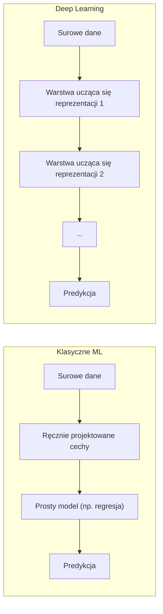
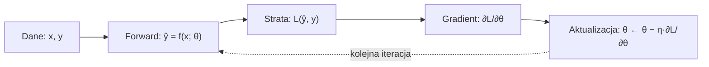

Język: [English](lecture.en.md) | **Polski**

# Wykład 01: Deep Learning, ML vs DL, tensory i podstawowy proces trenowania modelu

## Cele wykładu

1. wskazać, czym *deep learning* (DL) różni się od klasycznego uczenia maszynowego (ML), i podać konkretny przykład tej różnicy,
2. zdefiniować **tensor** przez cztery jego faktyczne własności (rangę, kształt, typ danych, urządzenie), a nie tylko jako "uogólnioną macierz",
3. wyprowadzić gradient funkcji straty MSE względem parametrów modelu liniowego za pomocą reguły łańcuchowej i zweryfikować go numerycznie przy użyciu automatycznego różniczkowania (*autograd*) w PyTorch,
4. zbudować od zera pętlę treningową (*forward → strata → backward → aktualizacja parametrów*), która działa tak samo na CPU, jak i na GPU.

## Dlaczego to jest ważne

Każdy kolejny temat, od MLP i propagacji wstecznej po CNN i transformery, opiera się na tym samym schemacie. Potrzebne są dane, model z parametrami, miara błędu oraz procedura, która stopniowo poprawia parametry. Tutaj ten schemat przedstawiono na przykładzie, który można policzyć na kartce. Bardziej złożone modele rozwijają tę samą ideę.

Ma to również znaczenie przy wyborze rozwiązania. Deep learning nie jest lepszy od klasycznego ML w każdym przypadku. Wymaga uwzględnienia ilości danych, czasu treningu, kosztu obliczeń i interpretowalności. Czasem te wymagania są uzasadnione, a czasem lepiej sprawdzi się prostszy model. Taka ocena należy do podstawowych decyzji inżynierskich.

## Intuicja

### Czym różni się deep learning od klasycznego ML

W klasycznym uczeniu maszynowym ekspert dziedzinowy analizuje dane i **ręcznie projektuje cechy** (*features*). Przy rozpoznawaniu cyfr pisanych ręcznie mogą to być liczba zamkniętych pętli, krzywizna linii lub liczba punktów przecięcia. Cechy trafiają następnie do stosunkowo prostego modelu, na przykład regresji liniowej, regresji logistycznej, SVM albo drzewa decyzyjnego. Model uczy się łączyć je tak, aby poprawnie przewidywać etykietę.

W deep learningu podział na ręcznie przygotowane cechy i prosty model zanika. Model składa się z wielu warstw różniczkowalnych przekształceń, które **uczą się reprezentacji danych**. Cały układ jest trenowany *end-to-end* tą samą procedurą gradientową, od surowych lub wstępnie przetworzonych danych aż do predykcji.

**Obie rodziny metod wykorzystują ten sam mechanizm**. Najpierw definiuje się miarę błędu, a następnie dostosowuje parametry, aby ten błąd zmniejszyć. Różnica dotyczy tego, *co* podlega dostosowaniu. W klasycznym ML jest to zwykle niewielka liczba parametrów modelu działającego na wcześniej ustalonych cechach. W DL parametrów jest znacznie więcej i są rozmieszczone w wielu warstwach, które podczas treningu tworzą użyteczną reprezentację danych.

W praktyce deep learning potrzebuje zwykle więcej danych i obliczeń niż klasyczne ML dla tego samego zadania. Model musi nauczyć się cech, zamiast otrzymać je od eksperta. Przy odpowiedniej ilości danych pozwala to rozwiązywać problemy, w których ręczne projektowanie cech byłoby niewykonalne, na przykład podczas pracy z surowym obrazem, dźwiękiem lub tekstem.

### Czym jest tensor

W matematyce i fizyce tensor uogólnia skalar, wektor i macierz na dowolną liczbę wymiarów (*rank*). W bibliotekach używanych w deep learningu tensor oznacza zwykle **wielowymiarową tablicę liczb o jednym typie danych**. Opisują ją cztery właściwości.

- **ranga** (*rank*), czyli liczba wymiarów. Skalar ma rangę 0, wektor 1, macierz 2, a partia obrazów RGB zwykle 4;
- **kształt** (*shape*), czyli rozmiar każdego wymiaru, na przykład `(32, 3, 28, 28)` dla 32 obrazów RGB o rozmiarze 28×28;
- **typ danych** (*dtype*), na przykład `float32` albo `int64`;
- **urządzenie** (*device*), czyli miejsce przechowywania danych, takie jak `cpu` lub `cuda` (GPU).

Informacja o urządzeniu odróżnia `torch.Tensor` od zwykłej tablicy NumPy. Operacja na dwóch tensorach wymaga, aby oba znajdowały się na tym samym urządzeniu.

## Formalny model

Uczenie nadzorowane można opisać za pomocą następujących elementów.

- Zbiór danych $\{(x_i, y_i)\}_{i=1}^{N}$ zawiera $N$ przykładów. Każdy przykład jest parą złożoną z wejścia i wartości docelowej.
- **Model** $f(x; \theta)$ jest funkcją parametryzowaną wektorem $\theta$. Dla wejścia $x$ zwraca predykcję $\hat{y} = f(x; \theta)$.
- **Funkcja straty** $\ell(\hat{y}, y)$ określa, jak bardzo predykcja różni się od wartości docelowej dla jednego przykładu.
- **Strata na zbiorze danych** jest zwykle średnią $L(\theta) = \frac{1}{N}\sum_{i=1}^{N} \ell\big(f(x_i; \theta), y_i\big)$.
- **Trening** służy znalezieniu $\theta^\*$ minimalizującego $L(\theta)$. W praktyce parametry $\theta$ poprawia się iteracyjnie, wybierając kierunek zmniejszający stratę.

Mechanizm uczenia powtarza cztery kroki: przejście w przód, obliczenie straty, obliczenie gradientu względem parametrów oraz aktualizację parametrów. Proces trwa do chwili, gdy strata przestaje się istotnie zmniejszać.

W tym wykładzie funkcję $f$ stanowi **regresja liniowa jednej zmiennej**. Prosty model pozwala policzyć cały proces na kartce. W wykładach 2 i 3 funkcję tę zastąpi sieć wielowarstwowa, a gradient będzie obliczany za pomocą propagacji wstecznej.

## Matematyka

### Model i strata

Model liniowy jednej zmiennej:

$$\hat{y}_i = w \cdot x_i + b$$

gdzie:

- $x_i$ oznacza wartość cechy wejściowej dla przykładu $i$;
- $w$ to **waga** (*weight*), czyli parametr opisujący nachylenie;
- $b$ to **bias** (wyraz wolny), czyli parametr opisujący przesunięcie;
- $\hat{y}_i$ oznacza predykcję modelu dla przykładu $i$.

Funkcją straty jest **błąd średniokwadratowy** (*Mean Squared Error*, MSE):

$$L(w, b) = \frac{1}{N}\sum_{i=1}^{N} (\hat{y}_i - y_i)^2 = \frac{1}{N}\sum_{i=1}^{N} (w x_i + b - y_i)^2$$

Wartość $y_i$ jest obserwowaną wartością docelową dla przykładu $i$, a $N$ oznacza liczbę przykładów. Podniesienie błędu do kwadratu usuwa jego znak i mocniej karze duże odchylenia niż małe.

### Gradient obliczony za pomocą reguły łańcuchowej

Aby zmniejszyć $L$, trzeba określić wpływ niewielkich zmian $w$ i $b$ na wartość funkcji. Opisują go pochodne cząstkowe $\partial L / \partial w$ oraz $\partial L / \partial b$.

Funkcja $L$ jest **złożeniem dwóch funkcji**. Funkcja wewnętrzna oblicza predykcję liniową, a zewnętrzna podnosi wynikający z niej błąd do kwadratu. Stosuje się więc **regułę łańcuchową** (*chain rule*). Jeśli $L = g(h(w))$, wówczas $\frac{dL}{dw} = g'(h(w)) \cdot h'(w)$.

Dla przykładu $i$ błąd wynosi $e_i = \hat{y}_i - y_i$, czyli predykcja minus wartość docelowa. Odpowiadający mu składnik straty ma postać $e_i^2$.

- Pochodna zewnętrzna po $e_i$ wynosi $\frac{\partial (e_i^2)}{\partial e_i} = 2 e_i$.
- Dla $e_i = w x_i + b - y_i$ pochodna wewnętrzna po $w$ wynosi $\frac{\partial e_i}{\partial w} = x_i$. Wartości $b$ i $y_i$ nie zależą od $w$.
- Pochodna wewnętrzna po $b$ wynosi $\frac{\partial e_i}{\partial b} = 1$.

Po zastosowaniu reguły łańcuchowej i uśrednieniu wyniku dla $N$ przykładów otrzymuje się:

$$\frac{\partial L}{\partial w} = \frac{1}{N}\sum_{i=1}^{N} 2 e_i \cdot x_i = \frac{2}{N}\sum_{i=1}^{N} (\hat{y}_i - y_i)\, x_i$$

$$\frac{\partial L}{\partial b} = \frac{1}{N}\sum_{i=1}^{N} 2 e_i \cdot 1 = \frac{2}{N}\sum_{i=1}^{N} (\hat{y}_i - y_i)$$

W każdym kroku obliczana jest lokalna pochodna, a kolejne wyniki są przez siebie mnożone. Ta sama zasada stanowi podstawę *backpropagation* w wielowarstwowym grafie obliczeniowym, omówionego w wykładzie 3. Zwiększa się liczba operacji, ale sposób obliczania pozostaje ten sam.

### Reguła aktualizacji (spadek gradientu)

Gradient $\big(\frac{\partial L}{\partial w}, \frac{\partial L}{\partial b}\big)$ wskazuje kierunek **najszybszego wzrostu** $L$ w pobliżu aktualnego punktu $(w, b)$. Zmniejszenie straty wymaga kroku w kierunku *przeciwnym* do gradientu.

$$w \leftarrow w - \eta \frac{\partial L}{\partial w}, \qquad b \leftarrow b - \eta \frac{\partial L}{\partial b}$$

Współczynnik uczenia $\eta$ (*learning rate*) jest małym dodatnim skalarem, który określa długość kroku. Zbyt duża wartość może powodować przeskakiwanie minimum i wzrost straty. Zbyt mała prowadzi do wolnej zbieżności. Temat ten zostanie rozwinięty w wykładzie 4 poświęconym optymalizatorom. Tutaj wystarczy intuicja oraz krótka demonstracja w notebooku.

## Przykład rozwiązany

Poniższe obliczenie przedstawia jeden ręczny krok spadku gradientu. Umożliwia ono sprawdzenie wyniku notebooka na kartce. Dane są pozbawione szumu i pochodzą dokładnie z zależności $y = 2x + 1$.

| $i$ | $x_i$ | $y_i$ |
|---|---|---|
| 1 | 1 | 3 |
| 2 | 2 | 5 |
| 3 | 3 | 7 |

Wartości początkowe to $w = 0$, $b = 0$, $N = 3$ oraz $\eta = 0.1$.

**Predykcje i błędy.** Dla wszystkich przykładów $\hat{y}_i = 0 \cdot x_i + 0 = 0$. Stąd $e_1 = 0 - 3 = -3$, $e_2 = 0 - 5 = -5$ oraz $e_3 = 0 - 7 = -7$.

**Strata początkowa**

$$L = \frac{1}{3}\big((-3)^2 + (-5)^2 + (-7)^2\big) = \frac{9 + 25 + 49}{3} = \frac{83}{3} \approx 27{,}667$$

**Gradienty**

$$\frac{\partial L}{\partial w} = \frac{2}{3}\big((-3)(1) + (-5)(2) + (-7)(3)\big) = \frac{2}{3}(-34) \approx -22{,}667$$

$$\frac{\partial L}{\partial b} = \frac{2}{3}(-3 - 5 - 7) = \frac{2}{3}(-15) = -10$$

**Aktualizacja**

$$w \leftarrow 0 - 0{,}1 \cdot (-22{,}667) = 2{,}2667, \qquad b \leftarrow 0 - 0{,}1 \cdot (-10) = 1{,}0$$

**Strata po jednym kroku.** Dla nowych wartości $w = 2{,}2667$ i $b = 1{,}0$ predykcje wynoszą $3{,}2667$, $5{,}5333$ i $7{,}8$. Odpowiadające im błędy to $0{,}2667$, $0{,}5333$ oraz $0{,}8$. Zatem

$$L_{\text{nowa}} = \frac{0{,}0711 + 0{,}2844 + 0{,}64}{3} \approx 0{,}332$$

Jeden krok zmniejszył stratę z $\approx 27{,}667$ do $\approx 0{,}332$. Tak duży spadek wynika z braku szumu i odpowiedniej skali danych. Notebook potwierdza, że metoda `.backward()` w PyTorch daje te same wartości gradientu co powyższe wzory. Dla danych z szumem strata nie spada do zera, lecz zatrzymuje się na poziomie zależnym od wariancji szumu.

## Eksperyment

Notebook [`examples.ipynb`](examples.ipynb) przedstawia ten sam mechanizm na syntetycznych danych z szumem, opisanych zależnością $y = a_{\text{true}} x + b_{\text{true}} + \varepsilon$.

1. generuje dane syntetyczne z ustalonym ziarnem losowości (reprodukowalność),
2. tworzy parametry `w`, `b` jako tensory z `requires_grad=True`,
3. w pętli treningowej oblicza predykcję (*forward*) i stratę MSE, wywołuje `loss.backward()`, a następnie **ręcznie**, bez `optim`, aktualizuje `w` i `b` wewnątrz `torch.no_grad()`,
4. **porównuje gradient z autograd ze wzorem wyprowadzonym wyżej**. Różnica powinna odpowiadać błędowi numerycznemu typu float32,
5. rysuje dopasowaną linię na tle danych w kilku punktach treningu oraz krzywą straty w funkcji iteracji,
6. demonstruje krótko, co się dzieje, gdy $\eta$ jest zbyt duże (strata rośnie/oscyluje, zamiast spadać).

Notebook działa na CPU, a urządzenie jest wybierane automatycznie przez `torch.device("cuda" if torch.cuda.is_available() else "cpu")`. Ten sam kod można więc uruchomić bez zmian na maszynie z GPU.

## Obserwacje

- Strata spada najszybciej na początku treningu, a następnie coraz wolniej. Wypukła krzywa straty wypłaszcza się w pobliżu minimum. Taki przebieg jest typowy dla regresji liniowej z MSE.
- Wyuczone $w$ i $b$ zbliżają się do $a_{\text{true}}$ i $b_{\text{true}}$, ale nie osiągają ich dokładnie. Dane zawierają szum, a model ma dostęp jedynie do zaszumionej próbki funkcji.
- Strata nie spada do zera nawet po wielu iteracjach. Jest to **błąd nieredukowalny** (*irreducible error*) wynikający z szumu. Nawet idealny model nie przewidzi wartości, która z definicji jest losowa.
- Gradient obliczony ręcznie i gradient zwrócony przez `autograd` są identyczne z dokładnością do błędu numerycznego. Wynik potwierdza zgodność automatycznego różniczkowania z wyprowadzonym wzorem.
- Przy zbyt dużym $\eta$ strata rośnie lub oscyluje. Kroki aktualizacji przekraczają wówczas minimum.

## Częste błędne przekonania

❌ Gradient $\partial L/\partial \theta$ określa wielkość błędu przypisanego do każdego parametru.

✅ Gradient określa kierunek i tempo *lokalnego* wzrostu straty przy niewielkiej zmianie parametru. Wskazuje kierunek najszybszego wzrostu funkcji w danym punkcie. Znak minus w regule aktualizacji kieruje krok w przeciwną stronę.

❌ Deep learning to po prostu "ML z większą liczbą warstw".

✅ Różnicę stanowi **uczenie reprezentacji**. W DL model tworzy użyteczne cechy podczas treningu *end-to-end*, zamiast otrzymać je od eksperta. Wiele warstw jest konsekwencją tego podejścia, a nie jego pełną definicją.

❌ Tensor w PyTorch to po prostu inna nazwa macierzy albo tablicy NumPy.

✅ Tensor uogólnia skalar, wektor i macierz na dowolną rangę. Zawiera też informację o urządzeniu (`device`) oraz opcjonalnie o grafie obliczeniowym używanym przez automatyczne różniczkowanie (`requires_grad`). Matematycznie macierz jest tensorem rangi 2. Różnica dotyczy dodatkowych informacji przechowywanych przez framework.

❌ Więcej iteracji/epok treningu to zawsze lepszy model.

✅ W wypukłym problemie bez nadmiarowych parametrów dłuższy trening zwykle pomaga aż do granicy błędu nieredukowalnego. W modelach z dużą liczbą parametrów może jednak prowadzić do *przeuczenia* (*overfitting*). Model zaczyna dopasowywać się do szumu danych treningowych, a jego jakość na nowych danych spada. Zjawisko to opisano w wykładzie 5.

## Implikacje inżynierskie

- **Kod niezależny od urządzenia** (*device-agnostic*) wykorzystuje `torch.device(...)` oraz `.to(device)`. Ten sam wzorzec służy do trenowania większych modeli na GPU. W tym przykładzie można go sprawdzić bez kosztownego treningu.
- **Reprodukowalność** wymaga między innymi ustawienia ziarna losowości przez `torch.manual_seed`. Pozwala to ponownie uzyskać ten sam wynik. Nie gwarantuje jednak pełnego determinizmu na każdym sprzęcie, ponieważ niektóre operacje GPU mogą zachowywać się inaczej. Dla CPU i tak małego problemu wynik pozostaje stabilny.
- **Współczynnik uczenia jako hiperparametr** zmienia zachowanie tej samej pętli treningowej. W zależności od $\eta$ trening może być zbieżny lub rozbieżny. Dobór współczynnika uczenia i pozostałych hiperparametrów jest stałym elementem pracy nad modelem. Temat wraca w wykładzie 4.
- **Precyzja numeryczna** wpływa na szybkość obliczeń i zużycie pamięci. Domyślnym typem danych w PyTorch jest 32-bitowy `float32`, podczas gdy NumPy domyślnie używa `float64`. Znaczenie tego kompromisu rośnie wraz z liczbą parametrów modelu.
- **Skala danych** decyduje o sposobie prowadzenia treningu. Tutaj cała próbka jest przetwarzana jednocześnie za pomocą *full-batch gradient descent*. Większe zbiory dzieli się na *mini-batche* i wczytuje za pomocą `DataLoader`, ponieważ nie mieszczą się w pamięci jako pojedynczy tensor.

## Co warto zapamiętać

- ML i DL zmniejszają miarę błędu przez dostosowanie parametrów. DL dodatkowo uczy się reprezentacji danych, zamiast korzystać wyłącznie z ręcznie zaprojektowanych cech.
- Tensor jest wielowymiarową tablicą opisaną przez rangę, kształt, typ danych i urządzenie. Może też przechowywać historię operacji potrzebną do automatycznego różniczkowania.
- Gradient straty MSE dla regresji liniowej można wyprowadzić za pomocą dwuetapowej reguły łańcuchowej. Jest to uproszczona wersja propagacji wstecznej z wykładu 3.
- `autograd` oblicza te same wartości, które wynikają z ręcznego wyprowadzenia. Notebook potwierdza to numerycznie.
- Pętla treningowa zawsze obejmuje przejście w przód, obliczenie straty i gradientu oraz aktualizację parametrów.

## Pytania dla studentów

1. Dlaczego przy zbyt dużym współczynniku uczenia $\eta$ strata może zacząć rosnąć, zamiast spadać? Jak wyjaśnia to interpretacja gradientu jako kierunku najszybszego wzrostu?
2. Czym tensor w PyTorch *faktycznie* różni się od tablicy NumPy, a czym się nie różni matematycznie?
3. Dane w eksperymencie zawierają szum, dlatego strata nie spada do zera. Czy oznacza to słabość modelu? Dlaczego?
4. W jakim zadaniu klasyczne ML z ręcznie zaprojektowanymi cechami może być lepszym wyborem inżynierskim niż deep learning? Jaki argument, poza małą ilością danych, przemawia za takim wyborem?

## Bibliografia

- Goodfellow, I., Bengio, Y., Courville, A. (2016). *Deep Learning*. MIT Press. https://www.deeplearningbook.org/. Rozdział 1 przedstawia szerszy kontekst historyczny oraz różnice między ML i DL.
- PyTorch Contributors. Dokumentacja *torch.Tensor*. https://pytorch.org/docs/stable/tensors.html
- PyTorch Contributors. Dokumentacja *Autograd mechanics*. https://pytorch.org/docs/stable/notes/autograd.html

Pełne wpisy znajdują się w pliku [`references/references.bib`](../../references/references.bib).
