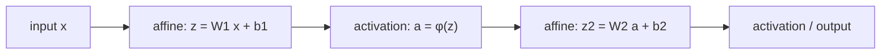

Language: **English (default)** | [Polski](lecture.md)

# Lecture 02: the perceptron, multi-layer perceptrons (MLPs), and activation functions

## Learning goals

After this lecture, you should be able to:

1. define the classical perceptron (linear combination + decision threshold) and point out how it differs from a modern neural-network layer,
2. interpret a linear classifier's decision boundary geometrically and explain why a single perceptron cannot solve the XOR problem,
3. **prove** that composing any number of affine transformations is still an affine transformation -- and draw the conclusion this implies about the limits of deep networks without nonlinearity,
4. write out the formulas and derivatives of the sigmoid, tanh, and ReLU activation functions, and state the practical consequence of each,
5. compute a small MLP's *forward pass* by hand and reproduce that result in PyTorch using `torch.nn`.

## Why this matters

The perceptron (Rosenblatt, 1958) is the historical starting point of neural networks -- and the first model shown to have a fundamental limitation (the XOR problem, formally described by Minsky and Papert in 1969), which stalled progress in the field for over a decade. Understanding *why* this model fails, and what exactly the MLP adds to it, is not a historical curiosity -- it is the reason every network you will build in this course (CNN, Transformer, anything) has nonlinear activations between its layers. Without this element, none of these architectures, however deep, would do anything more than a single linear layer.

## Intuition

### The perceptron as a linear classifier

The perceptron makes a binary decision based on a weighted sum of input features: if the sum exceeds a certain threshold, it classifies into one class, otherwise into the other. Geometrically: for two-dimensional data, the decision boundary is a **line** (in general: a hyperplane) -- everything on one side falls into class 0, everything on the other into class 1.

This works well when the classes can be separated by a single line (the data is *linearly separable*). It does not work when they cannot.

### The XOR problem

Consider four points and the XOR function (symmetric difference):

| $x_1$ | $x_2$ | $y = x_1 \oplus x_2$ |
|---|---|---|
| 0 | 0 | 0 |
| 1 | 0 | 1 |
| 0 | 1 | 1 |
| 1 | 1 | 0 |

Plot these four points on a plane and color them by class: $(0,0)$ and $(1,1)$ are class 0, $(1,0)$ and $(0,1)$ are class 1. No line separates these two groups -- classes 0 and 1 alternate along the diagonals of the unit square. This is not a matter of "poorly" chosen weights -- **no** choice of $w$, $b$ for a single perceptron solves this task perfectly. In the notebook you will see this not as a theorem, but as the result of actual training: the linear classifier's loss converges exactly to the level of random guessing, regardless of the random seed -- and the model's weights converge toward zero, because by XOR's symmetry, improving the prediction for one point worsens it for another by exactly the same amount.

### Why adding another linear layer alone will not help

The natural instinct: if one linear layer is not enough, let's add a second. The problem is that **a linear layer composed with a linear layer is still a linear layer** -- a mathematical proof follows in the *Mathematics* section. What actually changes a network's capabilities is inserting a **nonlinear activation function** between layers. An MLP (*Multi-Layer Perceptron*) is exactly this alternation: affine transformation → nonlinear activation → affine transformation → activation → ...

The layers between the input and the output are called **hidden layers** -- their number is the network's **depth**, the number of neurons in each is its **width**. Both of these dimensions affect how complex a decision boundary the network can in principle represent -- but, as we will see in the misconceptions section, "can represent" and "will learn well" are two different matters.

## Formal model

**The classical perceptron** (Rosenblatt, 1958): for an input $x \in \mathbb{R}^n$,

$$z = w^\top x + b, \qquad \hat{y} = \text{step}(z) = \begin{cases} 1 & z \geq 0 \\ 0 & z < 0 \end{cases}$$

The $\text{step}$ function is **non-differentiable** (it has a jump) -- Rosenblatt's perceptron was trained with its own, dedicated weight-update rule, not gradient descent. This is exactly the difference from what we today call a neural-network "layer":

**A modern neuron/layer**: the same linear core $z = w^\top x + b$, but with a **differentiable** activation function $\phi$ instead of a threshold:

$$a = \phi(z) = \phi(w^\top x + b)$$

Because $\phi$ has a well-defined derivative, the entire network can be trained with exactly the gradient-descent mechanism you learned in lecture 1 -- only now applied to a function composed of many layers (the full mechanism for computing this gradient, *backpropagation*, is the topic of lecture 3; here we use `autograd` and `torch.optim` as ready-made tools).

**A layer in vector form**: for an input $x \in \mathbb{R}^n$ and a layer with $m$ neurons, $W \in \mathbb{R}^{m \times n}$, $b \in \mathbb{R}^m$:

$$z = Wx + b \in \mathbb{R}^m, \qquad a = \phi(z) \quad \text{(element-wise)}$$

**An MLP** is a composition of $K$ such layers (we denote the number of layers $K$, to avoid colliding with $L$ -- the symbol for loss, see the *Loss for binary classification* section below and lectures 1 and 3): $a^{(0)} = x$, and for $l = 1, \dots, K$:

$$z^{(l)} = W^{(l)} a^{(l-1)} + b^{(l)}, \qquad a^{(l)} = \phi^{(l)}\big(z^{(l)}\big)$$

where the last layer often has a different activation than the hidden layers (e.g. for binary classification: sigmoid, or no activation at all if the loss is computed from logits -- see below).

## Mathematics

### Proof: the composition of affine transformations is affine

A transformation $f(x) = Wx + b$ is called **affine** (linear plus a shift). Let $f_1(x) = W_1 x + b_1$ and $f_2(y) = W_2 y + b_2$. Their composition:

$$f_2\big(f_1(x)\big) = W_2\big(W_1 x + b_1\big) + b_2 = \underbrace{(W_2 W_1)}_{W'} x + \underbrace{(W_2 b_1 + b_2)}_{b'} = W' x + b'$$

The result has exactly the form $W'x + b'$ -- so it is **still affine**. The same argument, applied inductively, works for any number of composed layers: $f_K \circ f_{K-1} \circ \dots \circ f_1$ is affine, regardless of whether $K = 2$ or $K = 200$ (we denote the number of layers $K$, not $L$ -- $L$ is reserved for loss).

**Conclusion:** a network built purely from layers $z = Wx+b$ *without* nonlinearity between them has exactly the same representational power as a single linear layer $W'x + b'$ -- no number of additional layers changes this. Only inserting a nonlinear $\phi$ between the layers breaks this property: $f_2(\phi(f_1(x)))$ cannot in general be reduced to a single affine transformation.

### Activation functions

**Sigmoid:**

$$\sigma(z) = \frac{1}{1 + e^{-z}}, \qquad \sigma'(z) = \sigma(z)\big(1 - \sigma(z)\big)$$

Range $(0, 1)$ -- convenient for interpretation as a "probability". The derivative reaches its maximum of $0.25$ at $z=0$ and **approaches zero** as $|z|$ grows (the function *saturates*). This means that for neurons strongly "excited" in either direction, the gradient carries very little information -- we will develop the consequences of this for deep networks in lecture 3 (the computational graph, and multiplying many such derivatives together).

**Tanh:**

$$\tanh(z) = \frac{e^{z} - e^{-z}}{e^{z} + e^{-z}} = 2\sigma(2z) - 1, \qquad \tanh'(z) = 1 - \tanh^2(z)$$

Range $(-1, 1)$, **zero-centered** -- unlike sigmoid, whose output is always positive. This can be a practical advantage (the next layer's inputs are not systematically shifted in one direction). Tanh saturates the same way sigmoid does -- its derivative also approaches zero for large $|z|$.

**ReLU** (*Rectified Linear Unit*):

$$\text{ReLU}(z) = \max(0, z), \qquad \text{ReLU}'(z) = \begin{cases} 1 & z > 0 \\ 0 & z < 0 \end{cases}$$

(at $z=0$ the derivative is formally undefined; PyTorch adopts the convention $0$). For $z>0$ the derivative is **constant and equal to 1** -- ReLU does not saturate on the positive side, which in practice helps a great deal when training deeper networks. It is also **cheap to compute** (one comparison, no exponential function) -- a real engineering reason it is today's default choice in many architectures. It does have a drawback, though: for $z<0$ the derivative is exactly $0$ -- a neuron that consistently receives negative input stops learning (the "dead ReLU" problem).

### Loss for binary classification

For classification (as opposed to regression from lecture 1), instead of MSE we use **Binary Cross-Entropy** (BCE). For a prediction $\hat{y} \in (0,1)$ (e.g. a sigmoid's output) and a label $y \in \{0,1\}$:

$$\ell(\hat{y}, y) = -\big[y \log \hat{y} + (1-y)\log(1-\hat{y})\big], \qquad L = \frac{1}{N}\sum_{i=1}^N \ell(\hat{y}_i, y_i)$$

Intuition: if the true label is $y=1$, the loss is $-\log \hat{y}$ -- it grows without bound when the model is *confident and wrong* ($\hat{y} \to 0$), and approaches zero when the model is confident and right ($\hat{y}\to 1$). This punishes "confident" mistakes much more heavily than MSE does. In practice (and in our notebook), BCE is computed directly from the **logits** $z$ (the output before sigmoid), using a single, numerically stable function (`BCEWithLogitsLoss` in PyTorch) -- this avoids separately computing $\log(\sigma(z))$, which for extreme $z$ could produce a numerical error.

## Worked example

We will construct *by hand* (with no training) the weights of a small MLP that solves XOR -- to see that the problem does not lie in a solution being "unreachable", only in the limitations of the perceptron architecture itself.

Network: 2 inputs → a hidden layer with 2 ReLU neurons → 1 linear output (no activation -- we compare directly against the label).

$$W^{(1)} = \begin{pmatrix} 1 & 1 \\ 1 & 1 \end{pmatrix}, \quad b^{(1)} = \begin{pmatrix} 0 \\ -1 \end{pmatrix}, \quad w^{(2)} = \begin{pmatrix} 1 \\ -2 \end{pmatrix}, \quad b^{(2)} = 0$$

Let's compute $h = \text{ReLU}(W^{(1)} x + b^{(1)})$ and $\hat{y} = w^{(2)\top} h + b^{(2)}$ for each of the four points:

| $x$ | $z^{(1)} = W^{(1)}x + b^{(1)}$ | $h = \text{ReLU}(z^{(1)})$ | $\hat{y} = h_1 - 2h_2$ | $y$ |
|---|---|---|---|---|
| $(0,0)$ | $(0,-1)$ | $(0,0)$ | $0$ | $0$ |
| $(1,0)$ | $(1,0)$ | $(1,0)$ | $1$ | $1$ |
| $(0,1)$ | $(1,0)$ | $(1,0)$ | $1$ | $1$ |
| $(1,1)$ | $(2,1)$ | $(2,1)$ | $2 - 2 = 0$ | $0$ |

An exact match in all four cases -- **with no training, no gradient, pure hand-picked weights**. What matters here: the two hidden neurons $h_1 = x_1+x_2$ and $h_2 = \max(0, x_1+x_2-1)$ are each, on their own, linear/simple -- it is only the **combination $h_1 - 2h_2$** after passing through ReLU that creates a nonlinear, "kinked" function, one that distinguishes the middle of the range $x_1+x_2=1$ (where $h_2=0$) from $x_1+x_2=2$ (where $h_2=1$ starts "subtracting"). You will see in the notebook that PyTorch, given exactly these weights, produces an identical result -- and, separately, that a network *trained from random initialization* by gradient descent also finds a solution, though not necessarily the same numbers.

*(Construction adapted from the classic example in: Goodfellow, Bengio, Courville, 2016, ch. 6.)*

## Experiment

The notebook [`examples.ipynb`](examples.ipynb):

1. **XOR and a single perceptron** -- trains a linear model (no hidden layer) on XOR; the loss stops exactly at the level of random guessing ($\ln 2 \approx 0.69$) regardless of the random seed, and the weights collapse toward zero (the model predicts $p\approx 0.5$ for every point) -- we also show that "accuracy" computed with a 0.5 threshold in this degenerate regime is unreliable noise, not a signal.
2. **XOR and a hand-constructed MLP** -- reproduces the worked example above in PyTorch and verifies agreement with the exact values.
3. **Activation functions** -- plots of sigmoid, tanh, ReLU and their derivatives over $z\in[-5,5]$; the derivative computed two ways (the closed-form formula and `autograd`) -- just as in lecture 1, we show they agree.
4. **Two interleaving half-moons** -- data generated locally (a parametric function, no downloads and no new dependencies), comparing: a linear model (`nn.Linear` + sigmoid) vs. an MLP (`nn.Linear` → ReLU → `nn.Linear`), both sides with a decision-boundary visualization over a grid of points.
5. **Ablation: removing the nonlinearity** -- the exact same MLP architecture as in point 4, but with `nn.Identity()` instead of `nn.ReLU()` between the layers -- we check empirically that the resulting decision boundary and accuracy are (within the randomness of optimization) the same as for the purely linear model, confirming the proof from the *Mathematics* section.

In the notebook, `torch.nn.Module`, `nn.Linear`, `nn.Sequential`, and `torch.optim` are used as tools: `nn.Linear(n, m)` is exactly $z = Wx+b$ from the *Formal model* section (with $W$, $b$ as parameters), and `optimizer.step()` performs the parameter update based on the gradient -- the same idea we wrote by hand in lecture 1 as `w -= lr * w.grad`. We do not go into *exactly how* `optimizer.step()` differs between different optimizers (Adam, SGD with momentum) -- that is the topic of lecture 4.

## What we observe

- The linear model on XOR gets stuck exactly at the level of random guessing, and its weights collapse toward zero -- this is not a matter of too few epochs or a bad learning rate, but of a fundamental lack of representational ability: the optimizer "gives up", because XOR's symmetry means no nonzero weight improves the average loss. "Accuracy" computed with a $0.5$ threshold at such weights can be misleading (it depends on numerical noise near the boundary) -- it is the loss, not accuracy, that is the reliable signal here.
- The hand-constructed MLP solves XOR perfectly, with zero epochs of training -- representational power and whether we *find* good weights are two separate matters.
- On the half-moons, the linear model achieves reasonable but clearly imperfect accuracy (it consistently errs where the half-moons interleave) -- the MLP with ReLU achieves clearly higher accuracy, and its decision boundary visually "wraps around" the shape of the data.
- The MLP without nonlinearity (with `nn.Identity`) reproduces almost exactly the result of the purely linear model -- despite formally having more layers and more parameters. This is empirical confirmation of the proof about composing affine transformations, not just a statement on paper.
- The sigmoid and tanh derivatives clearly decrease toward zero at the edges of the plot (saturation); the ReLU derivative is a constant value of $1$ over the entire positive range and exactly $0$ over the entire negative range -- with no gradual decay.

## Common misconceptions

❌ Rosenblatt's perceptron and a modern neural-network layer are basically the same thing.

✅ They share the same linear core ($w^\top x + b$), but the perceptron uses a non-differentiable step function and its own, historical learning rule. A modern layer uses a differentiable activation precisely so it can be trained by gradient descent -- a mechanism uniform across the whole network.

❌ Adding more linear layers by itself increases the model's power.

✅ We proved that the composition of affine transformations is affine -- a network built purely from layers $Wx+b$, with no nonlinearity between them, has exactly the same representational power as a single linear layer, regardless of the number of layers.

❌ A deeper or wider network always learns better.

✅ Greater model capacity increases representational *possibilities* (it can in principle express more complex functions), but it does not guarantee that training will actually find a good solution, nor that the model will generalize well to new data -- that also depends on optimization, the amount of data, and the risk of overfitting (lecture 5). In this lecture we show only that nonlinearity is *necessary*, not that a bigger model is automatically better.

❌ ReLU has no downsides, because unlike sigmoid/tanh it does not saturate.

✅ ReLU does not saturate for positive inputs, but it has a different problem: for negative inputs the derivative is exactly zero, so a neuron that persistently receives negative input stops receiving any learning signal at all (a "dead neuron").

## Engineering implications

- **Computational cost of activations**: ReLU is one comparison; sigmoid and tanh require computing $e^{-z}$. With millions of neurons and many training steps, this difference has a real effect on training time -- one of the practical reasons ReLU (and its variants) dominates modern architectures.
- **Numerical stability of the loss**: computing BCE from logits with a single function (`BCEWithLogitsLoss`) instead of manually computing `log(sigmoid(z))` avoids numerical errors for extreme values of $z$ -- a small but real engineering detail.
- **Architecture choice has a memory cost**: every added layer and every extra neuron means more parameters $W$, $b$ to store and to compute a gradient for -- "let's just try a bigger network" is not a free operation, even when (as here) we are talking about models that fit comfortably in CPU memory regardless.
- **Activation saturation and depth**: the fact that the sigmoid/tanh derivative shrinks to zero at saturation becomes a serious practical problem only once there are many layers in a row (we multiply many small numbers together) -- we will see this precisely when we get to the computational graph in lecture 3.
- **CPU is enough**: all the models in this lecture (a dozen to a few dozen neurons) train on CPU in a fraction of a second -- GPU training becomes practically important only for much larger networks and datasets, which we will meet later in the course.

## What to remember

- Perceptron = a linear model + a non-differentiable threshold; a modern layer = a linear model + a differentiable activation.
- Composing linear layers with no nonlinearity between them is still a single linear layer -- this is a theorem, not an empirical observation, and the notebook additionally confirms it experimentally.
- Sigmoid and tanh saturate (derivative → 0 for large $|z|$); ReLU does not saturate for $z>0$, but has a dead zone for $z<0$.
- An MLP with one hidden layer and a nonlinear activation solves XOR -- both through hand-picked weights and through gradient-based training.
- "More layers/neurons" increases a model's possibilities but does not guarantee a better result -- this is a separate matter from representability itself.

## Questions for students

1. Why does Rosenblatt's perceptron fail to solve XOR, while an MLP with one hidden layer and a nonlinear activation succeeds?
2. Reproduce (in your own words, without looking at your notes) the proof of why a network composed purely of linear layers has the representational power of a single linear layer, regardless of depth.
3. How does the behavior of the sigmoid derivative differ from the ReLU derivative for large positive input values? What consequences might this have when training deep networks?
4. Give a situation where tanh might be a better choice than sigmoid, and a situation where ReLU might be a better choice than both. Justify your answer.

## References

- Rosenblatt, F. (1958). *The Perceptron: A Probabilistic Model for Information Storage and Organization in the Brain*. Psychological Review, 65(6), 386-408.
- Goodfellow, I., Bengio, Y., Courville, A. (2016). *Deep Learning*. MIT Press. https://www.deeplearningbook.org/ -- chapter 6 (Deep Feedforward Networks) for the MLP formalization and the classic XOR example.
- PyTorch Contributors. *torch.nn* documentation. https://pytorch.org/docs/stable/nn.html
- PyTorch Contributors. *BCEWithLogitsLoss* documentation. https://pytorch.org/docs/stable/generated/torch.nn.BCEWithLogitsLoss.html

Full bibliography entries: [`references/references.bib`](../../references/references.bib).
