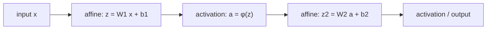

Language: **English (default)** | [Polski](lecture.md)

# Lecture 02. The perceptron, multilayer perceptrons (MLPs), and activation functions

## Learning goals

1. define the classical perceptron (linear combination + decision threshold) and point out how it differs from a modern neural-network layer,
2. interpret a linear classifier's decision boundary geometrically and explain why a single perceptron cannot solve the XOR problem,
3. **prove** that composing any number of affine transformations still produces an affine transformation and identify the resulting limitations of deep networks without nonlinearity,
4. write out the formulas and derivatives of the sigmoid, tanh, and ReLU activation functions, and state the practical consequence of each,
5. compute a small MLP's *forward pass* by hand and reproduce that result in PyTorch using `torch.nn`.

## Why this matters

Rosenblatt's 1958 perceptron is a historical starting point for neural networks. The XOR problem, formally described by Minsky and Papert in 1969, exposes its fundamental limitation. This result slowed progress in the field for more than a decade.

Understanding why the perceptron fails explains the role of an MLP. Nonlinear activations appear between layers in all later architectures covered in the course, including CNNs and transformers. Without nonlinearity, a deep network has no more representational power than a single linear layer.

## Intuition

### The perceptron as a linear classifier

The perceptron makes a binary decision from a weighted sum of input features. A result above a fixed threshold indicates one class, while a result below the threshold indicates the other. For two-dimensional data, the decision boundary is a **line**, or a hyperplane in the general case. Points on opposite sides of the boundary are assigned to different classes.

This works well when the classes can be separated by a single line (the data is *linearly separable*). It does not work when they cannot.

### The XOR problem

The XOR function, or symmetric difference, can be described by four points.

| $x_1$ | $x_2$ | $y = x_1 \oplus x_2$ |
|---|---|---|
| 0 | 0 | 0 |
| 1 | 0 | 1 |
| 0 | 1 | 1 |
| 1 | 1 | 0 |

On a plane, $(0,0)$ and $(1,1)$ belong to class 0, while $(1,0)$ and $(0,1)$ belong to class 1. The classes alternate along the diagonals of the unit square, so no single line can separate them. **No** choice of $w$ and $b$ for one perceptron solves the task perfectly.

The notebook demonstrates this limitation during training. The linear classifier's loss converges to the level of random guessing regardless of the random seed, and its weights approach zero. XOR symmetry means that improving the prediction for one point worsens another prediction by the same amount.

### Why adding another linear layer alone will not help

Adding a second linear layer does not solve the problem. **A composition of linear layers is still a linear layer**, as shown in the *Mathematics* section. The network gains new capabilities only when a **nonlinear activation function** is placed between the layers. An MLP (*Multi-Layer Perceptron*) alternates affine transformations with nonlinear activations.

The layers between the input and output are called **hidden layers**. Their number determines the network's **depth**, while the number of neurons in each layer determines its **width**. Both dimensions affect the complexity of the decision boundary that the network can represent. The ability to represent a function does not, however, guarantee that training will find a good solution.

## Formal model

**The classical perceptron.** For an input $x \in \mathbb{R}^n$,

$$z = w^\top x + b, \qquad \hat{y} = \text{step}(z) = \begin{cases} 1 & z \geq 0 \\ 0 & z < 0 \end{cases}$$

The $\text{step}$ function is **non-differentiable** because it contains a jump. Rosenblatt's perceptron was trained with a separate weight-update rule rather than gradient descent. This distinguishes it from a modern neural-network layer.

**A modern neuron or layer.** The linear core $z = w^\top x + b$ remains unchanged, but a **differentiable** activation function $\phi$ replaces the threshold.

$$a = \phi(z) = \phi(w^\top x + b)$$

The well-defined derivative of $\phi$ makes it possible to train the entire network with gradient descent, as in lecture 1. This time the optimized function contains several layers. Lecture 3 covers the full gradient calculation, known as *backpropagation*. Here, `autograd` and `torch.optim` provide the required operations.

**A layer in vector form.** For an input $x \in \mathbb{R}^n$ and a layer with $m$ neurons, $W \in \mathbb{R}^{m \times n}$ and $b \in \mathbb{R}^m$.

$$z = Wx + b \in \mathbb{R}^m, \qquad a = \phi(z) \quad \text{(element-wise)}$$

**An MLP** is a composition of $K$ such layers. The symbol $K$ denotes the number of layers, while $L$ is reserved for the loss. For $a^{(0)} = x$ and $l = 1, \dots, K$,

$$z^{(l)} = W^{(l)} a^{(l-1)} + b^{(l)}, \qquad a^{(l)} = \phi^{(l)}\big(z^{(l)}\big)$$

The last layer often uses a different activation from the hidden layers. Binary classification may use sigmoid or no activation when the loss is calculated directly from logits.

## Mathematics

### The composition of affine transformations is affine

A transformation $f(x) = Wx + b$ is **affine**, meaning linear with a shift. For $f_1(x) = W_1 x + b_1$ and $f_2(y) = W_2 y + b_2$, their composition is

$$f_2\big(f_1(x)\big) = W_2\big(W_1 x + b_1\big) + b_2 = \underbrace{(W_2 W_1)}_{W'} x + \underbrace{(W_2 b_1 + b_2)}_{b'} = W' x + b'$$

The result has the form $W'x + b'$, so it is **still affine**. The same argument applies inductively to any number of layers. The composition $f_K \circ f_{K-1} \circ \dots \circ f_1$ remains affine for both $K = 2$ and $K = 200$.

A network built only from layers $z = Wx+b$ has the same representational power as a single layer $W'x + b'$. Adding more layers does not change this result. A nonlinear function $\phi$ breaks the property because $f_2(\phi(f_1(x)))$ cannot generally be reduced to one affine transformation.

### Activation functions

**Sigmoid**

$$\sigma(z) = \frac{1}{1 + e^{-z}}, \qquad \sigma'(z) = \sigma(z)\big(1 - \sigma(z)\big)$$

The range $(0, 1)$ allows the output to be interpreted as a probability. The derivative reaches its maximum of $0.25$ at $z=0$ and **approaches zero** as $|z|$ grows. The function then saturates, and the gradient carries little information. In a deep network, multiplying many small derivatives strengthens this effect. Lecture 3 develops this behavior further.

**Tanh**

$$\tanh(z) = \frac{e^{z} - e^{-z}}{e^{z} + e^{-z}} = 2\sigma(2z) - 1, \qquad \tanh'(z) = 1 - \tanh^2(z)$$

The range $(-1, 1)$ is **zero-centered**, while sigmoid always produces a positive output. Inputs to the next layer are therefore not systematically shifted in one direction. Tanh also saturates, and its derivative approaches zero for large $|z|$.

**ReLU** (*Rectified Linear Unit*)

$$\text{ReLU}(z) = \max(0, z), \qquad \text{ReLU}'(z) = \begin{cases} 1 & z > 0 \\ 0 & z < 0 \end{cases}$$

At $z=0$, the derivative is formally undefined, and PyTorch uses the value $0$. On the positive side, the derivative is **constant and equal to 1**, so ReLU does not saturate there. This helps when training deeper networks. The calculation requires one comparison and no exponential function. For $z<0$, however, the derivative is exactly $0$. A neuron that consistently receives negative input stops learning, which leads to the *dead ReLU* problem.

### Loss for binary classification

Classification commonly uses **Binary Cross-Entropy** (BCE) instead of MSE. For a prediction $\hat{y} \in (0,1)$, such as a sigmoid output, and a label $y \in \{0,1\}$,

$$\ell(\hat{y}, y) = -\big[y \log \hat{y} + (1-y)\log(1-\hat{y})\big], \qquad L = \frac{1}{N}\sum_{i=1}^N \ell(\hat{y}_i, y_i)$$

For the label $y=1$, the loss is $-\log \hat{y}$. It grows without bound when the model is confident and wrong ($\hat{y} \to 0$) and approaches zero for a correct prediction ($\hat{y}\to 1$). BCE therefore penalizes confident mistakes more heavily than MSE. The notebook calculates the loss directly from the **logits** $z$ with the numerically stable `BCEWithLogitsLoss` function. This avoids a separate $\log(\sigma(z))$ calculation, which can produce numerical errors for extreme values of $z$.

## Worked example

The following example gives hand-picked weights for a small MLP that solves XOR without training. It shows that a solution exists but lies beyond the capabilities of a single perceptron.

The network contains 2 inputs, a hidden layer with 2 ReLU neurons, and 1 linear output without an activation. The result is compared directly with the label.

$$W^{(1)} = \begin{pmatrix} 1 & 1 \\ 1 & 1 \end{pmatrix}, \quad b^{(1)} = \begin{pmatrix} 0 \\ -1 \end{pmatrix}, \quad w^{(2)} = \begin{pmatrix} 1 \\ -2 \end{pmatrix}, \quad b^{(2)} = 0$$

For each of the four points, the calculation uses $h = \text{ReLU}(W^{(1)} x + b^{(1)})$ and $\hat{y} = w^{(2)\top} h + b^{(2)}$.

| $x$ | $z^{(1)} = W^{(1)}x + b^{(1)}$ | $h = \text{ReLU}(z^{(1)})$ | $\hat{y} = h_1 - 2h_2$ | $y$ |
|---|---|---|---|---|
| $(0,0)$ | $(0,-1)$ | $(0,0)$ | $0$ | $0$ |
| $(1,0)$ | $(1,0)$ | $(1,0)$ | $1$ | $1$ |
| $(0,1)$ | $(1,0)$ | $(1,0)$ | $1$ | $1$ |
| $(1,1)$ | $(2,1)$ | $(2,1)$ | $2 - 2 = 0$ | $0$ |

All four outputs are correct **without training or gradient calculation**. The hidden neurons $h_1 = x_1+x_2$ and $h_2 = \max(0, x_1+x_2-1)$ perform simple operations. Only the **combination $h_1 - 2h_2$** after the ReLU activation creates a nonlinear, kinked function. It distinguishes $x_1+x_2=1$, where $h_2=0$, from $x_1+x_2=2$, where $h_2=1$. The notebook reproduces this result in PyTorch. It also shows that a network trained from random initialization finds a solution, although usually with different weights.

*(The construction is adapted from the classic example in chapter 6 of Goodfellow, Bengio, and Courville, 2016.)*

## Experiment

The notebook [`examples.ipynb`](examples.ipynb) contains five experiments.

1. **XOR and a single perceptron.** A linear model with no hidden layer is trained on XOR. Its loss remains at the random-guessing level ($\ln 2 \approx 0.69$) regardless of the random seed, while the weights approach zero. The model predicts $p\approx 0.5$ for every point. Accuracy calculated with a 0.5 threshold is sensitive to numerical noise in this state and is not a reliable signal.
2. **XOR and a hand-constructed MLP.** A PyTorch implementation reproduces the worked example and checks the resulting values.
3. **Activation functions.** The plots show sigmoid, tanh, ReLU, and their derivatives over $z\in[-5,5]$. Derivatives obtained from the formulas agree with those computed by `autograd`.
4. **Two interleaving half-moons.** The data is generated locally with a parametric function, without downloads or additional dependencies. A linear model (`nn.Linear` + sigmoid) is compared with an MLP (`nn.Linear` → ReLU → `nn.Linear`). Both decision boundaries are visualized over a grid of points.
5. **Ablation of the nonlinearity.** The MLP architecture from experiment 4 is retained, but `nn.Identity()` replaces `nn.ReLU()`. Its decision boundary and accuracy match the linear model up to variation introduced by optimization. This result supports the proof in the *Mathematics* section.

The notebook uses `torch.nn.Module`, `nn.Linear`, `nn.Sequential`, and `torch.optim`. The layer `nn.Linear(n, m)` corresponds to $z = Wx+b$ from the *Formal model* section, with $W$ and $b$ as parameters. The `optimizer.step()` method updates these parameters from their gradients. This is the same operation written manually in lecture 1 as `w -= lr * w.grad`. Differences between optimizers such as Adam and SGD with momentum are covered in lecture 4.

## Observations

- The linear model on XOR remains at the random-guessing level, and its weights approach zero. This is caused neither by too few epochs nor by an unsuitable learning rate, but by limited representational power. Because of XOR's symmetry, no nonzero weight improves the average loss. In this case, loss is a more reliable signal than accuracy, which depends on a $0.5$ threshold and numerical noise.
- The hand-constructed MLP solves XOR without training. A model's representational power and an optimizer's ability to find suitable weights are separate concerns.
- On the half-moons data, the linear model achieves reasonable but imperfect accuracy. It makes systematic errors where the shapes interleave. The MLP with ReLU reaches higher accuracy, and its decision boundary follows the geometry of the data.
- Replacing the nonlinearity with `nn.Identity()` makes the MLP behave almost exactly like the linear model, despite its additional layers and parameters. This is empirical evidence for the property of affine transformations discussed earlier.
- The derivatives of sigmoid and tanh approach zero near the ends of the plot. The ReLU derivative equals $1$ for positive inputs and $0$ for negative inputs, with no gradual decay.

## Common misconceptions

❌ Rosenblatt's perceptron and a modern neural-network layer are basically the same thing.

✅ Both share the same linear core, $w^\top x + b$. The perceptron, however, uses a non-differentiable step function and a separate learning rule. A modern layer uses a differentiable activation, allowing the entire network to be trained by gradient descent.

❌ Adding more linear layers by itself increases the model's power.

✅ A composition of affine transformations remains affine. A network built only from layers $Wx+b$, with no nonlinearities between them, has the same representational power as a single linear layer.

❌ A deeper or wider network always learns better.

✅ Greater capacity allows a model to represent more complex functions, but it does not guarantee a good training result or generalization to new data. Optimization, the amount of data, and the risk of overfitting discussed in lecture 5 also matter. Nonlinearity is necessary for greater representational power, but a larger model is not automatically better.

❌ ReLU has no downsides, because unlike sigmoid/tanh it does not saturate.

✅ ReLU does not saturate for positive inputs, but its derivative is zero for negative inputs. A neuron that consistently receives negative inputs stops receiving a learning signal and becomes a "dead neuron."

## Engineering implications

- **Computational cost of activations.** ReLU requires one comparison, whereas sigmoid and tanh require the calculation of $e^{-z}$. Across millions of neurons and many training steps, this difference affects training time. It is one practical reason for the widespread use of ReLU and its variants.
- **Numerical stability of the loss.** Computing BCE directly from logits with `BCEWithLogitsLoss` avoids the numerical errors that can occur when `log(sigmoid(z))` is calculated manually for extreme values of $z$.
- **Memory cost of the architecture.** Each layer and neuron adds parameters $W$ and $b$ that must be stored and have their gradients calculated. Increasing model size therefore carries a cost, even when a small network fits comfortably in CPU memory.
- **Activation saturation and depth.** Vanishing sigmoid and tanh derivatives become especially important in deep networks, where many small values are multiplied. Lecture 3 presents this process using a computational graph.
- **CPU is sufficient for small models.** The networks in this lecture contain between a dozen and a few dozen neurons and train on a CPU in a fraction of a second. A GPU becomes practically important for larger architectures and datasets.

## What to remember

- Perceptron = a linear model + a non-differentiable threshold; modern layer = a linear model + a differentiable activation.
- A composition of linear layers with no nonlinearities between them is equivalent to a single linear layer. This follows from the proof and is also confirmed experimentally.
- Sigmoid and tanh saturate (derivative → 0 for large $|z|$); ReLU does not saturate for $z>0$, but has a dead zone for $z<0$.
- An MLP with one hidden layer and a nonlinear activation solves XOR with both hand-picked weights and gradient-based training.
- More layers or neurons increase a model's capacity but do not guarantee a better result. Representability and training effectiveness are separate concerns.

## Questions for students

1. Why does Rosenblatt's perceptron fail to solve XOR, while an MLP with one hidden layer and a nonlinear activation succeeds?
2. Why does a network composed only of linear layers have the representational power of a single linear layer, regardless of depth?
3. How does the behavior of the sigmoid derivative differ from the ReLU derivative for large positive input values? What consequences might this have when training deep networks?
4. In what situation might tanh be a better choice than sigmoid, and ReLU a better choice than either? What motivates each choice?

## References

- Rosenblatt, F. (1958). *The Perceptron: A Probabilistic Model for Information Storage and Organization in the Brain*. Psychological Review, 65(6), 386-408.
- Goodfellow, I., Bengio, Y., Courville, A. (2016). *Deep Learning*. MIT Press. https://www.deeplearningbook.org/. Chapter 6 (*Deep Feedforward Networks*) covers the MLP formalization and the classic XOR example.
- PyTorch Contributors. *torch.nn* documentation. https://pytorch.org/docs/stable/nn.html
- PyTorch Contributors. *BCEWithLogitsLoss* documentation. https://pytorch.org/docs/stable/generated/torch.nn.BCEWithLogitsLoss.html

Full bibliography entries are available in [`references/references.bib`](../../references/references.bib).
