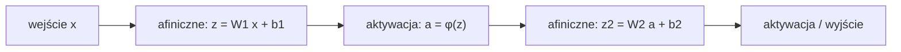

# Wykład 02: Perceptron, sieci wielowarstwowe (MLP) i funkcje aktywacji

## Cele wykładu

Po tym wykładzie powinieneś/powinnaś umieć:

1. zdefiniować klasyczny perceptron (kombinacja liniowa + próg decyzyjny) i wskazać, czym różni się od współczesnej warstwy sieci neuronowej,
2. zinterpretować geometrycznie granicę decyzyjną klasyfikatora liniowego i wyjaśnić, dlaczego pojedynczy perceptron nie rozwiąże problemu XOR,
3. **udowodnić**, że złożenie dowolnej liczby przekształceń afinicznych jest nadal przekształceniem afinicznym — i wyciągnąć z tego wniosek o granicach głębokich sieci bez nieliniowości,
4. zapisać wzory i pochodne funkcji aktywacji sigmoid, tanh, ReLU oraz wskazać praktyczną konsekwencję każdej z nich,
5. policzyć ręcznie *forward pass* małego MLP i odtworzyć ten wynik w PyTorch za pomocą `torch.nn`.

## Dlaczego to jest ważne

Perceptron (Rosenblatt, 1958) to historyczny punkt startowy sieci neuronowych — i pierwszy model, który okazał się mieć fundamentalne ograniczenie (problem XOR, formalnie opisany przez Minsky'ego i Paperta w 1969 roku), które na kilkanaście lat wyhamowało rozwój tej dziedziny. Zrozumienie *dlaczego* ten model zawodzi, i co dokładnie dodaje mu MLP, nie jest ciekawostką historyczną — to jest powód, dla którego każda sieć, którą zbudujesz w tym kursie (CNN, Transformer, cokolwiek), ma nieliniowe aktywacje między warstwami. Bez tego elementu żadna z tych architektur, niezależnie od głębokości, nie robiłaby nic więcej niż pojedyncza warstwa liniowa.

## Intuicja

### Perceptron jako klasyfikator liniowy

Perceptron podejmuje decyzję binarną na podstawie ważonej sumy cech wejściowych: jeśli suma przekracza pewien próg, klasyfikuje do jednej klasy, w przeciwnym razie do drugiej. Geometrycznie: dla danych dwuwymiarowych granica decyzyjna to **prosta** (ogólnie: hiperpłaszczyzna) — wszystko po jednej jej stronie trafia do klasy 0, wszystko po drugiej do klasy 1.

To działa dobrze, gdy klasy da się rozdzielić jedną prostą (dane *liniowo separowalne*). Nie działa, gdy się nie da.

### Problem XOR

Rozważmy cztery punkty i funkcję XOR (różnicę symetryczną):

| $x_1$ | $x_2$ | $y = x_1 \oplus x_2$ |
|---|---|---|
| 0 | 0 | 0 |
| 1 | 0 | 1 |
| 0 | 1 | 1 |
| 1 | 1 | 0 |

Narysuj te cztery punkty na płaszczyźnie i pokoloruj je klasą: $(0,0)$ i $(1,1)$ to klasa 0, $(1,0)$ i $(0,1)$ to klasa 1. Żadna prosta nie odseparuje tych dwóch grup — klasy 0 i 1 leżą naprzemiennie na przekątnych kwadratu jednostkowego. To nie jest kwestia "złego" doboru wag — **żaden** wybór $w$, $b$ pojedynczego perceptronu nie rozwiąże tego zadania idealnie. W notebooku zobaczysz to nie jako twierdzenie, tylko jako wynik faktycznego treningu: strata liniowego klasyfikatora zbiega dokładnie do poziomu losowego zgadywania, niezależnie od ziarna losowości — a wagi modelu zbiegają w okolice zera, bo przez symetrię XOR poprawienie predykcji dla jednego punktu pogarsza ją dla innego o dokładnie tyle samo.

### Dlaczego nie pomoże samo dodanie kolejnej warstwy liniowej

Naturalny odruch: skoro jedna warstwa liniowa nie wystarcza, dodajmy drugą. Problem w tym, że **warstwa liniowa złożona z warstwą liniową dalej jest warstwą liniową** — matematyczny dowód w sekcji *Matematyka*. Tym, co faktycznie zmienia możliwości sieci, jest wstawienie między warstwy **nieliniowej funkcji aktywacji**. MLP (*Multi-Layer Perceptron*, sieć wielowarstwowa) to właśnie na przemian: przekształcenie afiniczne → nieliniowa aktywacja → przekształcenie afiniczne → aktywacja → ...

Warstwy między wejściem a wyjściem nazywamy **warstwami ukrytymi** (*hidden layers*) — ich liczba to **głębokość** sieci, liczba neuronów w każdej to jej **szerokość**. Oba te wymiary wpływają na to, jak złożone granice decyzyjne sieć może w zasadzie reprezentować — ale, jak zobaczymy w sekcji o błędnych przekonaniach, "może reprezentować" i "nauczy się dobrze" to dwie różne sprawy.

## Formalny model

**Klasyczny perceptron** (Rosenblatt, 1958): dla wejścia $x \in \mathbb{R}^n$,

$$z = w^\top x + b, \qquad \hat{y} = \text{step}(z) = \begin{cases} 1 & z \geq 0 \\ 0 & z < 0 \end{cases}$$

Funkcja $\text{step}$ jest **nieróżniczkowalna** (ma skok) — perceptron Rosenblatta uczono własną, dedykowaną regułą aktualizacji wag, nie spadkiem gradientu. To jest właśnie różnica względem tego, co dziś nazywamy "warstwą" sieci neuronowej:

**Współczesny neuron/warstwa**: ten sam liniowy rdzeń $z = w^\top x + b$, ale z **różniczkowalną** funkcją aktywacji $\phi$ zamiast progu:

$$a = \phi(z) = \phi(w^\top x + b)$$

Dzięki temu, że $\phi$ ma dobrze określoną pochodną, całą sieć można trenować dokładnie tym mechanizmem spadku gradientu, który poznałeś/poznałaś w wykładzie 1 — tylko teraz zastosowanym do funkcji złożonej z wielu warstw (pełny mechanizm liczenia tego gradientu, *backpropagation*, to temat wykładu 3; tutaj używamy `autograd` i `torch.optim` jako gotowych narzędzi).

**Warstwa wektorowo**: dla wejścia $x \in \mathbb{R}^n$ i warstwy o $m$ neuronach, $W \in \mathbb{R}^{m \times n}$, $b \in \mathbb{R}^m$:

$$z = Wx + b \in \mathbb{R}^m, \qquad a = \phi(z) \quad \text{(element po elemencie)}$$

**MLP** to złożenie $L$ takich warstw: $a^{(0)} = x$, a dla $l = 1, \dots, L$:

$$z^{(l)} = W^{(l)} a^{(l-1)} + b^{(l)}, \qquad a^{(l)} = \phi^{(l)}\big(z^{(l)}\big)$$

gdzie ostatnia warstwa często ma inną aktywację niż warstwy ukryte (np. dla klasyfikacji binarnej: sigmoid albo brak aktywacji, jeśli stratę liczymy z logitów — zobacz niżej).

## Matematyka

### Dowód: złożenie przekształceń afinicznych jest afiniczne

Przekształcenie $f(x) = Wx + b$ nazywamy **afinicznym** (liniowe plus przesunięcie). Niech $f_1(x) = W_1 x + b_1$ i $f_2(y) = W_2 y + b_2$. Ich złożenie:

$$f_2\big(f_1(x)\big) = W_2\big(W_1 x + b_1\big) + b_2 = \underbrace{(W_2 W_1)}_{W'} x + \underbrace{(W_2 b_1 + b_2)}_{b'} = W' x + b'$$

Wynik ma dokładnie postać $W'x + b'$ — czyli **nadal jest afiniczny**. Ten sam argument, zastosowany indukcyjnie, działa dla dowolnej liczby złożonych ze sobą warstw: $f_L \circ f_{L-1} \circ \dots \circ f_1$ jest afiniczne, niezależnie od tego, czy $L = 2$ czy $L = 200$.

**Wniosek:** sieć zbudowana wyłącznie z warstw $z = Wx+b$ *bez* nieliniowości między nimi ma dokładnie taką samą moc reprezentacyjną jak pojedyncza warstwa liniowa $W'x + b'$ — żadna liczba dodatkowych warstw tego nie zmieni. Dopiero wstawienie nieliniowej $\phi$ między warstwy łamie tę własność: $f_2(\phi(f_1(x)))$ nie da się w ogólności sprowadzić do jednego przekształcenia afinicznego.

### Funkcje aktywacji

**Sigmoid:**

$$\sigma(z) = \frac{1}{1 + e^{-z}}, \qquad \sigma'(z) = \sigma(z)\big(1 - \sigma(z)\big)$$

Zakres $(0, 1)$ — wygodny do interpretacji jako "prawdopodobieństwo". Pochodna osiąga maksimum $0{,}25$ przy $z=0$ i **dąży do zera**, gdy $|z|$ rośnie (funkcja się *nasyca* — *saturates*). To oznacza, że dla neuronów mocno "pobudzonych" w jedną lub drugą stronę gradient niesie bardzo mało informacji — konsekwencje tego dla głębokich sieci rozwiniemy przy okazji wykładu 3 (graf obliczeniowy i mnożenie wielu takich pochodnych przez siebie).

**Tanh:**

$$\tanh(z) = \frac{e^{z} - e^{-z}}{e^{z} + e^{-z}} = 2\sigma(2z) - 1, \qquad \tanh'(z) = 1 - \tanh^2(z)$$

Zakres $(-1, 1)$, **wyśrodkowana na zerze** (*zero-centered*) — w przeciwieństwie do sigmoid, której wyjście jest zawsze dodatnie. To bywa praktyczną zaletą (wyjścia kolejnej warstwy nie są systematycznie przesunięte w jedną stronę). Tanh nasyca się tak samo jak sigmoid — pochodna też dąży do zera dla dużych $|z|$.

**ReLU** (*Rectified Linear Unit*):

$$\text{ReLU}(z) = \max(0, z), \qquad \text{ReLU}'(z) = \begin{cases} 1 & z > 0 \\ 0 & z < 0 \end{cases}$$

(w $z=0$ pochodna jest formalnie nieokreślona; PyTorch przyjmuje konwencję $0$). Dla $z>0$ pochodna jest **stała i równa 1** — ReLU się nie nasyca po dodatniej stronie, co w praktyce bardzo pomaga w trenowaniu głębszych sieci. Jest też **tania obliczeniowo** (jedno porównanie, żadnej funkcji wykładniczej) — to realny powód inżynierski, dla którego jest dziś domyślnym wyborem w wielu architekturach. Ma jednak swoją wadę: dla $z<0$ pochodna wynosi dokładnie $0$ — neuron, który konsekwentnie dostaje ujemne pobudzenie, przestaje się uczyć (problem "martwych neuronów", *dead ReLU*).

### Strata dla klasyfikacji binarnej

Dla klasyfikacji (w odróżnieniu od regresji z wykładu 1) zamiast MSE używamy **binarnej entropii krzyżowej** (*Binary Cross-Entropy*, BCE). Dla predykcji $\hat{y} \in (0,1)$ (np. wyjścia sigmoid) i etykiety $y \in \{0,1\}$:

$$\ell(\hat{y}, y) = -\big[y \log \hat{y} + (1-y)\log(1-\hat{y})\big], \qquad L = \frac{1}{N}\sum_{i=1}^N \ell(\hat{y}_i, y_i)$$

Intuicja: jeśli prawdziwa etykieta to $y=1$, strata to $-\log \hat{y}$ — rośnie bez ograniczeń, gdy model jest *pewny i błędny* ($\hat{y} \to 0$), a dąży do zera, gdy model jest pewny i słuszny ($\hat{y}\to 1$). To dużo silniej karze "pewne siebie" pomyłki niż MSE. W praktyce (i w naszym notebooku) liczy się BCE bezpośrednio z **logitów** $z$ (wyjścia przed sigmoid), jedną, liczbowo stabilną funkcją (`BCEWithLogitsLoss` w PyTorch) — unika to osobnego liczenia $\log(\sigma(z))$, co dla skrajnych $z$ mogłoby dać błąd numeryczny.

## Przykład rozwiązany

Skonstruujemy *ręcznie* (bez treningu) wagi małego MLP, które rozwiązuje XOR — żeby zobaczyć, że problem nie leży w "nieosiągalności" rozwiązania, tylko w ograniczeniach samej architektury perceptronu.

Sieć: 2 wejścia → warstwa ukryta z 2 neuronami ReLU → 1 wyjście liniowe (bez aktywacji — porównujemy bezpośrednio z etykietą).

$$W^{(1)} = \begin{pmatrix} 1 & 1 \\ 1 & 1 \end{pmatrix}, \quad b^{(1)} = \begin{pmatrix} 0 \\ -1 \end{pmatrix}, \quad w^{(2)} = \begin{pmatrix} 1 \\ -2 \end{pmatrix}, \quad b^{(2)} = 0$$

Policzmy $h = \text{ReLU}(W^{(1)} x + b^{(1)})$ i $\hat{y} = w^{(2)\top} h + b^{(2)}$ dla każdego z czterech punktów:

| $x$ | $z^{(1)} = W^{(1)}x + b^{(1)}$ | $h = \text{ReLU}(z^{(1)})$ | $\hat{y} = h_1 - 2h_2$ | $y$ |
|---|---|---|---|---|
| $(0,0)$ | $(0,-1)$ | $(0,0)$ | $0$ | $0$ |
| $(1,0)$ | $(1,0)$ | $(1,0)$ | $1$ | $1$ |
| $(0,1)$ | $(1,0)$ | $(1,0)$ | $1$ | $1$ |
| $(1,1)$ | $(2,1)$ | $(2,1)$ | $2 - 2 = 0$ | $0$ |

Dokładne trafienie we wszystkich czterech przypadkach — **bez treningu, bez gradientu, czystym ręcznym doborem wag**. Co istotne: oba neurony ukryte $h_1 = x_1+x_2$ i $h_2 = \max(0, x_1+x_2-1)$ są same w sobie liniowe/łatwe — to dopiero **kombinacja $h_1 - 2h_2$** po przejściu przez ReLU tworzy nieliniową, "załamaną" funkcję, która rozróżnia środek przedziału $x_1+x_2=1$ (gdzie $h_2=0$) od $x_1+x_2=2$ (gdzie $h_2=1$ zaczyna "odejmować"). Zobaczysz w notebooku, że PyTorch, dostając dokładnie te same wagi, da identyczny wynik — a osobno, że sieć *trenowana od losowej inicjalizacji* gradientowo też znajduje rozwiązanie, choć niekoniecznie te same liczby.

*(Konstrukcja zaadaptowana z klasycznego przykładu w: Goodfellow, Bengio, Courville, 2016, rozdz. 6.)*

## Eksperyment

Notebook [`examples.ipynb`](examples.ipynb):

1. **XOR i pojedynczy perceptron** — trenuje liniowy model (bez warstwy ukrytej) na XOR; strata zatrzymuje się dokładnie na poziomie losowego zgadywania ($\ln 2 \approx 0{,}69$) niezależnie od ziarna losowości, a wagi kolapsują w okolice zera (model przewiduje $p\approx 0{,}5$ dla każdego punktu) — pokazujemy też, że "dokładność" liczona progiem 0,5 w tym zdegenerowanym reżimie jest niewiarygodnym szumem, nie sygnałem.
2. **XOR i ręcznie skonstruowany MLP** — odtwarza przykład rozwiązany powyżej w PyTorch i weryfikuje zgodność co do wartości.
3. **Funkcje aktywacji** — wykresy sigmoid, tanh, ReLU i ich pochodnych na $z\in[-5,5]$; pochodna liczona dwoma sposobami (wzór w zamkniętej postaci i `autograd`) — tak jak w wykładzie 1, pokazujemy, że się zgadzają.
4. **Dwa przeplatające się półksiężyce** — dane generowane lokalnie (funkcja parametryczna, bez pobierania niczego i bez nowych zależności), porównanie: model liniowy (`nn.Linear` + sigmoid) kontra MLP (`nn.Linear` → ReLU → `nn.Linear`), obie strony z wizualizacją granicy decyzyjnej na siatce punktów.
5. **Ablacja: usunięcie nieliniowości** — dokładnie ta sama architektura MLP co w punkcie 4, ale z `nn.Identity()` zamiast `nn.ReLU()` między warstwami — sprawdzamy empirycznie, że wynikowa granica decyzyjna i skuteczność są (w granicach przypadkowości optymalizacji) takie same jak dla modelu czysto liniowego, co potwierdza dowód z sekcji *Matematyka*.

W notebooku `torch.nn.Module`, `nn.Linear`, `nn.Sequential` i `torch.optim` są używane jako narzędzia: `nn.Linear(n, m)` to dokładnie $z = Wx+b$ z sekcji *Formalny model* (z $W$, $b$ jako parametrami), a `optimizer.step()` wykonuje aktualizację parametrów na podstawie gradientu — tą samą ideę, którą w wykładzie 1 pisaliśmy ręcznie jako `w -= lr * w.grad`. Nie wchodzimy w to, *jak dokładnie* `optimizer.step()` różni się dla różnych optymalizatorów (Adam, SGD z momentum) — to temat wykładu 4.

## Co obserwujemy

- Model liniowy na XOR utyka dokładnie na poziomie losowego zgadywania, a jego wagi kolapsują w okolice zera — to nie jest kwestia zbyt małej liczby epok czy złego learning rate, tylko fundamentalnego braku zdolności reprezentacyjnej: optymalizator "poddaje się", bo symetria XOR sprawia, że żadna niezerowa waga nie poprawia średniej straty. "Dokładność" liczona progiem $0{,}5$ przy takich wagach bywa myląca (zależy od szumu numerycznego blisko granicy) — to strata, nie accuracy, jest tu wiarygodnym sygnałem.
- Ręcznie skonstruowany MLP trafia XOR idealnie, zero epok treningu — moc reprezentacyjna i to, czy *znajdziemy* dobre wagi, to dwie osobne sprawy.
- Na półksiężycach model liniowy osiąga sensowną, ale wyraźnie niedoskonałą dokładność (błądzi systematycznie w obszarze, gdzie półksiężyce się przeplatają) — MLP z ReLU osiąga wyraźnie wyższą dokładność, a jego granica decyzyjna wizualnie "owija się" wokół kształtu danych.
- MLP bez nieliniowości (z `nn.Identity`) odtwarza niemal dokładnie wynik modelu czysto liniowego — mimo że formalnie ma więcej warstw i więcej parametrów. To empiryczne potwierdzenie dowodu o kompozycji przekształceń afinicznych, nie tylko twierdzenie na papierze.
- Pochodna sigmoid i tanh wyraźnie maleje do zera przy krańcach wykresu (nasycenie); pochodna ReLU jest stałą wartością $1$ dla całego dodatniego zakresu i dokładnie $0$ dla całego ujemnego — bez stopniowego zanikania.

## Częste błędne przekonania

❌ Perceptron Rosenblatta i warstwa współczesnej sieci neuronowej to w zasadzie to samo.

✅ Mają ten sam liniowy rdzeń ($w^\top x + b$), ale perceptron używa nieróżniczkowalnej funkcji skoku i swojej własnej, historycznej reguły uczenia. Współczesna warstwa używa różniczkowalnej aktywacji właśnie po to, żeby dało się ją trenować spadkiem gradientu — mechanizmem jednolitym dla całej sieci.

❌ Dodanie kolejnych warstw liniowych samo w sobie zwiększa moc modelu.

✅ Udowodniliśmy, że złożenie przekształceń afinicznych jest afiniczne — sieć zbudowana z samych warstw $Wx+b$, bez nieliniowości między nimi, ma dokładnie taką moc reprezentacyjną jak jedna warstwa liniowa, niezależnie od liczby warstw.

❌ Głębsza lub szersza sieć zawsze uczy się lepiej.

✅ Większa pojemność modelu zwiększa *możliwości* reprezentacyjne (może w zasadzie wyrazić bardziej złożone funkcje), ale nie gwarantuje, że trening faktycznie znajdzie dobre rozwiązanie, ani że model będzie dobrze generalizował na nowych danych — to zależy też od optymalizacji, ilości danych i ryzyka przeuczenia (overfitting, wykład 5). W tym wykładzie pokazujemy wyłącznie, że nieliniowość jest *konieczna*, nie że większy model jest automatycznie lepszy.

❌ ReLU nie ma żadnych wad, bo w przeciwieństwie do sigmoid/tanh się nie nasyca.

✅ ReLU nie nasyca się dla dodatnich wejść, ale ma inny problem: dla ujemnych wejść pochodna wynosi dokładnie zero, więc neuron, który trwale dostaje ujemne pobudzenie, przestaje otrzymywać jakikolwiek sygnał uczący ("martwy neuron").

## Implikacje inżynierskie

- **Koszt obliczeniowy aktywacji**: ReLU to jedno porównanie; sigmoid i tanh wymagają obliczenia $e^{-z}$. Przy milionach neuronów i wielu krokach treningu ta różnica ma realny wpływ na czas treningu — to jeden z praktycznych powodów dominacji ReLU (i jego wariantów) w nowoczesnych architekturach.
- **Stabilność numeryczna straty**: liczenie BCE z logitów jedną funkcją (`BCEWithLogitsLoss`) zamiast ręcznego `log(sigmoid(z))` unika błędów numerycznych dla skrajnych wartości $z$ — mały, ale realny szczegół inżynierski.
- **Wybór architektury ma koszt pamięciowy**: każda dodana warstwa i każdy dodatkowy neuron to kolejne parametry $W$, $b$ do przechowania i policzenia gradientu dla każdego z nich — "spróbujmy większej sieci" nie jest operacją za darmo, nawet gdy (jak tutaj) mówimy o modelach, które i tak mieszczą się w pamięci CPU bez trudu.
- **Nasycenie aktywacji a głębokość**: to, że pochodna sigmoid/tanh maleje do zera przy nasyceniu, staje się poważnym problemem praktycznym dopiero przy wielu warstwach z rzędu (mnożymy przez siebie wiele małych liczb) — zobaczymy to precyzyjnie przy okazji grafu obliczeniowego w wykładzie 3.
- **CPU wystarcza**: wszystkie modele w tym wykładzie (kilkanaście–kilkadziesiąt neuronów) trenują się na CPU w ułamku sekundy — trening na GPU staje się praktycznie istotny dopiero przy znacznie większych sieciach i zbiorach danych, które poznamy w dalszej części kursu.

## Co warto zapamiętać

- Perceptron = model liniowy + nieróżniczkowalny próg; współczesna warstwa = model liniowy + różniczkowalna aktywacja.
- Złożenie warstw liniowych bez nieliniowości między nimi to wciąż jedna warstwa liniowa — to twierdzenie, nie obserwacja empiryczna, i notebook to dodatkowo potwierdza eksperymentalnie.
- Sigmoid i tanh się nasycają (pochodna → 0 dla dużych $|z|$); ReLU się nie nasyca dla $z>0$, ale ma martwą strefę dla $z<0$.
- MLP z jedną warstwą ukrytą i nieliniową aktywacją rozwiązuje XOR — zarówno przez ręczny dobór wag, jak i przez trening gradientowy.
- "Więcej warstw/neuronów" zwiększa możliwości modelu, ale nie gwarantuje lepszego wyniku — to osobne zagadnienie od samej reprezentowalności.

## Pytania dla studentów

1. Dlaczego perceptron Rosenblatta nie rozwiąże XOR, a MLP z jedną warstwą ukrytą i nieliniową aktywacją — tak?
2. Odtwórz (własnymi słowami, bez patrzenia do notatek) dowód, dlaczego sieć złożona wyłącznie z warstw liniowych ma moc reprezentacyjną pojedynczej warstwy liniowej, niezależnie od głębokości.
3. Czym różni się zachowanie pochodnej sigmoid i ReLU dla dużych dodatnich wartości wejścia? Jakie mogą być tego konsekwencje przy trenowaniu głębokich sieci?
4. Podaj sytuację, w której tanh mógłby być lepszym wyborem niż sigmoid, i sytuację, w której ReLU mógłby być lepszym wyborem niż oba. Uzasadnij.

## Bibliografia

- Rosenblatt, F. (1958). *The Perceptron: A Probabilistic Model for Information Storage and Organization in the Brain*. Psychological Review, 65(6), 386–408.
- Goodfellow, I., Bengio, Y., Courville, A. (2016). *Deep Learning*. MIT Press. https://www.deeplearningbook.org/ — rozdział 6 (Deep Feedforward Networks) dla formalizacji MLP i klasycznego przykładu XOR.
- PyTorch Contributors. *torch.nn* — dokumentacja. https://pytorch.org/docs/stable/nn.html
- PyTorch Contributors. *BCEWithLogitsLoss* — dokumentacja. https://pytorch.org/docs/stable/generated/torch.nn.BCEWithLogitsLoss.html

Pełne wpisy bibliograficzne: [`references/references.bib`](../../references/references.bib).
