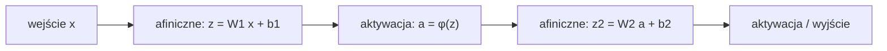

Język: [English](lecture.en.md) | **Polski**

# Wykład 02. Perceptron, sieci wielowarstwowe (MLP) i funkcje aktywacji

## Cele wykładu

1. zdefiniować klasyczny perceptron (kombinacja liniowa + próg decyzyjny) i wskazać, czym różni się od współczesnej warstwy sieci neuronowej,
2. zinterpretować geometrycznie granicę decyzyjną klasyfikatora liniowego i wyjaśnić, dlaczego pojedynczy perceptron nie rozwiąże problemu XOR,
3. **udowodnić**, że złożenie dowolnej liczby przekształceń afinicznych jest nadal przekształceniem afinicznym, oraz określić wynikające z tego ograniczenia głębokich sieci bez nieliniowości,
4. zapisać wzory i pochodne funkcji aktywacji sigmoid, tanh, ReLU oraz wskazać praktyczną konsekwencję każdej z nich,
5. policzyć ręcznie *forward pass* małego MLP i odtworzyć ten wynik w PyTorch za pomocą `torch.nn`.

## Dlaczego to jest ważne

Perceptron Rosenblatta z 1958 roku jest historycznym punktem wyjścia dla sieci neuronowych. Jego podstawowe ograniczenie ujawnia problem XOR, opisany formalnie przez Minsky'ego i Paperta w 1969 roku. Ograniczenie to na kilkanaście lat spowolniło rozwój dziedziny.

Analiza przyczyny niepowodzenia perceptronu wyjaśnia rolę MLP. Nieliniowe aktywacje między warstwami występują we wszystkich późniejszych architekturach omawianych w kursie, między innymi w CNN i transformerach. Bez nieliniowości głęboka sieć nie ma większej mocy reprezentacyjnej niż pojedyncza warstwa liniowa.

## Intuicja

### Perceptron jako klasyfikator liniowy

Perceptron podejmuje decyzję binarną na podstawie ważonej sumy cech wejściowych. Wynik powyżej ustalonego progu oznacza jedną klasę, a wynik poniżej progu drugą. Dla danych dwuwymiarowych granicą decyzyjną jest **prosta**, a w ogólnym przypadku hiperpłaszczyzna. Punkty po przeciwnych stronach granicy trafiają do różnych klas.

To działa dobrze, gdy klasy da się rozdzielić jedną prostą (dane *liniowo separowalne*). Nie działa, gdy się nie da.

### Problem XOR

Funkcję XOR (różnicę symetryczną) można opisać za pomocą czterech punktów.

| $x_1$ | $x_2$ | $y = x_1 \oplus x_2$ |
|---|---|---|
| 0 | 0 | 0 |
| 1 | 0 | 1 |
| 0 | 1 | 1 |
| 1 | 1 | 0 |

Na płaszczyźnie punkty $(0,0)$ i $(1,1)$ należą do klasy 0, a $(1,0)$ i $(0,1)$ do klasy 1. Klasy leżą naprzemiennie na przekątnych kwadratu jednostkowego, więc nie można rozdzielić ich jedną prostą. **Żaden** wybór $w$ i $b$ pojedynczego perceptronu nie rozwiąże tego zadania idealnie.

Notebook pokazuje to ograniczenie podczas treningu. Strata klasyfikatora liniowego zbiega do poziomu losowego zgadywania niezależnie od ziarna losowości, a wagi zbliżają się do zera. Symetria XOR sprawia, że poprawa predykcji dla jednego punktu pogarsza predykcję dla innego o taką samą wartość.

### Dlaczego nie pomoże samo dodanie kolejnej warstwy liniowej

Dodanie drugiej warstwy liniowej nie rozwiązuje problemu. **Złożenie warstw liniowych nadal jest warstwą liniową**, co zostanie wykazane w sekcji *Matematyka*. Możliwości sieci zmienia dopiero **nieliniowa funkcja aktywacji** umieszczona między warstwami. MLP (*Multi-Layer Perceptron*, sieć wielowarstwowa) składa się z naprzemiennych przekształceń afinicznych i nieliniowych aktywacji.

Warstwy między wejściem a wyjściem są nazywane **warstwami ukrytymi** (*hidden layers*). Ich liczba określa **głębokość** sieci, a liczba neuronów w każdej warstwie jej **szerokość**. Oba wymiary wpływają na złożoność możliwej granicy decyzyjnej. Zdolność do reprezentowania funkcji nie oznacza jednak, że trening znajdzie dobre rozwiązanie.

## Formalny model

**Klasyczny perceptron.** Dla wejścia $x \in \mathbb{R}^n$

$$z = w^\top x + b, \qquad \hat{y} = \text{step}(z) = \begin{cases} 1 & z \geq 0 \\ 0 & z < 0 \end{cases}$$

Funkcja $\text{step}$ jest **nieróżniczkowalna**, ponieważ zawiera skok. Perceptron Rosenblatta trenowano za pomocą osobnej reguły aktualizacji wag, a nie spadku gradientu. Tym różni się od współczesnej warstwy sieci neuronowej.

**Współczesny neuron lub warstwa.** Liniowy rdzeń $z = w^\top x + b$ pozostaje bez zmian, ale próg zastępuje **różniczkowalna** funkcja aktywacji $\phi$.

$$a = \phi(z) = \phi(w^\top x + b)$$

Dobrze określona pochodna $\phi$ pozwala trenować całą sieć spadkiem gradientu, podobnie jak w wykładzie 1. Tym razem optymalizowana funkcja składa się z wielu warstw. Pełny mechanizm obliczania gradientu, czyli *backpropagation*, jest tematem wykładu 3. Tutaj wykorzystywane są gotowe narzędzia `autograd` i `torch.optim`.

**Warstwa w postaci wektorowej.** Dla wejścia $x \in \mathbb{R}^n$ i warstwy o $m$ neuronach zachodzi $W \in \mathbb{R}^{m \times n}$ oraz $b \in \mathbb{R}^m$.

$$z = Wx + b \in \mathbb{R}^m, \qquad a = \phi(z) \quad \text{(element po elemencie)}$$

**MLP** jest złożeniem $K$ takich warstw. Symbol $K$ oznacza liczbę warstw, natomiast $L$ jest zarezerwowane dla straty. Dla $a^{(0)} = x$ i $l = 1, \dots, K$

$$z^{(l)} = W^{(l)} a^{(l-1)} + b^{(l)}, \qquad a^{(l)} = \phi^{(l)}\big(z^{(l)}\big)$$

Ostatnia warstwa często wykorzystuje inną aktywację niż warstwy ukryte. W klasyfikacji binarnej może to być sigmoid albo brak aktywacji, jeśli strata jest obliczana bezpośrednio z logitów.

## Matematyka

### Złożenie przekształceń afinicznych jest afiniczne

Przekształcenie $f(x) = Wx + b$ jest **afiniczne**, czyli liniowe z przesunięciem. Dla $f_1(x) = W_1 x + b_1$ oraz $f_2(y) = W_2 y + b_2$ ich złożenie ma postać

$$f_2\big(f_1(x)\big) = W_2\big(W_1 x + b_1\big) + b_2 = \underbrace{(W_2 W_1)}_{W'} x + \underbrace{(W_2 b_1 + b_2)}_{b'} = W' x + b'$$

Wynik ma postać $W'x + b'$, więc **nadal jest afiniczny**. Ten sam argument można zastosować indukcyjnie do dowolnej liczby warstw. Złożenie $f_K \circ f_{K-1} \circ \dots \circ f_1$ pozostaje afiniczne zarówno dla $K = 2$, jak i dla $K = 200$.

Sieć złożona wyłącznie z warstw $z = Wx+b$ ma taką samą moc reprezentacyjną jak pojedyncza warstwa $W'x + b'$. Liczba warstw nie zmienia tego wyniku. Dopiero nieliniowa funkcja $\phi$ łamie tę własność, ponieważ $f_2(\phi(f_1(x)))$ nie daje się w ogólnym przypadku sprowadzić do jednego przekształcenia afinicznego.

### Funkcje aktywacji

**Sigmoid**

$$\sigma(z) = \frac{1}{1 + e^{-z}}, \qquad \sigma'(z) = \sigma(z)\big(1 - \sigma(z)\big)$$

Zakres $(0, 1)$ pozwala interpretować wynik jako prawdopodobieństwo. Pochodna osiąga maksimum $0{,}25$ dla $z=0$ i **dąży do zera** wraz ze wzrostem $|z|$. Funkcja ulega wtedy nasyceniu (*saturation*), a gradient przekazuje niewiele informacji. W głębokiej sieci efekt wzmacnia się przez mnożenie wielu małych pochodnych. Zjawisko to zostanie rozwinięte w wykładzie 3.

**Tanh**

$$\tanh(z) = \frac{e^{z} - e^{-z}}{e^{z} + e^{-z}} = 2\sigma(2z) - 1, \qquad \tanh'(z) = 1 - \tanh^2(z)$$

Zakres $(-1, 1)$ jest **wyśrodkowany na zerze** (*zero-centered*), podczas gdy wynik sigmoid pozostaje dodatni. Dzięki temu wejścia kolejnej warstwy nie są systematycznie przesunięte w jednym kierunku. Tanh również ulega nasyceniu, a jej pochodna dąży do zera dla dużych $|z|$.

**ReLU** (*Rectified Linear Unit*)

$$\text{ReLU}(z) = \max(0, z), \qquad \text{ReLU}'(z) = \begin{cases} 1 & z > 0 \\ 0 & z < 0 \end{cases}$$

Dla $z=0$ pochodna jest formalnie nieokreślona, a PyTorch przyjmuje wartość $0$. Po dodatniej stronie pochodna jest **stała i równa 1**, więc ReLU nie ulega tam nasyceniu. Ułatwia to trening głębszych sieci. Obliczenie wymaga tylko jednego porównania, bez funkcji wykładniczej. Dla $z<0$ pochodna wynosi jednak dokładnie $0$. Neuron stale otrzymujący ujemne pobudzenie przestaje się uczyć, co prowadzi do problemu *dead ReLU*.

### Strata dla klasyfikacji binarnej

W klasyfikacji zamiast MSE stosuje się **binarną entropię krzyżową** (*Binary Cross-Entropy*, BCE). Dla predykcji $\hat{y} \in (0,1)$, na przykład wyjścia sigmoid, oraz etykiety $y \in \{0,1\}$

$$\ell(\hat{y}, y) = -\big[y \log \hat{y} + (1-y)\log(1-\hat{y})\big], \qquad L = \frac{1}{N}\sum_{i=1}^N \ell(\hat{y}_i, y_i)$$

Dla etykiety $y=1$ strata wynosi $-\log \hat{y}$. Rośnie bez ograniczeń, gdy model jest pewny błędnej odpowiedzi ($\hat{y} \to 0$), i dąży do zera dla poprawnej odpowiedzi ($\hat{y}\to 1$). BCE karze więc pewne, błędne predykcje mocniej niż MSE. W notebooku strata jest obliczana bezpośrednio z **logitów** $z$ przez stabilną numerycznie funkcję `BCEWithLogitsLoss`. Pozwala to uniknąć osobnego obliczania $\log(\sigma(z))$, które dla skrajnych wartości $z$ może powodować błędy numeryczne.

## Przykład rozwiązany

Poniższy przykład przedstawia ręcznie dobrane wagi małego MLP rozwiązującego XOR bez treningu. Pokazuje to, że rozwiązanie istnieje, ale pozostaje poza możliwościami pojedynczego perceptronu.

Sieć zawiera 2 wejścia, warstwę ukrytą z 2 neuronami ReLU oraz 1 wyjście liniowe bez aktywacji. Wynik jest porównywany bezpośrednio z etykietą.

$$W^{(1)} = \begin{pmatrix} 1 & 1 \\ 1 & 1 \end{pmatrix}, \quad b^{(1)} = \begin{pmatrix} 0 \\ -1 \end{pmatrix}, \quad w^{(2)} = \begin{pmatrix} 1 \\ -2 \end{pmatrix}, \quad b^{(2)} = 0$$

Dla każdego z czterech punktów obliczane są $h = \text{ReLU}(W^{(1)} x + b^{(1)})$ oraz $\hat{y} = w^{(2)\top} h + b^{(2)}$.

| $x$ | $z^{(1)} = W^{(1)}x + b^{(1)}$ | $h = \text{ReLU}(z^{(1)})$ | $\hat{y} = h_1 - 2h_2$ | $y$ |
|---|---|---|---|---|
| $(0,0)$ | $(0,-1)$ | $(0,0)$ | $0$ | $0$ |
| $(1,0)$ | $(1,0)$ | $(1,0)$ | $1$ | $1$ |
| $(0,1)$ | $(1,0)$ | $(1,0)$ | $1$ | $1$ |
| $(1,1)$ | $(2,1)$ | $(2,1)$ | $2 - 2 = 0$ | $0$ |

Wszystkie cztery wyniki są poprawne **bez treningu i obliczania gradientu**. Neurony ukryte $h_1 = x_1+x_2$ oraz $h_2 = \max(0, x_1+x_2-1)$ wykonują proste operacje. Dopiero **kombinacja $h_1 - 2h_2$** po aktywacji ReLU tworzy nieliniową, załamaną funkcję. Rozróżnia ona przypadek $x_1+x_2=1$, dla którego $h_2=0$, od $x_1+x_2=2$, dla którego $h_2=1$. Notebook odtwarza ten wynik w PyTorch. Pokazuje również, że sieć trenowana od losowej inicjalizacji znajduje rozwiązanie, choć zwykle z innymi wagami.

*(Konstrukcja została zaadaptowana z klasycznego przykładu opisanego przez Goodfellowa, Bengio i Courville'a w rozdziale 6 książki z 2016 roku.)*

## Eksperyment

Notebook [`examples.ipynb`](examples.ipynb) obejmuje pięć eksperymentów.

1. **XOR i pojedynczy perceptron.** Model liniowy bez warstwy ukrytej jest trenowany na XOR. Strata zatrzymuje się na poziomie losowego zgadywania ($\ln 2 \approx 0{,}69$) niezależnie od ziarna losowości, a wagi zbliżają się do zera. Model przewiduje $p\approx 0{,}5$ dla każdego punktu. Dokładność liczona z progiem 0,5 jest w tym stanie podatna na szum numeryczny i nie stanowi wiarygodnego sygnału.
2. **XOR i ręcznie skonstruowany MLP.** Implementacja w PyTorch odtwarza rozwiązany przykład i sprawdza zgodność wartości.
3. **Funkcje aktywacji.** Wykresy przedstawiają sigmoid, tanh, ReLU oraz ich pochodne dla $z\in[-5,5]$. Pochodne obliczone ze wzoru i przez `autograd` dają zgodne wyniki.
4. **Dwa przeplatające się półksiężyce.** Dane powstają lokalnie za pomocą funkcji parametrycznej, bez pobierania plików i dodatkowych zależności. Porównywane są model liniowy (`nn.Linear` + sigmoid) oraz MLP (`nn.Linear` → ReLU → `nn.Linear`). Obie granice decyzyjne są wizualizowane na siatce punktów.
5. **Ablacja nieliniowości.** Architektura MLP z punktu 4 zostaje zachowana, ale `nn.Identity()` zastępuje `nn.ReLU()`. Granica decyzyjna i skuteczność odpowiadają, z dokładnością do losowości optymalizacji, modelowi liniowemu. Wynik potwierdza dowód z sekcji *Matematyka*.

Notebook korzysta z `torch.nn.Module`, `nn.Linear`, `nn.Sequential` i `torch.optim`. Warstwa `nn.Linear(n, m)` odpowiada równaniu $z = Wx+b$ z sekcji *Formalny model*, gdzie $W$ i $b$ są parametrami. Metoda `optimizer.step()` aktualizuje je na podstawie gradientu. Jest to ta sama operacja, która w wykładzie 1 została zapisana ręcznie jako `w -= lr * w.grad`. Różnice między optymalizatorami, takimi jak Adam i SGD z momentum, są tematem wykładu 4.

## Obserwacje

- Model liniowy na XOR zatrzymuje się na poziomie losowego zgadywania, a jego wagi zbliżają się do zera. Nie wynika to ze zbyt małej liczby epok ani niewłaściwego współczynnika uczenia, lecz z ograniczonej mocy reprezentacyjnej. Symetria XOR sprawia, że żadna niezerowa waga nie poprawia średniej straty. W tym przypadku strata jest bardziej wiarygodnym sygnałem niż dokładność zależna od progu $0{,}5$ i szumu numerycznego.
- Ręcznie skonstruowany MLP rozwiązuje XOR bez treningu. Moc reprezentacyjna modelu i zdolność optymalizatora do znalezienia dobrych wag są osobnymi zagadnieniami.
- Dla półksiężyców model liniowy osiąga rozsądną, ale niedoskonałą dokładność. Popełnia systematyczne błędy w obszarze nakładania się kształtów. MLP z ReLU uzyskuje wyższą dokładność, a jego granica decyzyjna dopasowuje się do geometrii danych.
- MLP z `nn.Identity()` zamiast nieliniowości daje niemal taki sam wynik jak model liniowy, mimo większej liczby warstw i parametrów. Stanowi to empiryczne potwierdzenie własności przekształceń afinicznych.
- Pochodne sigmoid i tanh maleją do zera przy krańcach wykresu. Pochodna ReLU jest równa $1$ dla dodatnich wejść oraz $0$ dla ujemnych, bez stopniowego zanikania.

## Częste błędne przekonania

❌ Perceptron Rosenblatta i warstwa współczesnej sieci neuronowej to w zasadzie to samo.

✅ Oba rozwiązania mają ten sam liniowy rdzeń $w^\top x + b$. Perceptron używa jednak nieróżniczkowalnej funkcji skoku oraz osobnej reguły uczenia. Współczesna warstwa ma różniczkowalną aktywację, dzięki czemu cała sieć może być trenowana spadkiem gradientu.

❌ Dodanie kolejnych warstw liniowych samo w sobie zwiększa moc modelu.

✅ Złożenie przekształceń afinicznych pozostaje afiniczne. Sieć zbudowana z samych warstw $Wx+b$, bez nieliniowości między nimi, ma taką samą moc reprezentacyjną jak jedna warstwa liniowa.

❌ Głębsza lub szersza sieć zawsze uczy się lepiej.

✅ Większa pojemność pozwala reprezentować bardziej złożone funkcje, ale nie gwarantuje dobrego wyniku treningu ani generalizacji. Znaczenie mają również optymalizacja, ilość danych i ryzyko przeuczenia omówione w wykładzie 5. Nieliniowość jest konieczna dla zwiększenia mocy reprezentacyjnej, lecz większy model nie musi być lepszy.

❌ ReLU nie ma żadnych wad, bo w przeciwieństwie do sigmoid/tanh się nie nasyca.

✅ ReLU nie ulega nasyceniu dla dodatnich wejść, ale dla ujemnych ma pochodną równą zero. Neuron stale otrzymujący ujemne pobudzenie przestaje dostawać sygnał uczący i staje się martwy.

## Implikacje inżynierskie

- **Koszt obliczeniowy aktywacji.** ReLU wymaga jednego porównania, a sigmoid i tanh obliczenia $e^{-z}$. Przy milionach neuronów i wielu krokach różnica wpływa na czas treningu. Jest to jeden z powodów popularności ReLU i jej wariantów.
- **Stabilność numeryczna straty.** Obliczanie BCE z logitów przez `BCEWithLogitsLoss` pozwala uniknąć błędów numerycznych związanych z ręcznym `log(sigmoid(z))` dla skrajnych wartości $z$.
- **Koszt pamięciowy architektury.** Każda warstwa i każdy neuron dodają parametry $W$ i $b$, które trzeba przechować oraz obliczyć dla nich gradient. Zwiększenie sieci zawsze wiąże się więc z dodatkowym kosztem, nawet jeśli mały model mieści się bez problemu w pamięci CPU.
- **Nasycenie aktywacji i głębokość.** Zanikanie pochodnej sigmoid i tanh staje się szczególnie istotne w głębokich sieciach, gdzie wiele małych wartości jest przez siebie mnożonych. Wykład 3 przedstawia ten proces na grafie obliczeniowym.
- **CPU wystarcza dla małych modeli.** Sieci używane w tym wykładzie mają od kilkunastu do kilkudziesięciu neuronów i trenują się na CPU w ułamku sekundy. GPU nabiera znaczenia przy większych architekturach i zbiorach danych.

## Co warto zapamiętać

- Perceptron = model liniowy + nieróżniczkowalny próg; współczesna warstwa = model liniowy + różniczkowalna aktywacja.
- Złożenie warstw liniowych bez nieliniowości między nimi nadal odpowiada jednej warstwie liniowej. Wynika to z dowodu i jest dodatkowo potwierdzone eksperymentalnie.
- Sigmoid i tanh się nasycają (pochodna → 0 dla dużych $|z|$); ReLU się nie nasyca dla $z>0$, ale ma martwą strefę dla $z<0$.
- MLP z jedną warstwą ukrytą i nieliniową aktywacją rozwiązuje XOR zarówno przy ręcznie dobranych wagach, jak i po treningu gradientowym.
- Większa liczba warstw lub neuronów zwiększa możliwości modelu, ale nie gwarantuje lepszego wyniku. Reprezentowalność i skuteczność treningu są osobnymi zagadnieniami.

## Pytania dla studentów

1. Dlaczego perceptron Rosenblatta nie rozwiąże XOR, podczas gdy MLP z jedną warstwą ukrytą i nieliniową aktywacją poradzi sobie z tym zadaniem?
2. Dlaczego sieć złożona wyłącznie z warstw liniowych ma moc reprezentacyjną pojedynczej warstwy liniowej, niezależnie od głębokości?
3. Czym różni się zachowanie pochodnej sigmoid i ReLU dla dużych dodatnich wartości wejścia? Jakie mogą być tego konsekwencje przy trenowaniu głębokich sieci?
4. W jakiej sytuacji tanh może być lepszym wyborem niż sigmoid, a ReLU lepszym wyborem niż obie te funkcje? Z czego wynika taki wybór?

## Bibliografia

- Rosenblatt, F. (1958). *The Perceptron: A Probabilistic Model for Information Storage and Organization in the Brain*. Psychological Review, 65(6), 386–408.
- Goodfellow, I., Bengio, Y., Courville, A. (2016). *Deep Learning*. MIT Press. https://www.deeplearningbook.org/. Rozdział 6 (*Deep Feedforward Networks*) zawiera formalizację MLP i klasyczny przykład XOR.
- PyTorch Contributors. Dokumentacja *torch.nn*. https://pytorch.org/docs/stable/nn.html
- PyTorch Contributors. Dokumentacja *BCEWithLogitsLoss*. https://pytorch.org/docs/stable/generated/torch.nn.BCEWithLogitsLoss.html

Pełne wpisy znajdują się w pliku [`references/references.bib`](../../references/references.bib).
