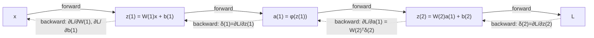

Language: **English (default)** | [Polski](lecture.md)

# Lecture 03. Backpropagation, the chain rule, and automatic differentiation

## Learning goals

1. recall the derivative, the partial derivative, and the chain rule, and recognize them in a computational graph,
2. read a small computational graph and identify its forward-pass values, local derivatives, and **upstream gradient** at each node,
3. derive the weight and bias gradients for a one-hidden-layer network, first in scalar form and then in matrix form for a complete batch,
4. implement and verify these gradients with an analytical formula, `autograd`, and finite differences, and identify the limitations of the last method,
5. correctly use `requires_grad`, `backward()`, `.grad`, `zero_grad()`, and `detach()`, and explain the accumulation of gradients that have not been cleared,
6. explain why backpropagation is computationally efficient, and, using measured (not just described) gradient norms, demonstrate why saturated activations lead to vanishing gradients in deeper networks.

## Why this matters

Lecture 1 introduced a manual gradient calculation for a linear neuron. Lecture 2 used `loss.backward()` to train an MLP without examining how it works. Backpropagation closes that gap. It is a systematic and efficient application of the chain rule to a graph of tensor operations.

Understanding this mechanism is essential when diagnosing a network that does not learn, becomes numerically unstable, or converges very slowly. These problems recur in later modules and in engineering practice.

## Intuition

### What exactly gets propagated backward

The backward pass does not propagate an abstract "error." It propagates **values that describe how the loss would change after a small change in an intermediate quantity**. This is the same gradient introduced in lecture 1, now calculated for intermediate nodes such as hidden-layer outputs and weighted sums. The gradient passes through these nodes on its way from the loss to the first layer's weights.

### Why earlier layers' gradients depend on later ones

The loss $L$ is a composite function. It depends on the network output, which depends on the final hidden layer, while each earlier value depends on the preceding one, down to the first layer's weights. The chain rule expresses the derivative of this composition as the **product** of partial derivatives along the path. Calculating $\partial L/\partial W^{(1)}$ therefore requires every layer between $W^{(1)}$ and $L$. This follows from function composition rather than an implementation choice.

### Why this is efficient

A naive calculation of $\partial L/\partial \theta_j$ for each parameter separately, for example with finite differences, requires a separate forward pass for every $\theta_j$. A network with one million parameters would need at least one million such passes. Backpropagation obtains **all** gradients in one backward pass whose cost is comparable to a forward pass. Previously calculated upstream gradients (`δ`) are shared by parameters connected to the same node, so the same work is not repeated.

## Formal model

The notation from lecture 2 can be extended with gradients for a network with one hidden layer.

$$z^{(1)} = W^{(1)} x + b^{(1)}, \qquad a^{(1)} = \phi(z^{(1)}), \qquad z^{(2)} = W^{(2)} a^{(1)} + b^{(2)}, \qquad \hat{y} = z^{(2)}$$

The output is linear because the example concerns regression and continues the use of MSE from lecture 1. This avoids introducing BCE classification as an additional concept. The loss for one example is $\ell = (\hat{y}-y)^2$, while a batch of $N$ examples uses $L = \frac{1}{N}\sum_i \ell_i$.

The required gradients are $\dfrac{\partial L}{\partial W^{(1)}}$, $\dfrac{\partial L}{\partial b^{(1)}}$, $\dfrac{\partial L}{\partial W^{(2)}}$, and $\dfrac{\partial L}{\partial b^{(2)}}$. They make it possible to perform a gradient-descent step as in lecture 1.

Backpropagation **computes the gradient**, while applying that gradient is the job of the **optimizer** covered in lecture 4. The update may be $\theta \leftarrow \theta - \eta \nabla L$ or a more sophisticated rule. Calling `loss.backward()` does not change any parameter; it only writes to `.grad`.

## Mathematics

### Derivative, partial derivative, and chain rule

For a function of one variable $f(x)$, the derivative $f'(x)$ describes the rate of change of $f$ at $x$. For a function of several variables $f(x_1, \dots, x_n)$, the partial derivative $\partial f/\partial x_i$ is calculated with respect to $x_i$ while the other variables remain fixed. Lecture 1 used such derivatives separately for $w$ and $b$.

**The chain rule** for the composition $L = f(g(x))$ is $\dfrac{dL}{dx} = \dfrac{df}{dg}\cdot\dfrac{dg}{dx}$. For a longer chain $L = f_n(f_{n-1}(\dots f_1(x)\dots))$, the derivative is a product of $n$ local derivatives, one for each step in the graph. Backpropagation rests on this property. The rest of the algorithm determines the order in which local derivatives are calculated and reused.

### A computational graph. A scalar example

The example contains one neuron with a sigmoid activation and MSE loss against a target $t$.

$$u = wx, \qquad v = u + b, \qquad a = \sigma(v), \qquad L = (a-t)^2$$

The graph contains four intermediate nodes, each with a local derivative.

| node | operation | local derivative |
|---|---|---|
| $u$ | $u = wx$ | $\partial u/\partial w = x$, $\quad \partial u/\partial x = w$ |
| $v$ | $v = u+b$ | $\partial v/\partial u = 1$, $\quad \partial v/\partial b = 1$ |
| $a$ | $a = \sigma(v)$ | $\partial a/\partial v = \sigma(v)\big(1-\sigma(v)\big) = a(1-a)$ (lecture 2) |
| $L$ | $L = (a-t)^2$ | $\partial L/\partial a = 2(a-t)$ |

The **forward pass** calculates $u, v, a$, and $L$ in order from input to loss. The **backward pass** proceeds in reverse, from loss to input, and multiplies successive local derivatives.

$$\underbrace{\frac{\partial L}{\partial v}}_{=:\ \delta_v} = \frac{\partial L}{\partial a}\cdot\frac{\partial a}{\partial v} = 2(a-t)\cdot a(1-a)$$

The value $\delta_v := \partial L/\partial v$ is the **upstream gradient** flowing into node $v$. It is calculated **once** and reused for every path from $v$ toward the input.

$$\frac{\partial L}{\partial w} = \delta_v \cdot \frac{\partial v}{\partial u}\cdot\frac{\partial u}{\partial w} = \delta_v \cdot 1 \cdot x = \delta_v\, x, \qquad \frac{\partial L}{\partial b} = \delta_v \cdot \frac{\partial v}{\partial b} = \delta_v$$

This reuse explains the computational efficiency. A single value $\delta_v$ produces the gradients for both $w$ and $b$ without another pass through $a$ and $L$.

### Local derivative, upstream gradient, gradient, and Jacobian

These terms have distinct meanings even without the full formalism of matrix calculus.

- A **local derivative** describes the change in one node's output with respect to its direct inputs, independently of the rest of the graph. One example is $\partial a/\partial v = a(1-a)$.
- An **upstream gradient** has the form $\partial L/\partial(\text{node's output})$. It describes the loss change after a small change in that node's output and accounts for the entire downstream graph. Backpropagation passes this value between nodes and multiplies it by local derivatives.
- A **gradient** in the context of training usually means $\partial L/\partial\theta$ for a parameter $\theta$. It is the product of the upstream gradient and the node's local derivative with respect to that parameter.
- A **Jacobian** applies to a node with vector input and vector output. For $z = Wx+b$, where $x\in\mathbb R^n$ and $z\in\mathbb R^m$, it is an $m\times n$ matrix of partial derivatives and equals $W$ with respect to $x$. An element-wise activation $a_i = \phi(z_i)$ has a diagonal Jacobian with $\phi'(z_i)$ on the diagonal. Multiplication by this matrix is equivalent to coordinate-wise multiplication ($\odot$), as used during the backward pass through an activation.

### Backpropagation for a one-hidden-layer network

The derivation starts with a single example and then extends to a complete batch.

**The output layer.** $\hat y = z^{(2)}$ (linear output), $\ell = (\hat y - y)^2$:

$$\delta^{(2)} := \frac{\partial \ell}{\partial z^{(2)}} = \frac{\partial \ell}{\partial \hat y}\cdot\frac{\partial \hat y}{\partial z^{(2)}} = 2(\hat y - y)\cdot 1 = 2(\hat y-y)$$

Since $z^{(2)} = W^{(2)} a^{(1)} + b^{(2)}$, the local derivatives with respect to the parameters are $\partial z^{(2)}/\partial W^{(2)} = a^{(1)}$ (in the sense that each element $W^{(2)}_{jk}$ multiplies $a^{(1)}_k$) and $\partial z^{(2)}/\partial b^{(2)} = 1$, so:

$$\frac{\partial \ell}{\partial W^{(2)}} = \delta^{(2)} \big(a^{(1)}\big)^\top, \qquad \frac{\partial \ell}{\partial b^{(2)}} = \delta^{(2)}$$

The outer product $\delta^{(2)}(a^{(1)})^\top$ has the same shape as $W^{(2)}$. Matching shapes provide a basic implementation check.

**Propagating to the hidden layer.** The next step requires $\partial \ell/\partial a^{(1)}$, which describes how the loss depends on the hidden layer's output. The transformation $z^{(2)} = W^{(2)} a^{(1)} + b^{(2)}$ has the Jacobian $W^{(2)}$ with respect to $a^{(1)}$. The gradient is therefore multiplied by the **transposed** weight matrix.

$$\frac{\partial \ell}{\partial a^{(1)}} = \big(W^{(2)}\big)^\top \delta^{(2)}$$

The pass through the activation uses its diagonal Jacobian, which gives coordinate-wise multiplication.

$$\delta^{(1)} := \frac{\partial \ell}{\partial z^{(1)}} = \frac{\partial \ell}{\partial a^{(1)}} \odot \phi'\big(z^{(1)}\big) = \Big[\big(W^{(2)}\big)^\top \delta^{(2)}\Big] \odot \phi'\big(z^{(1)}\big)$$

The first-layer gradients have an analogous form.

$$\frac{\partial \ell}{\partial W^{(1)}} = \delta^{(1)} x^\top, \qquad \frac{\partial \ell}{\partial b^{(1)}} = \delta^{(1)}$$

Every layer repeats the formula $\delta \mapsto \delta \cdot (\text{input})^\top$ for weights and $\delta \mapsto \delta$ for bias. A network with $K$ layers performs this step $K$ times from output to input. The symbol $K$ denotes the number of layers, while $L$ remains reserved for the loss.

### The batched version

For one example, $\delta^{(l)}$ is a vector with one entry per neuron in layer $l$. A hidden layer with $m$ neurons has, for example, $\delta^{(1)}\in\mathbb R^{m}$. A batch of $N$ examples produces a **matrix** $\Delta^{(l)}\in\mathbb R^{N\times m}$ whose rows contain the gradients for individual examples. The symbol $\Delta$ therefore represents the same concept as $\delta$, collected for the complete batch. Only the transposes and sums need to be adjusted to match matrix shapes.

As in modules 1 and 2, the data has shape $X \in \mathbb{R}^{N\times n}$, with one example per row. This follows the `nn.Linear` convention, $Z = XW^\top + b$. For $\hat Y, Y \in \mathbb{R}^{N\times 1}$, the loss is $L = \frac{1}{N}\sum_{i=1}^N (\hat y_i - y_i)^2$. The factor $\frac1N$ from averaging the loss **must** appear at the start of backpropagation.

$$\Delta^{(2)} := \frac{\partial L}{\partial Z^{(2)}} = \frac{2}{N}\big(\hat Y - Y\big) \quad \in \mathbb{R}^{N\times 1}$$

$$\frac{\partial L}{\partial W^{(2)}} = \big(\Delta^{(2)}\big)^\top A^{(1)}, \qquad \frac{\partial L}{\partial b^{(2)}} = \sum_{i=1}^N \Delta^{(2)}_i$$

**Broadcasting.** The bias $b^{(2)}$ has shape $(k,)$, with one entry per output neuron and no example dimension. The product $A^{(1)}(W^{(2)})^\top$ has shape $(N, k)$. During addition, NumPy or PyTorch treats the bias as an array of shape $(1, k)$ and stretches it along the example dimension without physically copying memory. The same vector is therefore added to every one of the $N$ rows.

During the backward pass, broadcasting leads to a **sum**. The bias gradient combines contributions from all examples because each used the same parameter. This explains $\sum_{i=1}^N$ in the formulas rather than an average or a value from one example. Omitting this sum is a common error in manual implementations.

The remaining calculations follow the scalar version.

$$\frac{\partial L}{\partial A^{(1)}} = \Delta^{(2)} W^{(2)} \quad\in\mathbb{R}^{N\times m}, \qquad \Delta^{(1)} := \frac{\partial L}{\partial Z^{(1)}} = \frac{\partial L}{\partial A^{(1)}} \odot \phi'\big(Z^{(1)}\big)$$

$$\frac{\partial L}{\partial W^{(1)}} = \big(\Delta^{(1)}\big)^\top X, \qquad \frac{\partial L}{\partial b^{(1)}} = \sum_{i=1}^N \Delta^{(1)}_i$$

Shapes can be checked independently of numerical values. Since $W^{(1)}\in\mathbb R^{m\times n}$, the gradient $\partial L/\partial W^{(1)}$ must also have shape $m\times n$. The product $(\Delta^{(1)})^\top X$ has shape $(m\times N)(N\times n) = m\times n$. This check is a first line of defense against implementation errors and appears in both the notebook and the lab.

## Worked example

The manual gradient calculation for the neuron in the scalar graph uses $x=1.5$, $w=0.8$, $b=-0.3$, and $t=1.0$.

$$u = wx = 0.8\cdot 1.5 = 1.2, \qquad v = u+b = 1.2-0.3 = 0.9$$

$$a = \sigma(0.9) \approx 0.7109, \qquad L = (a-t)^2 \approx (0.7109-1)^2 \approx 0.0836$$

$$a(1-a) \approx 0.7109\cdot 0.2891 \approx 0.2055, \qquad 2(a-t) \approx 2\cdot(-0.2891) \approx -0.5781$$

$$\delta_v = 2(a-t)\cdot a(1-a) \approx -0.5781 \cdot 0.2055 \approx -0.1188$$

$$\frac{\partial L}{\partial w} = \delta_v \cdot x \approx -0.1188\cdot 1.5 \approx -0.1782, \qquad \frac{\partial L}{\partial b} = \delta_v \approx -0.1188$$

The `autograd` results agree to the seventh decimal place. The accuracy of finite differences is limited by floating-point arithmetic, as shown in the *Observations* section.

## Experiment

The notebook [`examples.ipynb`](examples.ipynb) contains six experiments.

1. **A scalar graph and three methods.** The gradients $\partial L/\partial w$ and $\partial L/\partial b$ are calculated analytically, by `autograd`, and with central finite differences, $\frac{\partial L}{\partial \theta}\approx \frac{L(\theta+h)-L(\theta-h)}{2h}$. Lecture 2 compared these methods for an activation derivative. Here, they verify the complete loss gradient with respect to the parameters.
2. **The effect of step $h$ on finite differences.** A plot shows the error relative to `autograd` as a function of $h$ in `float64`. A large step causes truncation error because the approximation is no longer local. A very small step causes rounding error when two close values are subtracted. An optimal range lies between these extremes for a given problem scale.
3. **A one-hidden-layer network with a batch larger than 1.** The three methods are compared for a network with 2 inputs, several sigmoid neurons, and 1 linear output. Both the values and shapes of all four gradients $W^{(1)}, b^{(1)}, W^{(2)}$, and $b^{(2)}$ are checked.
4. **Gradient accumulation.** Two consecutive calls to `backward()` without `zero_grad()` show that `.grad` values are added rather than overwritten.
5. **`detach()` and cutting the graph.** Two paths lead to the same node from parameters `w` and `c`. After `.detach()` cuts the first path, the loss still requires a gradient through `c`, but `w.grad` remains `None`. This demonstrates the selective behavior of `detach()`.
6. **Saturation and vanishing gradients.** The weight-gradient norm is measured at each layer in stacks using sigmoid, tanh, or ReLU. The result shows how the norm depends on depth and activation choice.

## Observations

- The analytical formula and `autograd` produce almost identical results. Differences on the order of $10^{-7}$–$10^{-8}$ match `float32` precision. Both methods perform the same mathematical calculation.
- Finite differences in `float32` with $h=10^{-4}$ do not always fall within a tight tolerance of `autograd`. With `float64` and a step on the order of $10^{-5}$–$10^{-6}$, the error drops to about $10^{-12}$. The plot is U-shaped. At $h=10^{-1}$, truncation error is about $10^{-4}$; at $h=10^{-8}$, rounding error is about $10^{-9}$.
- The batched bias gradient is a sum over examples and has shape `(m,)`, not `(N, m)`.
- A second call to `backward()` without `zero_grad()` produces a `.grad` twice as large because gradients **accumulate**.
- A value passed through `.detach()` stops propagation. Parameters before the cut receive a zero gradient or `None` when this was their only path to the loss.
- In a stack of sigmoid layers, the gradient norm falls by about 7–8 orders of magnitude from the last layer to the first across 10 layers. For tanh, the difference is less than a factor of 1.5. For ReLU, it is smaller still and does not decrease monotonically with depth.

## Common misconceptions

❌ `loss.backward()` updates the model's parameters.

✅ `backward()` only **computes** gradients and stores them in `.grad` for each parameter with `requires_grad=True`. The update $\theta \leftarrow \theta - \eta\nabla L$ or a more elaborate operation is performed by `optimizer.step()`. Without this step or a manual update, the model does not change.

❌ Gradients overwrite themselves by default on every `backward()`, so there is no need to zero them.

✅ Gradients **accumulate** by default. This deliberate PyTorch behavior can combine contributions from several small batches before one update. Without `optimizer.zero_grad()` or `param.grad = None` before the next `backward()`, however, successive steps produce incorrectly large updates.

❌ Checking the gradient with finite differences at one point proves the backpropagation implementation is correct everywhere.

✅ Such a check confirms agreement only **at one point**, for the chosen $h$ and within numerical error. At non-differentiable points such as $z=0$ for ReLU, a central difference averages two distinct one-sided derivatives. Gradient checking is a useful but pointwise and approximate diagnostic, not a mathematical proof.

❌ A deeper network always has harder, slower training because of its number of parameters.

✅ Vanishing gradients do not result from the number of parameters itself. They arise from **multiplying many small local derivatives** along a long path through the graph. Saturated activations have derivatives below 1 and often much smaller. This differs from the computational cost of a larger model and gives activation choice practical importance.

## Engineering implications

- **Memory.** The backward pass requires intermediate values from the forward pass, here $z^{(1)}, a^{(1)}$, and $z^{(2)}$. `autograd` retains them while building the graph. Larger networks and batches therefore increase memory use as well as computation time.
- **Debugging with shapes.** A mismatch between a gradient tensor and its parameter often indicates a missing sum over the batch or a missing transpose. Shape checks can expose these errors before numerical values are examined.
- **Deliberate gradient accumulation.** A common source of bugs can also simulate a batch larger than available memory. Gradients from several smaller passes are accumulated before one `optimizer.step()`.
- **`detach()` in practice.** Detaching is useful for logging, metric calculation, or a frozen target. It prevents unnecessary graph growth and unwanted gradient flow into another part of the model.
- **Deep networks.** The measured vanishing gradient in sigmoid layers previews a problem that becomes important in recurrent networks in lecture 9. Optimizer choice is developed further in lecture 4.

## What to remember

- Backpropagation systematically applies the chain rule from the loss to the parameters and reuses upstream gradients. It is not a separate algorithm for every layer.
- An upstream gradient (`δ`) calculated at a node serves every parameter feeding into that node. One backward pass replaces a separate pass for every parameter.
- Backward through a linear transformation $Wx+b$ multiplies by $W^\top$; backward through an element-wise activation multiplies coordinate-wise by $\phi'$ (because its Jacobian is diagonal).
- The bias gradient sums over examples in a batch as a consequence of broadcasting in the forward pass.
- `backward()` computes the gradient, while the optimizer updates the parameters. These are separate steps.
- Gradients accumulate by default; `zero_grad()` is not a formality.
- Finite differences are an approximation affected by precision, the choice of $h$, and non-differentiable points. They support verification rather than proof.

## Questions for students

1. Why does the first layer's weight gradient depend on the second layer's weights, rather than only on the input data?
2. How does a local derivative differ from an upstream gradient for any node in the scalar graph?
3. Why does the backward pass through $z=Wx+b$ use $W^\top$, not $W$?
4. How could the `.grad` values across successive steps confirm that a missing `zero_grad()` causes the loss to remain unchanged?

## References

- Rumelhart, D. E., Hinton, G. E., Williams, R. J. (1986). *Learning representations by back-propagating errors*. Nature, 323(6088), 533-536.
- Goodfellow, I., Bengio, Y., Courville, A. (2016). *Deep Learning*. MIT Press. https://www.deeplearningbook.org/. Chapter 6.5 (*Back-Propagation and Other Differentiation Algorithms*) covers differentiation algorithms.
- PyTorch Contributors. *Autograd mechanics* documentation. https://pytorch.org/docs/stable/notes/autograd.html
- PyTorch Contributors. *torch.autograd.gradcheck* documentation. https://pytorch.org/docs/stable/generated/torch.autograd.gradcheck.html

Full bibliography entries are available in [`references/references.bib`](../../references/references.bib).
