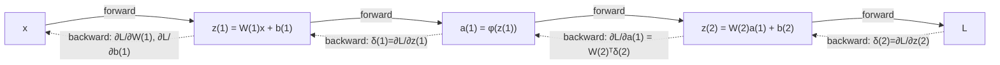

Language: **English (default)** | [Polski](lecture.md)

# Lecture 03: backpropagation, the chain rule, and automatic differentiation

## Learning goals

After this lecture, you should be able to:

1. recall the derivative, the partial derivative, and the chain rule, and recognize them in a computational graph,
2. read a small computational graph and identify in it: the forward-pass values, the local derivatives, and the **upstream gradient** at each node,
3. derive *by hand*, step by step, the weight and bias gradients for a network with one hidden layer -- first scalar, then in matrix form for a whole batch,
4. implement and verify these gradients with three independent methods: the hand-derived formula, `autograd`, and finite differences -- and know when the last of these fails,
5. correctly use `requires_grad`, `backward()`, `.grad`, `zero_grad()`, and `detach()`, and explain why gradients **accumulate** if you do not zero them,
6. explain why backpropagation is computationally efficient, and, using measured (not just described) gradient norms, demonstrate why saturated activations lead to vanishing gradients in deeper networks.

## Why this matters

In lecture 1 we computed the gradient for a single linear neuron by hand. In lecture 2 we built an MLP and *used* `loss.backward()`, without asking exactly what happens underneath. This lecture closes that gap: backpropagation is not a magic black box, just a systematic, efficient application of the chain rule to a graph whose nodes are tensor operations. Understanding this mechanism is what separates knowing how to *call* PyTorch from knowing how to **debug** a network that isn't learning, is exploding numerically, or is learning strangely slowly -- situations you will run into repeatedly in later modules and in engineering practice.

## Intuition

### What exactly gets propagated backward

We do not propagate "errors" backward in some magical sense -- we propagate **numbers saying how much the loss would change if a given intermediate quantity changed slightly**. This is exactly the same notion of gradient you learned in lecture 1, only now computed not just for parameters, but for *every* intermediate node of the graph (hidden-layer outputs, weighted sums, etc.) -- because it is through these nodes that the gradient must "pass" to get from the loss to the first layer's weights.

### Why earlier layers' gradients depend on later ones

The loss $L$ is a *composite* function: it depends on the network's output, which depends on the last hidden layer, which depends on the second-to-last, and so on down to the first layer's weights. The chain rule says the derivative of such a composite function is the **product** of the partial derivatives along the path. So to compute $\partial L/\partial W^{(1)}$ (the weights of the *first* layer), we must "pass through" everything that lies between $W^{(1)}$ and $L$ -- that is, through every later layer. This is not an implementation choice, it is a consequence of the network being a composition of functions.

### Why this is efficient

The naive alternative -- computing $\partial L/\partial \theta_j$ separately for each parameter $\theta_j$ (e.g. by finite differences, see the *Mathematics* section) -- requires a separate forward pass for every single parameter. A network with a million parameters means a million (or more) passes to compute all the gradients. Backpropagation computes **all** gradients in a single backward pass, at a cost comparable to one forward pass -- because it **shares** the already-computed upstream gradients (`δ`) among all the parameters that feed into a given node. That is the entire secret of its efficiency: we never compute the same thing twice.

## Formal model

A reminder of the notation from lecture 2, now extended with gradients: a network with one hidden layer,

$$z^{(1)} = W^{(1)} x + b^{(1)}, \qquad a^{(1)} = \phi(z^{(1)}), \qquad z^{(2)} = W^{(2)} a^{(1)} + b^{(2)}, \qquad \hat{y} = z^{(2)}$$

(a linear output -- regression, continuing MSE from lecture 1, not the BCE classification from lecture 2 -- a deliberate choice, so as not to mix two new things at once). The loss for one example: $\ell = (\hat{y}-y)^2$; for a batch of $N$ examples: $L = \frac{1}{N}\sum_i \ell_i$.

**What we are looking for:** $\dfrac{\partial L}{\partial W^{(1)}}$, $\dfrac{\partial L}{\partial b^{(1)}}$, $\dfrac{\partial L}{\partial W^{(2)}}$, $\dfrac{\partial L}{\partial b^{(2)}}$ -- so we can perform a gradient-descent step, exactly as in lecture 1.

**An important distinction, which we will return to in the misconceptions section:** backpropagation **computes the gradient**. What is done with that gradient -- $\theta \leftarrow \theta - \eta \nabla L$, or something more sophisticated -- is the job of the **optimizer** (lecture 4). `loss.backward()` does not change any parameter; it only changes the `.grad` attribute.

## Mathematics

### Reminder: derivative, partial derivative, chain rule

For a function of one variable $f(x)$, the derivative $f'(x)$ tells you how fast $f$ grows at $x$. For a function of several variables $f(x_1, \dots, x_n)$, the partial derivative $\partial f/\partial x_i$ is the derivative of $f$ with respect to $x_i$, holding the other variables fixed -- exactly what we computed in lecture 1 for $w$ and $b$ separately.

**The chain rule** for the composition $L = f(g(x))$: $\dfrac{dL}{dx} = \dfrac{df}{dg}\cdot\dfrac{dg}{dx}$. For a longer chain $L = f_n(f_{n-1}(\dots f_1(x)\dots))$, the derivative is the product of $n$ local derivatives -- one for each "step" of the graph. This is the entire mathematics backpropagation rests on; the rest is **bookkeeping**: in what order, and how many times, to compute and reuse each local derivative.

### A computational graph -- a scalar example

Consider a single neuron with a sigmoid activation and MSE loss against a target $t$:

$$u = wx, \qquad v = u + b, \qquad a = \sigma(v), \qquad L = (a-t)^2$$

This is a graph with four intermediate nodes, each with one local derivative:

| node | operation | local derivative |
|---|---|---|
| $u$ | $u = wx$ | $\partial u/\partial w = x$, $\quad \partial u/\partial x = w$ |
| $v$ | $v = u+b$ | $\partial v/\partial u = 1$, $\quad \partial v/\partial b = 1$ |
| $a$ | $a = \sigma(v)$ | $\partial a/\partial v = \sigma(v)\big(1-\sigma(v)\big) = a(1-a)$ (lecture 2) |
| $L$ | $L = (a-t)^2$ | $\partial L/\partial a = 2(a-t)$ |

The **forward pass** is computing $u, v, a, L$ in that order, from input to loss. The **backward pass** is computing derivatives in the *reverse* order, from loss to input, multiplying successive local derivatives:

$$\underbrace{\frac{\partial L}{\partial v}}_{=:\ \delta_v} = \frac{\partial L}{\partial a}\cdot\frac{\partial a}{\partial v} = 2(a-t)\cdot a(1-a)$$

Let's call $\delta_v := \partial L/\partial v$ the **upstream gradient** flowing into node $v$ -- a number we compute **once** and use for *everything* that lies beyond $v$ toward the input:

$$\frac{\partial L}{\partial w} = \delta_v \cdot \frac{\partial v}{\partial u}\cdot\frac{\partial u}{\partial w} = \delta_v \cdot 1 \cdot x = \delta_v\, x, \qquad \frac{\partial L}{\partial b} = \delta_v \cdot \frac{\partial v}{\partial b} = \delta_v$$

This is exactly the moment where the efficiency becomes visible: we computed $\delta_v$ once, and used it for both gradients ($w$ and $b$) without passing through $a$ and $L$ again.

### Local derivative, upstream gradient, gradient, Jacobian -- four different notions

These words are often confused, so let's distinguish them precisely, without the full formalism of matrix calculus:

- **Local derivative** -- the derivative of a *single* node's output with respect to its direct inputs, computed as if the rest of the graph did not exist (e.g. $\partial a/\partial v = a(1-a)$ above).
- **Upstream gradient** -- $\partial L/\partial(\text{node's output})$: how much the loss would change if *that* node's output changed slightly, accounting for **all** of the rest of the graph beyond it. This is what backpropagation passes from node to node, multiplying it by successive local derivatives (like $\delta_v$ above).
- **Gradient** (in the context of training) -- usually: $\partial L/\partial\theta$ for a specific parameter $\theta$ -- the product of the upstream gradient at the node where $\theta$ "enters" the graph, and that node's local derivative with respect to $\theta$.
- **Jacobian** -- when a node has *both* vector input and vector output (e.g. $z = Wx+b$: input $x\in\mathbb R^n$, output $z\in\mathbb R^m$), the local "derivative" is an $m\times n$ matrix of partial derivatives of each output coordinate with respect to each input coordinate -- this is the Jacobian. For $z=Wx+b$, the Jacobian with respect to $x$ is simply $W$. For an activation function applied **element-wise** ($a_i = \phi(z_i)$, no $a_i$ depends on $z_j$ for $j\neq i$), the Jacobian is a **diagonal matrix** with $\phi'(z_i)$ on the diagonal -- which is why, in practice (and in the section below), the backward pass through an element-wise activation is ordinary coordinate-wise multiplication ($\odot$), not a full matrix product: multiplying by a diagonal matrix **is** coordinate-wise multiplication.

### Backpropagation for a one-hidden-layer network -- scalar to matrix derivation

Let's start with a single example (not a batch), so every step is explicit, and then generalize to a batch.

**The output layer.** $\hat y = z^{(2)}$ (linear output), $\ell = (\hat y - y)^2$:

$$\delta^{(2)} := \frac{\partial \ell}{\partial z^{(2)}} = \frac{\partial \ell}{\partial \hat y}\cdot\frac{\partial \hat y}{\partial z^{(2)}} = 2(\hat y - y)\cdot 1 = 2(\hat y-y)$$

Since $z^{(2)} = W^{(2)} a^{(1)} + b^{(2)}$, the local derivatives with respect to the parameters are $\partial z^{(2)}/\partial W^{(2)} = a^{(1)}$ (in the sense that each element $W^{(2)}_{jk}$ multiplies $a^{(1)}_k$) and $\partial z^{(2)}/\partial b^{(2)} = 1$, so:

$$\frac{\partial \ell}{\partial W^{(2)}} = \delta^{(2)} \big(a^{(1)}\big)^\top, \qquad \frac{\partial \ell}{\partial b^{(2)}} = \delta^{(2)}$$

(the outer product $\delta^{(2)}(a^{(1)})^\top$ has a shape matching $W^{(2)}$ -- this is how we sanity-check ourselves when writing code: *shapes must match*).

**Propagating to the hidden layer.** To continue backward, we need $\partial \ell/\partial a^{(1)}$ -- how the loss depends on the hidden layer's *output*. Since $z^{(2)} = W^{(2)} a^{(1)} + b^{(2)}$ is a linear transformation of $a^{(1)}$, its Jacobian with respect to $a^{(1)}$ is $W^{(2)}$, so we propagate the gradient by multiplying by the **transposed** weight matrix:

$$\frac{\partial \ell}{\partial a^{(1)}} = \big(W^{(2)}\big)^\top \delta^{(2)}$$

From there, through the activation (a diagonal Jacobian, see above -- coordinate-wise multiplication):

$$\delta^{(1)} := \frac{\partial \ell}{\partial z^{(1)}} = \frac{\partial \ell}{\partial a^{(1)}} \odot \phi'\big(z^{(1)}\big) = \Big[\big(W^{(2)}\big)^\top \delta^{(2)}\Big] \odot \phi'\big(z^{(1)}\big)$$

And analogously to the second layer:

$$\frac{\partial \ell}{\partial W^{(1)}} = \delta^{(1)} x^\top, \qquad \frac{\partial \ell}{\partial b^{(1)}} = \delta^{(1)}$$

The same formula $\delta \mapsto \delta \cdot (\text{input})^\top$ for weights and $\delta \mapsto \delta$ for bias repeats at every layer -- this is the "repeatable step" that, in a network with $K$ layers, we perform $K$ times, once per layer, going from output to input (we denote the number of layers $K$, as in lecture 2 -- $L$ in this course always means loss).

### The batched version

Above, $\delta^{(l)}$ was the upstream gradient flowing into layer $l$ **for a single example** -- a vector with as many entries as that layer has neurons (e.g. $\delta^{(1)}\in\mathbb R^{m}$ for a hidden layer with $m$ neurons). For a batch of $N$ examples, we compute this same gradient for every example at once -- so we get not a vector, but a **matrix** $\Delta^{(l)}\in\mathbb R^{N\times m}$: one **row** per example, exactly the same vector $\delta^{(l)}$ we would have computed for that example on its own. So the capital letter $\Delta$ denotes the same concept as $\delta$ (the upstream gradient into a given layer), just collected for several examples at once -- it is not a different entity, only the same vector stacked into rows. Thanks to this, the same formulas ($\delta \mapsto \dots$) carry over to $\Delta$ almost unchanged, only with transposes/sums adjusted to a matrix shape instead of a vector (see below).

In modules 1 and 2 we kept data as $X \in \mathbb{R}^{N\times n}$ (row = example) -- matching `nn.Linear`'s convention, $Z = XW^\top + b$. We keep that convention. Let $\hat Y, Y \in \mathbb{R}^{N\times 1}$, $L = \frac{1}{N}\sum_{i=1}^N (\hat y_i - y_i)^2$. The factor $\frac1N$ (averaging the loss over examples, as in lecture 1) **must** enter the gradient right at the start of backpropagation:

$$\Delta^{(2)} := \frac{\partial L}{\partial Z^{(2)}} = \frac{2}{N}\big(\hat Y - Y\big) \quad \in \mathbb{R}^{N\times 1}$$

$$\frac{\partial L}{\partial W^{(2)}} = \big(\Delta^{(2)}\big)^\top A^{(1)}, \qquad \frac{\partial L}{\partial b^{(2)}} = \sum_{i=1}^N \Delta^{(2)}_i$$

**A brief note on broadcasting.** $b^{(2)}$ has shape $(k,)$ -- one entry per output neuron, with no example dimension. But $A^{(1)}(W^{(2)})^\top$ has shape $(N, k)$ -- one row per example. To add them, NumPy/PyTorch **broadcasts** $b^{(2)}$: treats it as if it had shape $(1, k)$, and "replicates" it (without physically copying memory) along the example dimension until it matches $(N, k)$ -- so the same vector $b^{(2)}$ ends up added to *each* of the $N$ rows separately. This is the general broadcasting rule: a dimension of size 1 (or absent) is stretched to match the larger dimension on the other side of the operation -- here, the "examples" dimension is present in $A^{(1)}(W^{(2)})^\top$ and absent in $b^{(2)}$, so it is $b^{(2)}$ that gets stretched, not the other way around.

Why does the bias gradient sum over examples? Since in the forward pass $b^{(2)}$ is **added to every one** of the $N$ rows through broadcasting -- every example "sees" the same bias -- in the backward pass the effect of this broadcasting reverses into a **sum**: the bias gradient is the sum of contributions from every example that used it (hence $\sum_{i=1}^N$ in the formulas below, not, say, an average or a single example's value). This is one of the most common bugs in a manual implementation (forgetting to sum over the batch for the bias gradient) -- we will return to this in the *Common misconceptions* section.

Continuing, analogously to the scalar version:

$$\frac{\partial L}{\partial A^{(1)}} = \Delta^{(2)} W^{(2)} \quad\in\mathbb{R}^{N\times m}, \qquad \Delta^{(1)} := \frac{\partial L}{\partial Z^{(1)}} = \frac{\partial L}{\partial A^{(1)}} \odot \phi'\big(Z^{(1)}\big)$$

$$\frac{\partial L}{\partial W^{(1)}} = \big(\Delta^{(1)}\big)^\top X, \qquad \frac{\partial L}{\partial b^{(1)}} = \sum_{i=1}^N \Delta^{(1)}_i$$

Each of these formulas has a shape that can be checked independently of the numeric values -- $W^{(1)}\in\mathbb R^{m\times n}$, so $\partial L/\partial W^{(1)}$ must also have shape $m\times n$; $(\Delta^{(1)})^\top X$ has shape $(m\times N)(N\times n) = m\times n$. ✓. Checking shapes *before* checking numeric values is the first line of defense against bugs in such an implementation -- and exactly what we do in the notebook and in the lab.

## Worked example

Let's compute the gradient by hand for the single neuron from the scalar graph above, with concrete numbers: $x=1.5$, $w=0.8$, $b=-0.3$, $t=1.0$.

$$u = wx = 0.8\cdot 1.5 = 1.2, \qquad v = u+b = 1.2-0.3 = 0.9$$

$$a = \sigma(0.9) \approx 0.7109, \qquad L = (a-t)^2 \approx (0.7109-1)^2 \approx 0.0836$$

$$a(1-a) \approx 0.7109\cdot 0.2891 \approx 0.2055, \qquad 2(a-t) \approx 2\cdot(-0.2891) \approx -0.5781$$

$$\delta_v = 2(a-t)\cdot a(1-a) \approx -0.5781 \cdot 0.2055 \approx -0.1188$$

$$\frac{\partial L}{\partial w} = \delta_v \cdot x \approx -0.1188\cdot 1.5 \approx -0.1782, \qquad \frac{\partial L}{\partial b} = \delta_v \approx -0.1188$$

In the notebook, these same numbers come out of `autograd` agreeing to the seventh decimal place, and from finite differences -- with an accuracy limited by floating-point arithmetic's precision (see the *What we observe* section).

## Experiment

The notebook [`examples.ipynb`](examples.ipynb):

1. **A scalar graph: three methods** -- the gradient $\partial L/\partial w$, $\partial L/\partial b$ from the worked example, computed by the hand-derived formula, `autograd`, and (central) finite differences: $\frac{\partial L}{\partial \theta}\approx \frac{L(\theta+h)-L(\theta-h)}{2h}$. This is the same "verify the formula against `autograd`" mechanism we applied in lecture 2 to a single activation derivative ($\sigma'$, $\tanh'$, $\text{ReLU}'$) -- here we do the same for the gradient of the **entire loss** with respect to the parameters, i.e. for the output of the full backpropagation algorithm, not a single function.
2. **The effect of the step $h$ on finite differences** -- a plot of the error against `autograd` as a function of $h$ (in `float64`): too large an $h$ gives a truncation error (the approximation stops being local), too small an $h$ gives a rounding error (subtracting two floating-point numbers that are close to each other). There is a "best" $h$ in between.
3. **A one-hidden-layer network, batch > 1: three methods** -- the same three methods for a full network (2 inputs, a few sigmoid hidden neurons, 1 linear output), on a batch of several examples, verifying **all four** gradients ($W^{(1)}, b^{(1)}, W^{(2)}, b^{(2)}$) and their **shapes**.
4. **Gradient accumulation** -- two successive calls to `backward()` with no `zero_grad()` show that `.grad` *sums*, not overwrites.
5. **`detach()` and cutting the graph** -- two paths lead to the same node (one from parameter `w`, the other from an independent parameter `c`); after cutting the first with `.detach()`, the rest of the graph still requires a gradient (thanks to `c`), so `backward()` proceeds normally -- but `w.grad` stays `None`, because its only path to the loss was cut. This shows the selectivity of `detach()`, not just the fact that "something breaks".
6. **Saturation and vanishing gradients** -- a stack of a dozen or so layers with sigmoid/tanh/ReLU; we measure (not assume) the weight-gradient norm at every layer and show how it depends on depth and on the choice of activation.

## What we observe

- The hand-derived formula and `autograd` agree practically bit-for-bit (differences on the order of $10^{-7}$-$10^{-8}$, i.e. exactly at the level of `float32` precision) -- this is not an approximation, it is the same mathematics computed two different ways.
- Finite differences in `float32` with a "reasonable-looking" $h=10^{-4}$ do **not** always agree with `autograd` within a tight tolerance -- only in `float64`, with a well-chosen $h$ (on the order of $10^{-5}$-$10^{-6}$ for our data's scale), does the error drop to the $10^{-12}$ level. The plot of error against $h$ has the shape of a U: on both sides of the optimum the error grows, for a different reason on each side (at $h=10^{-1}$, an error on the order of $10^{-4}$ from truncation; at $h=10^{-8}$, an error on the order of $10^{-9}$ from rounding).
- The bias gradient in the batched version is a sum over examples, not a single value -- shape `(m,)`, not `(N, m)`.
- A second call to `backward()` without `zero_grad()` gives a `.grad` twice as large as a single call -- the gradients **add**.
- A value passed through `.detach()` stops propagation: the parameters "before" the cut point get a zero gradient (or no gradient at all -- `None` -- if that was their only path).
- The gradient norm in a stack of sigmoid layers decreases drastically from the last layer to the first (in our experiment, by about 7-8 orders of magnitude over 10 layers, i.e. tens of millions of times); for tanh, the difference between the first and last layer is less than one and a half times -- a practically unnoticeable decline compared with sigmoid; for ReLU the difference is smaller still and is not monotonically decreasing with depth.

## Common misconceptions

❌ `loss.backward()` updates the model's parameters.

✅ `backward()` only **computes** gradients and stores them in the `.grad` of every parameter with `requires_grad=True`. The update ($\theta \leftarrow \theta - \eta\nabla L$, or something more elaborate) is performed only by `optimizer.step()` -- a separate step, a separate responsibility. Without `optimizer.step()` (or a manual update as in lecture 1), the model does not change, no matter how many times you call `backward()`.

❌ Gradients overwrite themselves by default on every `backward()`, so there is no need to zero them.

✅ By default they **accumulate** (sum up) -- this is deliberate PyTorch behavior (useful, e.g., for manually summing losses from several mini-batches before a single update step), but without an explicit `optimizer.zero_grad()` (or `param.grad = None`) before every new `backward()`, gradients from successive steps add up, producing incorrectly large updates.

❌ Checking the gradient with finite differences at one point proves the backpropagation implementation is correct everywhere.

✅ It proves only that **at this specific point**, for the chosen $h$, the two methods agree within numerical error. At non-differentiable points (e.g. $z=0$ for ReLU), finite differences give a result that does not correspond to any single, well-defined derivative -- the central difference "averages" two different one-sided derivatives. Gradient checking is a strong, but pointwise and approximate, diagnostic tool, not a mathematical proof.

❌ A deeper network always has harder, slower training because of its number of parameters.

✅ The problem we show here (vanishing gradients) does not come from the *number* of parameters, but from **multiplying together many small local derivatives** (saturated activations have a derivative $<1$, often $\ll 1$) along a long path in the graph. This is a qualitatively different mechanism than "more parameters = slower" -- and one of the reasons the choice of activation (lecture 2) has practical, not just aesthetic, significance.

## Engineering implications

- **Memory:** to compute the gradient backward, the intermediate values from the forward pass must be remembered (here: $z^{(1)}, a^{(1)}, z^{(2)}$) -- this is exactly what `autograd` does automatically, building a graph as it goes through the forward pass. Larger networks and larger batches therefore cost not only time, but also memory proportional to the size of this remembered graph.
- **Debugging through shapes:** a mismatch between a gradient tensor's shape and its parameter's shape is the most common signal of a bug in a manual backpropagation implementation (a forgotten sum over the batch, a forgotten transpose) -- checking shapes is a cheap, immediate check, before you even look at the numeric values.
- **Gradient accumulation as a feature, not just a pitfall:** the same property that is a frequent source of bugs (see above) is sometimes used deliberately -- e.g. to simulate a larger batch than fits in memory, by summing gradients from several smaller passes before a single `optimizer.step()`.
- **`detach()` in practice:** useful when we want to use a value computed by the network (e.g. for logging, for metrics, as a "frozen" target) without unnecessarily growing the computational graph and without accidentally letting the gradient flow where we do not want it to.
- **Why this matters for deep networks:** the measured vanishing gradient in sigmoid layers is a preview of a practical problem you will confront directly with recurrent networks (lecture 9) and when choosing an optimizer (lecture 4) -- here we introduce it as a phenomenon you can measure, not just a name to remember.

## What to remember

- Backpropagation is the chain rule applied systematically to a graph, from loss to parameters, reusing the upstream gradient -- not a separate algorithm for every layer.
- The upstream gradient (`δ`) computed once at a given node serves every parameter feeding into that node -- hence the efficiency: one backward pass, not one per parameter.
- Backward through a linear transformation $Wx+b$ multiplies by $W^\top$; backward through an element-wise activation multiplies coordinate-wise by $\phi'$ (because its Jacobian is diagonal).
- The bias gradient sums over the examples in a batch -- a consequence of broadcasting in the forward pass.
- `backward()` computes the gradient; the optimizer performs the parameter update -- these are two different steps.
- Gradients accumulate by default; `zero_grad()` is not a formality.
- Finite differences are an approximation with their own limitations (`float32` vs. `float64`, choice of $h$, non-differentiable points) -- useful for verification, not for proof.

## Questions for students

1. Why does the first layer's weight gradient depend on the second layer's weights, rather than only on the input data?
2. Explain in your own words the difference between a "local derivative" and an "upstream gradient", using any node from this lecture's scalar graph as an example.
3. Why does the backward pass through $z=Wx+b$ use $W^\top$, not $W$?
4. You have a training loop where the loss does not decrease, even though the network has sufficient capacity. One hypothesis: a forgotten `zero_grad()`. How would you check this by looking at the `.grad` values across successive steps?

## References

- Rumelhart, D. E., Hinton, G. E., Williams, R. J. (1986). *Learning representations by back-propagating errors*. Nature, 323(6088), 533-536.
- Goodfellow, I., Bengio, Y., Courville, A. (2016). *Deep Learning*. MIT Press. https://www.deeplearningbook.org/ -- chapter 6.5 (Back-Propagation and Other Differentiation Algorithms).
- PyTorch Contributors. *Autograd mechanics* documentation. https://pytorch.org/docs/stable/notes/autograd.html
- PyTorch Contributors. *torch.autograd.gradcheck* documentation. https://pytorch.org/docs/stable/generated/torch.autograd.gradcheck.html

Full bibliography entries: [`references/references.bib`](../../references/references.bib).
