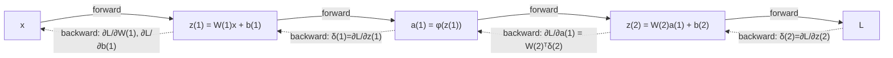

Język: [English](lecture.en.md) | **Polski**

# Wykład 03: Backpropagation, reguła łańcuchowa i automatyczne różniczkowanie

## Cele wykładu

Po tym wykładzie powinieneś/powinnaś umieć:

1. przypomnieć sobie pochodną, pochodną cząstkową i regułę łańcuchową, i rozpoznać je w grafie obliczeniowym,
2. odczytać mały graf obliczeniowy i wskazać w nim: wartości z propagacji w przód, lokalne pochodne i **gradient napływający** (*upstream gradient*) w każdym węźle,
3. wyprowadzić *ręcznie*, krok po kroku, gradienty wag i biasów dla sieci z jedną warstwą ukrytą — najpierw skalarnie, potem w postaci macierzowej dla całego batcha,
4. zaimplementować i zweryfikować te gradienty trzema niezależnymi metodami: wzorem ręcznym, `autograd` i różnicami skończonymi — i wiedzieć, kiedy ta ostatnia metoda zawodzi,
5. używać poprawnie `requires_grad`, `backward()`, `.grad`, `zero_grad()` i `detach()`, i wyjaśnić, dlaczego gradienty się **akumulują**, jeśli się ich nie wyzeruje,
6. wyjaśnić, dlaczego backpropagation jest efektywny obliczeniowo, i na przykładzie zmierzonych (nie tylko opisanych) norm gradientu zademonstrować, dlaczego nasycone aktywacje prowadzą do zanikania gradientu w głębszych sieciach.

## Dlaczego to jest ważne

W wykładzie 1 liczyliśmy gradient dla jednego neuronu liniowego ręcznie. W wykładzie 2 zbudowaliśmy MLP i *użyliśmy* `loss.backward()`, nie pytając, co dokładnie się pod spodem dzieje. Ten wykład domyka tę lukę: backpropagation to nie magiczna czarna skrzynka, tylko systematyczne, efektywne zastosowanie reguły łańcuchowej do grafu, w którym węzłami są operacje tensorowe. Zrozumienie tego mechanizmu jest tym, co odróżnia umiejętność *wywoływania* PyTorch od umiejętności **debugowania** sieci, która się nie uczy, eksploduje liczbowo albo uczy się dziwnie wolno — a to są sytuacje, z którymi spotkasz się wielokrotnie w dalszych modułach i w praktyce inżynierskiej.

## Intuicja

### Co dokładnie jest propagowane wstecz

Nie propagujemy wstecz "błędów" w jakimś magicznym sensie — propagujemy **liczby mówiące, jak bardzo strata zmieniłaby się, gdyby dana wielkość pośrednia zmieniła się nieznacznie**. To dokładnie to samo pojęcie gradientu, które poznałeś/aś w wykładzie 1, tylko teraz liczone nie tylko dla parametrów, ale dla *każdego* węzła pośredniego grafu (wyjść warstw ukrytych, sum ważonych, itd.) — bo to właśnie przez te węzły gradient musi "przejść", żeby dotrzeć od straty do wag pierwszej warstwy.

### Dlaczego gradienty wcześniejszych warstw zależą od późniejszych

Strata $L$ jest funkcją *złożoną*: zależy od wyjścia sieci, które zależy od ostatniej warstwy ukrytej, która zależy od przedostatniej, i tak dalej, aż do wag pierwszej warstwy. Reguła łańcuchowa mówi, że pochodna takiej złożonej funkcji to **iloczyn** pochodnych cząstkowych wzdłuż ścieżki. Żeby policzyć $\partial L/\partial W^{(1)}$ (wagi *pierwszej* warstwy), musimy więc "przejść" przez wszystko, co leży między $W^{(1)}$ a $L$ — czyli przez wszystkie późniejsze warstwy. To nie jest wybór implementacyjny, to konsekwencja tego, że sieć jest złożeniem funkcji.

### Dlaczego to jest efektywne

Naiwna alternatywa — policzyć $\partial L/\partial \theta_j$ osobno dla każdego parametru $\theta_j$ (np. metodą różnic skończonych, patrz sekcja *Matematyka*) — wymaga osobnej propagacji w przód dla każdego parametru z osobna. Sieć z milionem parametrów to milion (lub więcej) przebiegów do policzenia wszystkich gradientów. Backpropagation liczy **wszystkie** gradienty w jednym przebiegu wstecznym, kosztem porównywalnym do jednego przebiegu w przód — bo **współdzieli** już policzone gradienty napływające (`δ`) między wszystkimi parametrami, które przyczyniają się do danego węzła. To jest cała tajemnica efektywności: nie liczymy tego samego dwa razy.

## Formalny model

Przypomnienie notacji z wykładu 2, teraz uzupełnione o gradienty: sieć z jedną warstwą ukrytą,

$$z^{(1)} = W^{(1)} x + b^{(1)}, \qquad a^{(1)} = \phi(z^{(1)}), \qquad z^{(2)} = W^{(2)} a^{(1)} + b^{(2)}, \qquad \hat{y} = z^{(2)}$$

(wyjście liniowe — regresja, kontynuacja MSE z wykładu 1, nie klasyfikacja BCE z wykładu 2 — to świadomy wybór, żeby nie mieszać dwóch nowych rzeczy naraz). Strata dla jednego przykładu: $\ell = (\hat{y}-y)^2$; dla batcha $N$ przykładów: $L = \frac{1}{N}\sum_i \ell_i$.

**To, czego szukamy:** $\dfrac{\partial L}{\partial W^{(1)}}$, $\dfrac{\partial L}{\partial b^{(1)}}$, $\dfrac{\partial L}{\partial W^{(2)}}$, $\dfrac{\partial L}{\partial b^{(2)}}$ — żeby móc wykonać krok spadku gradientu, dokładnie jak w wykładzie 1.

**Ważne rozróżnienie, do którego wrócimy w sekcji o błędnych przekonaniach:** backpropagation **oblicza gradient**. To, co robi z tym gradientem — $\theta \leftarrow \theta - \eta \nabla L$ albo coś bardziej wyrafinowanego — to zadanie **optymalizatora** (wykład 4). `loss.backward()` nie zmienia żadnego parametru; zmienia tylko atrybut `.grad`.

## Matematyka

### Przypomnienie: pochodna, pochodna cząstkowa, reguła łańcuchowa

Dla funkcji jednej zmiennej $f(x)$, pochodna $f'(x)$ mówi, jak szybko $f$ rośnie w $x$. Dla funkcji wielu zmiennych $f(x_1, \dots, x_n)$, pochodna cząstkowa $\partial f/\partial x_i$ to pochodna $f$ po $x_i$ przy ustalonych pozostałych zmiennych — dokładnie to liczyliśmy w wykładzie 1 dla $w$ i $b$ osobno.

**Reguła łańcuchowa** dla złożenia $L = f(g(x))$: $\dfrac{dL}{dx} = \dfrac{df}{dg}\cdot\dfrac{dg}{dx}$. Dla dłuższego łańcucha $L = f_n(f_{n-1}(\dots f_1(x)\dots))$, pochodna to iloczyn $n$ lokalnych pochodnych — jedna za każdy "krok" grafu. To jest cała matematyka, na której stoi backpropagation; reszta to **księgowość**: w jakiej kolejności i ile razy każdą lokalną pochodną policzyć i wykorzystać.

### Graf obliczeniowy — przykład skalarny

Rozważmy jeden neuron z aktywacją sigmoid i stratą MSE względem celu $t$:

$$u = wx, \qquad v = u + b, \qquad a = \sigma(v), \qquad L = (a-t)^2$$

To jest graf o czterech węzłach pośrednich, każdy z jedną lokalną pochodną:

| węzeł | operacja | lokalna pochodna |
|---|---|---|
| $u$ | $u = wx$ | $\partial u/\partial w = x$, $\quad \partial u/\partial x = w$ |
| $v$ | $v = u+b$ | $\partial v/\partial u = 1$, $\quad \partial v/\partial b = 1$ |
| $a$ | $a = \sigma(v)$ | $\partial a/\partial v = \sigma(v)\big(1-\sigma(v)\big) = a(1-a)$ (wykład 2) |
| $L$ | $L = (a-t)^2$ | $\partial L/\partial a = 2(a-t)$ |

**Propagacja w przód** (*forward pass*) to policzenie $u, v, a, L$ w tej kolejności, od wejścia do straty. **Propagacja wstecz** (*backward pass*) to policzenie pochodnych w kolejności *odwrotnej*, od straty do wejścia, mnożąc kolejne lokalne pochodne:

$$\underbrace{\frac{\partial L}{\partial v}}_{=:\ \delta_v} = \frac{\partial L}{\partial a}\cdot\frac{\partial a}{\partial v} = 2(a-t)\cdot a(1-a)$$

Nazwijmy $\delta_v := \partial L/\partial v$ **gradientem napływającym** (*upstream gradient*) do węzła $v$ — to liczba, którą obliczamy **raz** i wykorzystujemy do *wszystkiego*, co leży za $v$ w stronę wejścia:

$$\frac{\partial L}{\partial w} = \delta_v \cdot \frac{\partial v}{\partial u}\cdot\frac{\partial u}{\partial w} = \delta_v \cdot 1 \cdot x = \delta_v\, x, \qquad \frac{\partial L}{\partial b} = \delta_v \cdot \frac{\partial v}{\partial b} = \delta_v$$

To jest właśnie ten moment, w którym widać efektywność: $\delta_v$ policzyliśmy jeden raz, a użyliśmy go do obu gradientów ($w$ i $b$) bez ponownego przechodzenia przez $a$ i $L$.

### Lokalna pochodna, gradient napływający, gradient, Jacobian — cztery różne pojęcia

Te słowa bywają mylone, więc rozróżnijmy je precyzyjnie, bez pełnego formalizmu rachunku macierzowego:

- **Lokalna pochodna** (*local derivative*) — pochodna wyjścia *jednego* węzła względem jego bezpośrednich wejść, licząc tak, jakby reszta grafu nie istniała (np. $\partial a/\partial v = a(1-a)$ powyżej).
- **Gradient napływający** (*upstream gradient*) — $\partial L/\partial(\text{wyjście węzła})$: ile strata zmieniłaby się, gdyby wyjście *tego* węzła nieznacznie się zmieniło, uwzględniając **całą** resztę grafu za nim. To jest to, co backpropagation przekazuje z węzła do węzła, mnożąc je przez kolejne lokalne pochodne (jak $\delta_v$ wyżej).
- **Gradient** (w kontekście treningu) — zwykle: $\partial L/\partial\theta$ dla konkretnego parametru $\theta$ — iloczyn gradientu napływającego do węzła, w którym $\theta$ "wchodzi" do grafu, i lokalnej pochodnej tego węzła względem $\theta$.
- **Jacobian** — gdy węzeł ma wejście *i* wyjście wektorowe (np. $z = Wx+b$: wejście $x\in\mathbb R^n$, wyjście $z\in\mathbb R^m$), lokalna "pochodna" to macierz $m\times n$ pochodnych cząstkowych każdej współrzędnej wyjścia względem każdej współrzędnej wejścia — to jest Jacobian. Dla $z=Wx+b$ Jacobian względem $x$ to po prostu $W$. Dla funkcji aktywacji stosowanej **element po elemencie** ($a_i = \phi(z_i)$, żaden $a_i$ nie zależy od $z_j$ dla $j\neq i$) Jacobian jest **macierzą diagonalną** z $\phi'(z_i)$ na przekątnej — dlatego w praktyce (i w sekcji niżej) backward przez aktywację elementwise to zwykłe mnożenie po współrzędnych ($\odot$), a nie pełne mnożenie macierzowe: mnożenie przez macierz diagonalną **jest** mnożeniem po współrzędnych.

### Backpropagation dla sieci z jedną warstwą ukrytą — wyprowadzenie skalarne → macierzowe

Zacznijmy od pojedynczego przykładu (nie batcha), żeby każdy krok był jawny, a potem uogólnijmy na batch.

**Warstwa wyjściowa.** $\hat y = z^{(2)}$ (liniowe wyjście), $\ell = (\hat y - y)^2$:

$$\delta^{(2)} := \frac{\partial \ell}{\partial z^{(2)}} = \frac{\partial \ell}{\partial \hat y}\cdot\frac{\partial \hat y}{\partial z^{(2)}} = 2(\hat y - y)\cdot 1 = 2(\hat y-y)$$

Ponieważ $z^{(2)} = W^{(2)} a^{(1)} + b^{(2)}$, lokalne pochodne względem parametrów to $\partial z^{(2)}/\partial W^{(2)} = a^{(1)}$ (w sensie: każdy element $W^{(2)}_{jk}$ mnoży $a^{(1)}_k$) i $\partial z^{(2)}/\partial b^{(2)} = 1$, więc:

$$\frac{\partial \ell}{\partial W^{(2)}} = \delta^{(2)} \big(a^{(1)}\big)^\top, \qquad \frac{\partial \ell}{\partial b^{(2)}} = \delta^{(2)}$$

(iloczyn zewnętrzny $\delta^{(2)}(a^{(1)})^\top$ ma kształt zgodny z $W^{(2)}$ — to jest sposób, w jaki sprawdzamy się przy pisaniu kodu: *kształty muszą się zgadzać*).

**Propagacja do warstwy ukrytej.** Żeby iść dalej wstecz, potrzebujemy $\partial \ell/\partial a^{(1)}$ — jak strata zależy od *wyjścia* warstwy ukrytej. Ponieważ $z^{(2)} = W^{(2)} a^{(1)} + b^{(2)}$ jest przekształceniem liniowym $a^{(1)}$, jego Jacobian względem $a^{(1)}$ to $W^{(2)}$, więc gradient propagujemy, mnożąc przez **transponowaną** macierz wag:

$$\frac{\partial \ell}{\partial a^{(1)}} = \big(W^{(2)}\big)^\top \delta^{(2)}$$

Stąd, przez aktywację (Jacobian diagonalny, patrz wyżej — mnożenie po współrzędnych):

$$\delta^{(1)} := \frac{\partial \ell}{\partial z^{(1)}} = \frac{\partial \ell}{\partial a^{(1)}} \odot \phi'\big(z^{(1)}\big) = \Big[\big(W^{(2)}\big)^\top \delta^{(2)}\Big] \odot \phi'\big(z^{(1)}\big)$$

I analogicznie jak dla warstwy drugiej:

$$\frac{\partial \ell}{\partial W^{(1)}} = \delta^{(1)} x^\top, \qquad \frac{\partial \ell}{\partial b^{(1)}} = \delta^{(1)}$$

Ten sam wzór $\delta \mapsto \delta \cdot (\text{wejście})^\top$ dla wag i $\delta \mapsto \delta$ dla biasu powtarza się w każdej warstwie — to jest ten "powtarzalny krok", który w sieci o $K$ warstwach wykonujemy $K$ razy, raz na warstwę, idąc od wyjścia do wejścia (liczbę warstw oznaczamy $K$, tak jak w wykładzie 2 — $L$ w tym kursie zawsze oznacza stratę).

### Wersja wsadowa (batch)

Powyżej $\delta^{(l)}$ był gradientem napływającym do warstwy $l$ **dla
jednego przykładu** — wektorem o tylu wpisach, ile neuronów ma ta warstwa
(np. $\delta^{(1)}\in\mathbb R^{m}$ dla warstwy ukrytej o $m$ neuronach).
Dla batcha $N$ przykładów ten sam gradient liczymy dla każdego przykładu
naraz — dostajemy więc nie wektor, a **macierz** $\Delta^{(l)}\in\mathbb
R^{N\times m}$: jeden **wiersz** na przykład, dokładnie taki sam wektor
$\delta^{(l)}$, jaki policzylibyśmy dla tego przykładu z osobna. Dużą
literą $\Delta$ oznaczamy więc dalej to samo pojęcie co $\delta$ (gradient
napływający do danej warstwy), tylko zebrane dla wielu przykładów naraz —
nie jest to inny byt, tylko ten sam wektor powielony wierszami. Dzięki
temu te same wzory ($\delta \mapsto \dots$) przechodzą na $\Delta$
niemal bez zmian, tylko z transpozycjami/sumami dopasowanymi do kształtu
macierzy zamiast wektora (zobacz niżej).

W module 1 i 2 dane trzymaliśmy jako $X \in \mathbb{R}^{N\times n}$ (wiersz = przykład) — zgodnie z konwencją `nn.Linear`, $Z = XW^\top + b$. Zachowujemy tę konwencję. Niech $\hat Y, Y \in \mathbb{R}^{N\times 1}$, $L = \frac{1}{N}\sum_{i=1}^N (\hat y_i - y_i)^2$. Czynnik $\frac1N$ (uśrednienie straty po przykładach, jak w wykładzie 1) **musi** wejść do gradientu już na starcie propagacji wstecznej:

$$\Delta^{(2)} := \frac{\partial L}{\partial Z^{(2)}} = \frac{2}{N}\big(\hat Y - Y\big) \quad \in \mathbb{R}^{N\times 1}$$

$$\frac{\partial L}{\partial W^{(2)}} = \big(\Delta^{(2)}\big)^\top A^{(1)}, \qquad \frac{\partial L}{\partial b^{(2)}} = \sum_{i=1}^N \Delta^{(2)}_i$$

**Krótko o broadcastingu.** $b^{(2)}$ ma kształt $(k,)$ — jeden wpis na
neuron wyjściowy, bez wymiaru przykładów. Ale $A^{(1)}(W^{(2)})^\top$ ma
kształt $(N, k)$ — jeden wiersz na przykład. Żeby je dodać, NumPy/PyTorch
**broadcastuje** $b^{(2)}$: traktuje go tak, jakby miał kształt $(1, k)$,
i "powiela" (bez fizycznego kopiowania pamięci) wzdłuż wymiaru przykładów,
aż dopasuje się do $(N, k)$ — w efekcie ten sam wektor $b^{(2)}$ jest
dodawany do *każdego* z $N$ wierszy osobno. To ogólna zasada broadcastingu:
wymiar o rozmiarze 1 (albo nieobecny) jest rozciągany tak, by dopasować
się do większego wymiaru po drugiej stronie operacji — tutaj: wymiar
"przykłady" jest obecny w $A^{(1)}(W^{(2)})^\top$, a nieobecny w
$b^{(2)}$, więc to $b^{(2)}$ jest rozciągane, nie odwrotnie.

Dlaczego suma po przykładach dla biasu? Skoro w propagacji w przód
$b^{(2)}$ jest **dodawany do każdego** z $N$ wierszy przez broadcasting —
każdy przykład "widzi" ten sam bias — to w propagacji wstecz efekt tego
broadcastingu odwraca się w **sumowanie**: gradient biasu to suma
wkładów od wszystkich przykładów, które go użyły (stąd $\sum_{i=1}^N$ we
wzorach niżej, a nie np. średnia czy wartość z jednego przykładu). To
jeden z najczęstszych błędów przy ręcznej implementacji (zapomniane
sumowanie po batchu dla gradientu biasu) — wrócimy do tego w sekcji
*Częste błędne przekonania*.

Dalej, analogicznie do wersji skalarnej:

$$\frac{\partial L}{\partial A^{(1)}} = \Delta^{(2)} W^{(2)} \quad\in\mathbb{R}^{N\times m}, \qquad \Delta^{(1)} := \frac{\partial L}{\partial Z^{(1)}} = \frac{\partial L}{\partial A^{(1)}} \odot \phi'\big(Z^{(1)}\big)$$

$$\frac{\partial L}{\partial W^{(1)}} = \big(\Delta^{(1)}\big)^\top X, \qquad \frac{\partial L}{\partial b^{(1)}} = \sum_{i=1}^N \Delta^{(1)}_i$$

Każdy z tych wzorów ma kształt, który da się sprawdzić niezależnie od wartości liczbowych — $W^{(1)}\in\mathbb R^{m\times n}$, więc $\partial L/\partial W^{(1)}$ też musi mieć kształt $m\times n$; $(\Delta^{(1)})^\top X$ ma kształt $(m\times N)(N\times n) = m\times n$. ✓. Sprawdzanie kształtów *przed* sprawdzaniem wartości liczbowych to pierwsza linia obrony przed błędami w takiej implementacji — i dokładnie to robimy w notebooku i w laboratorium.

## Przykład rozwiązany

Policzmy ręcznie gradient dla pojedynczego neuronu z grafu skalarnego powyżej, z konkretnymi liczbami: $x=1{,}5$, $w=0{,}8$, $b=-0{,}3$, $t=1{,}0$.

$$u = wx = 0{,}8\cdot 1{,}5 = 1{,}2, \qquad v = u+b = 1{,}2-0{,}3 = 0{,}9$$

$$a = \sigma(0{,}9) \approx 0{,}7109, \qquad L = (a-t)^2 \approx (0{,}7109-1)^2 \approx 0{,}0836$$

$$a(1-a) \approx 0{,}7109\cdot 0{,}2891 \approx 0{,}2055, \qquad 2(a-t) \approx 2\cdot(-0{,}2891) \approx -0{,}5781$$

$$\delta_v = 2(a-t)\cdot a(1-a) \approx -0{,}5781 \cdot 0{,}2055 \approx -0{,}1188$$

$$\frac{\partial L}{\partial w} = \delta_v \cdot x \approx -0{,}1188\cdot 1{,}5 \approx -0{,}1782, \qquad \frac{\partial L}{\partial b} = \delta_v \approx -0{,}1188$$

W notebooku te same liczby wychodzą z `autograd` co do siódmego miejsca po przecinku, a z różnic skończonych — z dokładnością ograniczoną precyzją arytmetyki zmiennoprzecinkowej (zobacz sekcję *Co obserwujemy*).

## Eksperyment

Notebook [`examples.ipynb`](examples.ipynb):

1. **Graf skalarny: trzy metody** — gradient $\partial L/\partial w$, $\partial L/\partial b$ z przykładu rozwiązanego, policzony wzorem ręcznym, `autograd` i różnicami skończonymi (centralnymi): $\frac{\partial L}{\partial \theta}\approx \frac{L(\theta+h)-L(\theta-h)}{2h}$. To ten sam mechanizm "zweryfikuj wzór względem `autograd`", który w wykładzie 2 zastosowaliśmy do samej pochodnej aktywacji ($\sigma'$, $\tanh'$, $\text{ReLU}'$) — tu robimy to samo dla gradientu **całej straty** względem parametrów, czyli dla wyniku pełnego algorytmu propagacji wstecznej, nie pojedynczej funkcji.
2. **Wpływ kroku $h$ na różnice skończone** — wykres błędu względem `autograd` w funkcji $h$ (w `float64`): zbyt duże $h$ daje błąd obcięcia (przybliżenie przestaje być lokalne), zbyt małe $h$ daje błąd zaokrągleń (odejmowanie dwóch bliskich sobie liczb zmiennoprzecinkowych). Istnieje "najlepsze" $h$ pomiędzy.
3. **Sieć z jedną warstwą ukrytą, batch > 1: trzy metody** — te same trzy metody dla pełnej sieci (2 wejścia, kilka neuronów ukrytych z sigmoid, 1 wyjście liniowe), na batchu kilku przykładów, weryfikując **wszystkie cztery** gradienty ($W^{(1)}, b^{(1)}, W^{(2)}, b^{(2)}$) i ich **kształty**.
4. **Akumulacja gradientów** — dwa kolejne wywołania `backward()` bez `zero_grad()` pokazują, że `.grad` się *sumuje*, nie nadpisuje.
5. **`detach()` i przerwanie grafu** — dwie ścieżki prowadzą do tego samego węzła (jedna od parametru `w`, druga od niezależnego parametru `c`); po odcięciu pierwszej przez `.detach()` strata nadal wymaga gradientu (dzięki `c`), ale `w.grad` zostaje `None` — pokazuje to selektywność `detach()`, nie tylko fakt, że "coś się psuje".
6. **Nasycenie i zanikanie gradientu** — stos kilkunastu warstw z sigmoid/tanh/ReLU; mierzymy (nie zakładamy) normę gradientu wag w każdej warstwie i pokazujemy, jak zależy od głębokości i od wyboru aktywacji.

## Co obserwujemy

- Wzór ręczny i `autograd` zgadzają się praktycznie co do bitu (różnice rzędu $10^{-7}$–$10^{-8}$, czyli dokładnie na poziomie precyzji `float32`) — to nie jest przybliżenie, to ta sama matematyka liczona dwoma sposobami.
- Różnice skończone w `float32` przy "rozsądnie wyglądającym" $h=10^{-4}$ **nie** zawsze zgadzają się z `autograd` w granicach ciasnej tolerancji — dopiero w `float64`, z odpowiednio dobranym $h$ (rząd $10^{-5}$–$10^{-6}$ dla naszej skali danych), błąd spada do poziomu $10^{-12}$. Wykres błędu względem $h$ ma kształt litery U: po obu stronach optimum błąd rośnie, z innego powodu po każdej stronie (przy $h=10^{-1}$ błąd rzędu $10^{-4}$ od strony obcięcia, przy $h=10^{-8}$ błąd rzędu $10^{-9}$ od strony zaokrągleń).
- Gradient biasu w wersji wsadowej to suma po przykładach, nie pojedyncza wartość — kształt `(m,)`, nie `(N, m)`.
- Drugie wywołanie `backward()` bez `zero_grad()` daje `.grad` dwa razy większe niż pojedyncze wywołanie — gradienty się **dodają**.
- Wartość przepuszczona przez `.detach()` zatrzymuje propagację: parametry "przed" odciętym punktem dostają gradient zerowy (lub w ogóle `None`, jeśli to jedyna ścieżka do nich).
- Norma gradientu w stosie warstw sigmoid maleje drastycznie od ostatniej warstwy do pierwszej (w naszym eksperymencie o ok. 7–8 rzędów wielkości na 10 warstw, czyli dziesiątki milionów razy); dla tanh różnica między pierwszą a ostatnią warstwą to niecałe półtora raza — spadek praktycznie niezauważalny w porównaniu z sigmoid; dla ReLU różnica jest jeszcze mniejsza i nie jest jednostajnie malejąca z głębokością.

## Częste błędne przekonania

❌ `loss.backward()` aktualizuje parametry modelu.

✅ `backward()` tylko **oblicza** gradienty i zapisuje je w `.grad` każdego parametru z `requires_grad=True`. Aktualizację ($\theta \leftarrow \theta - \eta\nabla L$ albo coś bardziej złożonego) wykonuje dopiero `optimizer.step()` — osobny krok, osobna odpowiedzialność. Bez `optimizer.step()` (albo ręcznej aktualizacji jak w wykładzie 1) model się nie zmienia, niezależnie od tego, ile razy wywołasz `backward()`.

❌ Gradienty domyślnie się nadpisują przy każdym `backward()`, więc nie trzeba ich zerować.

✅ Domyślnie się **akumulują** (sumują) — to celowe zachowanie PyTorch (przydatne np. przy ręcznym sumowaniu strat z wielu mini-batchy przed jednym krokiem aktualizacji), ale bez jawnego `optimizer.zero_grad()` (albo `param.grad = None`) przed każdym nowym `backward()` gradienty z kolejnych kroków się sumują, dając nieprawidłowo duże aktualizacje.

❌ Sprawdzenie gradientu różnicami skończonymi w jednym punkcie dowodzi, że implementacja backpropagation jest poprawna wszędzie.

✅ Dowodzi tylko, że **w tym konkretnym punkcie**, przy wybranym $h$, obie metody się zgadzają w granicach błędu numerycznego. W punktach nieróżniczkowalnych (np. $z=0$ dla ReLU) różnice skończone dają wynik, który nie odpowiada żadnej jednoznacznie zdefiniowanej pochodnej — centralna różnica "uśrednia" dwie różne jednostronne pochodne. Gradient checking to silne, ale punktowe i przybliżone narzędzie diagnostyczne, nie dowód matematyczny.

❌ Głębsza sieć zawsze ma trudniejszy, wolniejszy trening z powodu liczby parametrów.

✅ Problem, który tu pokazujemy (zanikanie gradientu), nie bierze się z *liczby* parametrów, tylko z **mnożenia przez siebie wielu małych lokalnych pochodnych** (nasycone aktywacje mają pochodną $<1$, często $\ll 1$) wzdłuż długiej ścieżki w grafie. To mechanizm jakościowo inny niż "więcej parametrów = wolniej" — i jeden z powodów, dla których dobór aktywacji (wykład 2) ma znaczenie praktyczne, nie tylko estetyczne.

## Implikacje inżynierskie

- **Pamięć:** żeby policzyć gradient wstecz, trzeba pamiętać wartości pośrednie z propagacji w przód (tu: $z^{(1)}, a^{(1)}, z^{(2)}$) — to jest dokładnie to, co `autograd` robi automatycznie, budując graf w trakcie forward. Większe sieci i większe batch'e kosztują więc nie tylko czas, ale i pamięć proporcjonalną do rozmiaru tego zapamiętanego grafu.
- **Debugowanie przez kształty:** niezgodność kształtu tensora gradientu z kształtem parametru to najczęstszy sygnał błędu w ręcznej implementacji backpropagation (zapomniana suma po batchu, zapomniana transpozycja) — sprawdzanie kształtów to tania, natychmiastowa kontrola, zanim w ogóle spojrzysz na wartości liczbowe.
- **Akumulacja gradientów jako funkcja, nie tylko pułapka:** ta sama własność, która jest częstym źródłem błędów (patrz wyżej), bywa wykorzystywana celowo — np. do symulowania większego batcha niż mieści się w pamięci, przez sumowanie gradientów z kilku mniejszych przebiegów przed jednym `optimizer.step()`.
- **`detach()` w praktyce:** przydatny, gdy chcemy użyć wartości wyliczonej przez sieć (np. do logowania, do metryk, jako "zamrożony" cel) bez niepotrzebnego rozrastania grafu obliczeniowego i bez przypadkowego przepływu gradientu tam, gdzie go nie chcemy.
- **Dlaczego to ma znaczenie dla głębokich sieci:** zmierzone zanikanie gradientu w warstwach sigmoid to zapowiedź praktycznego problemu, z którym będziesz się mierzyć wprost przy sieciach rekurencyjnych (wykład 9) i przy wyborze optymalizatora (wykład 4) — tu wprowadzamy go jako zjawisko, które potrafisz zmierzyć, nie jako nazwę do zapamiętania.

## Co warto zapamiętać

- Backpropagation to reguła łańcuchowa zastosowana systematycznie do grafu, od straty do parametrów, z ponownym wykorzystaniem gradientu napływającego — nie osobny algorytm dla każdej warstwy.
- Gradient napływający (`δ`) policzony raz w danym węźle obsługuje wszystkie parametry zasilające ten węzeł — stąd efektywność: jeden przebieg wstecz, nie jeden na parametr.
- Backward przez przekształcenie liniowe $Wx+b$ mnoży przez $W^\top$; backward przez aktywację elementwise mnoży po współrzędnych przez $\phi'$ (bo jej Jacobian jest diagonalny).
- Gradient biasu sumuje się po przykładach w batchu — konsekwencja broadcastingu w propagacji w przód.
- `backward()` liczy gradient; aktualizację parametrów robi optymalizator — to dwa różne kroki.
- Gradienty się akumulują domyślnie; `zero_grad()` nie jest formalnością.
- Różnice skończone to przybliżenie z własnymi ograniczeniami (`float32` vs `float64`, dobór $h$, punkty nieróżniczkowalne) — użyteczne do weryfikacji, nie do dowodu.

## Pytania dla studentów

1. Dlaczego gradient wag pierwszej warstwy zależy od wag drugiej warstwy, a nie tylko od danych wejściowych?
2. Wyjaśnij własnymi słowami różnicę między "lokalną pochodną" a "gradientem napływającym" na przykładzie dowolnego węzła z grafu skalarnego z tego wykładu.
3. Dlaczego backward przez $z=Wx+b$ używa $W^\top$, a nie $W$?
4. Masz pętlę treningową, w której strata nie spada, mimo że sieć ma wystarczającą pojemność. Jedna z hipotez: zapomniane `zero_grad()`. Jak byś to sprawdził/a, patrząc na wartości `.grad` w kolejnych krokach?

## Bibliografia

- Rumelhart, D. E., Hinton, G. E., Williams, R. J. (1986). *Learning representations by back-propagating errors*. Nature, 323(6088), 533–536.
- Goodfellow, I., Bengio, Y., Courville, A. (2016). *Deep Learning*. MIT Press. https://www.deeplearningbook.org/ — rozdział 6.5 (Back-Propagation and Other Differentiation Algorithms).
- PyTorch Contributors. *Autograd mechanics* — dokumentacja. https://pytorch.org/docs/stable/notes/autograd.html
- PyTorch Contributors. *torch.autograd.gradcheck* — dokumentacja. https://pytorch.org/docs/stable/generated/torch.autograd.gradcheck.html

Pełne wpisy bibliograficzne: [`references/references.bib`](../../references/references.bib).
