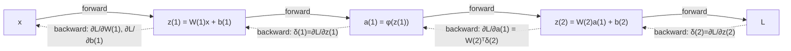

Język: [English](lecture.en.md) | **Polski**

# Wykład 03. Backpropagation, reguła łańcuchowa i automatyczne różniczkowanie

## Cele wykładu

1. przypomnieć pochodną, pochodną cząstkową i regułę łańcuchową oraz rozpoznać je w grafie obliczeniowym,
2. odczytać mały graf obliczeniowy i wskazać wartości z propagacji w przód, lokalne pochodne oraz **gradient napływający** (*upstream gradient*) w każdym węźle,
3. wyprowadzić krok po kroku gradienty wag i biasów dla sieci z jedną warstwą ukrytą, najpierw skalarnie, a następnie w postaci macierzowej dla całego batcha,
4. zaimplementować i zweryfikować te gradienty za pomocą wzoru analitycznego, `autograd` oraz różnic skończonych, a także określić ograniczenia ostatniej metody,
5. poprawnie używać `requires_grad`, `backward()`, `.grad`, `zero_grad()` i `detach()` oraz wyjaśnić akumulację niewyzerowanych gradientów,
6. wyjaśnić, dlaczego backpropagation jest efektywny obliczeniowo, i na przykładzie zmierzonych (nie tylko opisanych) norm gradientu zademonstrować, dlaczego nasycone aktywacje prowadzą do zanikania gradientu w głębszych sieciach.

## Dlaczego to jest ważne

Wykład 1 przedstawiał ręczne obliczenie gradientu dla neuronu liniowego. W wykładzie 2 funkcja `loss.backward()` została użyta do treningu MLP bez analizy jej działania. Backpropagation wypełnia tę lukę. Jest systematycznym i efektywnym zastosowaniem reguły łańcuchowej do grafu operacji tensorowych.

Znajomość tego mechanizmu jest potrzebna przy diagnozowaniu sieci, która nie uczy się, staje się niestabilna numerycznie albo zbiega bardzo wolno. Takie problemy pojawiają się zarówno w dalszych modułach, jak i w praktyce inżynierskiej.

## Intuicja

### Co dokładnie jest propagowane wstecz

Wstecz nie są propagowane abstrakcyjne "błędy", lecz **wartości opisujące zmianę straty po niewielkiej zmianie wielkości pośredniej**. Jest to ten sam gradient co w wykładzie 1, tym razem obliczany również dla węzłów pośrednich, takich jak wyjścia warstw ukrytych i sumy ważone. Gradient przechodzi przez te węzły od straty do wag pierwszej warstwy.

### Dlaczego gradienty wcześniejszych warstw zależą od późniejszych

Strata $L$ jest funkcją złożoną. Zależy od wyjścia sieci, ono od ostatniej warstwy ukrytej, a każda wcześniejsza wartość od poprzedniej, aż do wag pierwszej warstwy. Reguła łańcuchowa przedstawia pochodną takiej funkcji jako **iloczyn** pochodnych cząstkowych wzdłuż ścieżki. Obliczenie $\partial L/\partial W^{(1)}$ wymaga więc uwzględnienia wszystkich warstw między $W^{(1)}$ a $L$. Wynika to ze złożenia funkcji, a nie z decyzji implementacyjnej.

### Dlaczego to jest efektywne

Naiwne obliczanie $\partial L/\partial \theta_j$ osobno dla każdego parametru, na przykład metodą różnic skończonych, wymaga osobnej propagacji w przód dla każdej wartości $\theta_j$. Sieć z milionem parametrów potrzebowałaby co najmniej miliona takich przebiegów. Backpropagation wyznacza **wszystkie** gradienty w jednym przebiegu wstecznym, którego koszt jest porównywalny z propagacją w przód. Raz obliczone gradienty napływające (`δ`) są współdzielone przez parametry związane z danym węzłem, dzięki czemu te same obliczenia nie są powtarzane.

## Formalny model

Notację z wykładu 2 można uzupełnić o gradienty dla sieci z jedną warstwą ukrytą.

$$z^{(1)} = W^{(1)} x + b^{(1)}, \qquad a^{(1)} = \phi(z^{(1)}), \qquad z^{(2)} = W^{(2)} a^{(1)} + b^{(2)}, \qquad \hat{y} = z^{(2)}$$

Wyjście jest liniowe, ponieważ przykład dotyczy regresji i kontynuuje użycie MSE z wykładu 1. Dzięki temu klasyfikacja z BCE nie wprowadza dodatkowego zagadnienia. Strata dla jednego przykładu wynosi $\ell = (\hat{y}-y)^2$, a dla batcha $N$ przykładów $L = \frac{1}{N}\sum_i \ell_i$.

Potrzebne są gradienty $\dfrac{\partial L}{\partial W^{(1)}}$, $\dfrac{\partial L}{\partial b^{(1)}}$, $\dfrac{\partial L}{\partial W^{(2)}}$ i $\dfrac{\partial L}{\partial b^{(2)}}$. Pozwalają one wykonać krok spadku gradientu tak jak w wykładzie 1.

Backpropagation **oblicza gradient**, natomiast jego zastosowanie należy do **optymalizatora** omawianego w wykładzie 4. Może to być aktualizacja $\theta \leftarrow \theta - \eta \nabla L$ lub bardziej rozbudowana reguła. Wywołanie `loss.backward()` nie zmienia parametrów, lecz zapisuje wartości w atrybutach `.grad`.

## Matematyka

### Pochodna, pochodna cząstkowa i reguła łańcuchowa

Dla funkcji jednej zmiennej $f(x)$ pochodna $f'(x)$ opisuje tempo zmiany $f$ w punkcie $x$. W przypadku funkcji wielu zmiennych $f(x_1, \dots, x_n)$ pochodna cząstkowa $\partial f/\partial x_i$ jest obliczana względem $x_i$ przy ustalonych pozostałych zmiennych. W wykładzie 1 takie pochodne zostały wyznaczone osobno dla $w$ i $b$.

**Reguła łańcuchowa** dla złożenia $L = f(g(x))$ ma postać $\dfrac{dL}{dx} = \dfrac{df}{dg}\cdot\dfrac{dg}{dx}$. Dla dłuższego łańcucha $L = f_n(f_{n-1}(\dots f_1(x)\dots))$ pochodna jest iloczynem $n$ lokalnych pochodnych, po jednej dla każdego kroku grafu. Na tej własności opiera się backpropagation. Pozostała część algorytmu określa kolejność obliczania i ponownego wykorzystania lokalnych pochodnych.

### Graf obliczeniowy. Przykład skalarny

Przykład obejmuje jeden neuron z aktywacją sigmoid i stratą MSE względem celu $t$.

$$u = wx, \qquad v = u + b, \qquad a = \sigma(v), \qquad L = (a-t)^2$$

Graf zawiera cztery węzły pośrednie, z których każdy ma lokalną pochodną.

| węzeł | operacja | lokalna pochodna |
|---|---|---|
| $u$ | $u = wx$ | $\partial u/\partial w = x$, $\quad \partial u/\partial x = w$ |
| $v$ | $v = u+b$ | $\partial v/\partial u = 1$, $\quad \partial v/\partial b = 1$ |
| $a$ | $a = \sigma(v)$ | $\partial a/\partial v = \sigma(v)\big(1-\sigma(v)\big) = a(1-a)$ (wykład 2) |
| $L$ | $L = (a-t)^2$ | $\partial L/\partial a = 2(a-t)$ |

**Propagacja w przód** (*forward pass*) oblicza kolejno $u, v, a$ i $L$, od wejścia do straty. **Propagacja wstecz** (*backward pass*) przechodzi w odwrotnej kolejności, od straty do wejścia, i mnoży kolejne lokalne pochodne.

$$\underbrace{\frac{\partial L}{\partial v}}_{=:\ \delta_v} = \frac{\partial L}{\partial a}\cdot\frac{\partial a}{\partial v} = 2(a-t)\cdot a(1-a)$$

Wartość $\delta_v := \partial L/\partial v$ jest **gradientem napływającym** (*upstream gradient*) do węzła $v$. Wystarczy obliczyć ją **raz**, a następnie wykorzystać dla wszystkich ścieżek prowadzących od $v$ w stronę wejścia.

$$\frac{\partial L}{\partial w} = \delta_v \cdot \frac{\partial v}{\partial u}\cdot\frac{\partial u}{\partial w} = \delta_v \cdot 1 \cdot x = \delta_v\, x, \qquad \frac{\partial L}{\partial b} = \delta_v \cdot \frac{\partial v}{\partial b} = \delta_v$$

Na tym polega oszczędność obliczeń. Jedna wartość $\delta_v$ służy do wyznaczenia gradientów $w$ i $b$, bez ponownego przechodzenia przez $a$ oraz $L$.

### Lokalna pochodna, gradient napływający, gradient i Jacobian

Pojęcia te mają różne znaczenia, nawet bez wprowadzania pełnego formalizmu rachunku macierzowego.

- **Lokalna pochodna** (*local derivative*) opisuje zmianę wyjścia jednego węzła względem jego bezpośrednich wejść, niezależnie od reszty grafu. Przykładem jest $\partial a/\partial v = a(1-a)$.
- **Gradient napływający** (*upstream gradient*) ma postać $\partial L/\partial(\text{wyjście węzła})$. Określa zmianę straty po niewielkiej zmianie wyjścia danego węzła i uwzględnia całą dalszą część grafu. Backpropagation przekazuje tę wartość między węzłami i mnoży ją przez lokalne pochodne.
- **Gradient** w kontekście treningu zwykle oznacza $\partial L/\partial\theta$ dla parametru $\theta$. Jest iloczynem gradientu napływającego oraz lokalnej pochodnej węzła względem tego parametru.
- **Jacobian** dotyczy węzła z wejściem i wyjściem wektorowym. Dla $z = Wx+b$, gdzie $x\in\mathbb R^n$ i $z\in\mathbb R^m$, jest macierzą $m\times n$ pochodnych cząstkowych, a względem $x$ ma wartość $W$. Aktywacja stosowana element po elemencie, $a_i = \phi(z_i)$, ma Jacobian diagonalny z $\phi'(z_i)$ na przekątnej. Mnożenie przez taką macierz odpowiada mnożeniu po współrzędnych ($\odot$), stosowanemu w propagacji wstecznej przez aktywację.

### Backpropagation dla sieci z jedną warstwą ukrytą

Wyprowadzenie zaczyna się od pojedynczego przykładu, a następnie przechodzi do całego batcha.

**Warstwa wyjściowa.** $\hat y = z^{(2)}$ (liniowe wyjście), $\ell = (\hat y - y)^2$:

$$\delta^{(2)} := \frac{\partial \ell}{\partial z^{(2)}} = \frac{\partial \ell}{\partial \hat y}\cdot\frac{\partial \hat y}{\partial z^{(2)}} = 2(\hat y - y)\cdot 1 = 2(\hat y-y)$$

Ponieważ $z^{(2)} = W^{(2)} a^{(1)} + b^{(2)}$, lokalne pochodne względem parametrów to $\partial z^{(2)}/\partial W^{(2)} = a^{(1)}$ (w sensie: każdy element $W^{(2)}_{jk}$ mnoży $a^{(1)}_k$) i $\partial z^{(2)}/\partial b^{(2)} = 1$, więc:

$$\frac{\partial \ell}{\partial W^{(2)}} = \delta^{(2)} \big(a^{(1)}\big)^\top, \qquad \frac{\partial \ell}{\partial b^{(2)}} = \delta^{(2)}$$

Iloczyn zewnętrzny $\delta^{(2)}(a^{(1)})^\top$ ma kształt zgodny z $W^{(2)}$. Zgodność kształtów stanowi podstawową kontrolę poprawności implementacji.

**Propagacja do warstwy ukrytej.** Dalszy krok wymaga $\partial \ell/\partial a^{(1)}$, czyli zależności straty od wyjścia warstwy ukrytej. Przekształcenie $z^{(2)} = W^{(2)} a^{(1)} + b^{(2)}$ ma względem $a^{(1)}$ Jacobian równy $W^{(2)}$. Gradient jest więc mnożony przez **transponowaną** macierz wag.

$$\frac{\partial \ell}{\partial a^{(1)}} = \big(W^{(2)}\big)^\top \delta^{(2)}$$

Przejście przez aktywację wykorzystuje diagonalny Jacobian, czyli mnożenie po współrzędnych.

$$\delta^{(1)} := \frac{\partial \ell}{\partial z^{(1)}} = \frac{\partial \ell}{\partial a^{(1)}} \odot \phi'\big(z^{(1)}\big) = \Big[\big(W^{(2)}\big)^\top \delta^{(2)}\Big] \odot \phi'\big(z^{(1)}\big)$$

Gradienty pierwszej warstwy mają analogiczną postać.

$$\frac{\partial \ell}{\partial W^{(1)}} = \delta^{(1)} x^\top, \qquad \frac{\partial \ell}{\partial b^{(1)}} = \delta^{(1)}$$

W każdej warstwie powtarza się wzór $\delta \mapsto \delta \cdot (\text{wejście})^\top$ dla wag oraz $\delta \mapsto \delta$ dla biasu. Sieć o $K$ warstwach wykonuje ten krok $K$ razy, od wyjścia do wejścia. Symbol $K$ oznacza liczbę warstw, a $L$ pozostaje oznaczeniem straty.

### Wersja wsadowa (batch)

W przypadku jednego przykładu $\delta^{(l)}$ jest wektorem o tylu elementach, ile neuronów ma warstwa $l$. Dla warstwy ukrytej z $m$ neuronami zachodzi na przykład $\delta^{(1)}\in\mathbb R^{m}$. Batch złożony z $N$ przykładów daje **macierz** $\Delta^{(l)}\in\mathbb R^{N\times m}$, w której każdy wiersz zawiera gradient odpowiadający jednemu przykładowi. Symbol $\Delta$ oznacza zatem to samo pojęcie co $\delta$, ale zebrane dla całego batcha. Wzory wymagają jedynie dopasowania transpozycji i sum do kształtów macierzy.

Tak jak w modułach 1 i 2, dane mają postać $X \in \mathbb{R}^{N\times n}$, gdzie jeden wiersz odpowiada jednemu przykładowi. Jest to zgodne z konwencją `nn.Linear`, $Z = XW^\top + b$. Dla $\hat Y, Y \in \mathbb{R}^{N\times 1}$ strata wynosi $L = \frac{1}{N}\sum_{i=1}^N (\hat y_i - y_i)^2$. Czynnik $\frac1N$, wynikający z uśrednienia straty, **musi** pojawić się już na początku propagacji wstecznej.

$$\Delta^{(2)} := \frac{\partial L}{\partial Z^{(2)}} = \frac{2}{N}\big(\hat Y - Y\big) \quad \in \mathbb{R}^{N\times 1}$$

$$\frac{\partial L}{\partial W^{(2)}} = \big(\Delta^{(2)}\big)^\top A^{(1)}, \qquad \frac{\partial L}{\partial b^{(2)}} = \sum_{i=1}^N \Delta^{(2)}_i$$

**Broadcasting.** Bias $b^{(2)}$ ma kształt $(k,)$, czyli jeden element na neuron wyjściowy i brak wymiaru przykładów. Iloczyn $A^{(1)}(W^{(2)})^\top$ ma natomiast kształt $(N, k)$. Podczas dodawania NumPy lub PyTorch traktuje bias jak tablicę o kształcie $(1, k)$ i rozciąga ją wzdłuż wymiaru przykładów bez fizycznego kopiowania pamięci. Ten sam wektor jest dzięki temu dodawany do każdego z $N$ wierszy.

W propagacji wstecznej efekt broadcastingu prowadzi do **sumowania**. Gradient biasu jest sumą wkładów wszystkich przykładów, ponieważ każdy z nich korzystał z tego samego parametru. Stąd we wzorach występuje $\sum_{i=1}^N$, a nie średnia ani wartość dla pojedynczego przykładu. Pominięcie tej sumy jest częstym błędem w ręcznych implementacjach.

Dalsze obliczenia są analogiczne do wersji skalarnej.

$$\frac{\partial L}{\partial A^{(1)}} = \Delta^{(2)} W^{(2)} \quad\in\mathbb{R}^{N\times m}, \qquad \Delta^{(1)} := \frac{\partial L}{\partial Z^{(1)}} = \frac{\partial L}{\partial A^{(1)}} \odot \phi'\big(Z^{(1)}\big)$$

$$\frac{\partial L}{\partial W^{(1)}} = \big(\Delta^{(1)}\big)^\top X, \qquad \frac{\partial L}{\partial b^{(1)}} = \sum_{i=1}^N \Delta^{(1)}_i$$

Kształty można sprawdzić niezależnie od wartości liczbowych. Skoro $W^{(1)}\in\mathbb R^{m\times n}$, gradient $\partial L/\partial W^{(1)}$ również musi mieć kształt $m\times n$. Iloczyn $(\Delta^{(1)})^\top X$ ma kształt $(m\times N)(N\times n) = m\times n$. Taka kontrola jest pierwszą linią obrony przed błędami i pojawia się zarówno w notebooku, jak i w laboratorium.

## Przykład rozwiązany

Ręczne obliczenie gradientu dla neuronu z grafu skalarnego wykorzystuje wartości $x=1{,}5$, $w=0{,}8$, $b=-0{,}3$ i $t=1{,}0$.

$$u = wx = 0{,}8\cdot 1{,}5 = 1{,}2, \qquad v = u+b = 1{,}2-0{,}3 = 0{,}9$$

$$a = \sigma(0{,}9) \approx 0{,}7109, \qquad L = (a-t)^2 \approx (0{,}7109-1)^2 \approx 0{,}0836$$

$$a(1-a) \approx 0{,}7109\cdot 0{,}2891 \approx 0{,}2055, \qquad 2(a-t) \approx 2\cdot(-0{,}2891) \approx -0{,}5781$$

$$\delta_v = 2(a-t)\cdot a(1-a) \approx -0{,}5781 \cdot 0{,}2055 \approx -0{,}1188$$

$$\frac{\partial L}{\partial w} = \delta_v \cdot x \approx -0{,}1188\cdot 1{,}5 \approx -0{,}1782, \qquad \frac{\partial L}{\partial b} = \delta_v \approx -0{,}1188$$

Wyniki z `autograd` są zgodne do siódmego miejsca po przecinku. Dokładność różnic skończonych jest ograniczona przez arytmetykę zmiennoprzecinkową, co ilustruje sekcja *Obserwacje*.

## Eksperyment

Notebook [`examples.ipynb`](examples.ipynb) zawiera sześć eksperymentów.

1. **Graf skalarny i trzy metody.** Gradienty $\partial L/\partial w$ oraz $\partial L/\partial b$ są obliczane analitycznie, przez `autograd` i za pomocą centralnych różnic skończonych, $\frac{\partial L}{\partial \theta}\approx \frac{L(\theta+h)-L(\theta-h)}{2h}$. Wykład 2 porównywał te metody dla pochodnej aktywacji, a tutaj weryfikowany jest gradient całej straty względem parametrów.
2. **Wpływ kroku $h$ na różnice skończone.** Wykres przedstawia błąd względem `autograd` w funkcji $h$ dla `float64`. Zbyt duży krok powoduje błąd obcięcia, ponieważ przybliżenie przestaje być lokalne. Zbyt mały prowadzi do błędu zaokrągleń przy odejmowaniu bliskich liczb. Pomiędzy nimi znajduje się wartość optymalna dla danej skali problemu.
3. **Sieć z jedną warstwą ukrytą i batch większy niż 1.** Trzy metody są porównywane dla sieci z 2 wejściami, kilkoma neuronami sigmoid oraz 1 wyjściem liniowym. Sprawdzane są wartości i kształty wszystkich czterech gradientów $W^{(1)}, b^{(1)}, W^{(2)}$ oraz $b^{(2)}$.
4. **Akumulacja gradientów.** Dwa kolejne wywołania `backward()` bez `zero_grad()` pokazują, że wartości `.grad` są sumowane, a nie nadpisywane.
5. **`detach()` i przerwanie grafu.** Do jednego węzła prowadzą dwie ścieżki, od parametrów `w` i `c`. Po odcięciu pierwszej przez `.detach()` strata nadal wymaga gradientu dzięki `c`, ale `w.grad` pozostaje równe `None`. Pokazuje to selektywne działanie `detach()`.
6. **Nasycenie i zanikanie gradientu.** Dla stosu kilkunastu warstw z sigmoid, tanh lub ReLU mierzona jest norma gradientu wag w każdej warstwie. Wynik pokazuje jej zależność od głębokości i rodzaju aktywacji.

## Obserwacje

- Wzór analityczny i `autograd` dają niemal identyczne wyniki. Różnice rzędu $10^{-7}$–$10^{-8}$ odpowiadają precyzji `float32`. Obie metody wykonują te same obliczenia matematyczne.
- Różnice skończone w `float32` dla $h=10^{-4}$ nie zawsze mieszczą się w ciasnej tolerancji względem `autograd`. Przy `float64` i kroku rzędu $10^{-5}$–$10^{-6}$ błąd spada do około $10^{-12}$. Wykres ma kształt litery U. Dla $h=10^{-1}$ dominuje błąd obcięcia rzędu $10^{-4}$, a dla $h=10^{-8}$ błąd zaokrągleń rzędu $10^{-9}$.
- Gradient biasu dla batcha jest sumą po przykładach i ma kształt `(m,)`, a nie `(N, m)`.
- Drugie wywołanie `backward()` bez `zero_grad()` daje dwukrotnie większe `.grad`, ponieważ gradienty się **dodają**.
- Wartość przekazana przez `.detach()` zatrzymuje propagację. Parametry przed miejscem odcięcia otrzymują gradient zerowy albo `None`, jeśli była to ich jedyna ścieżka do straty.
- W stosie warstw sigmoid norma gradientu maleje od ostatniej warstwy do pierwszej o około 7–8 rzędów wielkości na 10 warstwach. Dla tanh różnica nie przekracza półtorakrotności, a dla ReLU jest jeszcze mniejsza i nie maleje jednostajnie wraz z głębokością.

## Częste błędne przekonania

❌ `loss.backward()` aktualizuje parametry modelu.

✅ `backward()` tylko **oblicza** gradienty i zapisuje je w `.grad` każdego parametru z `requires_grad=True`. Aktualizację $\theta \leftarrow \theta - \eta\nabla L$ lub bardziej złożoną operację wykonuje dopiero `optimizer.step()`. Bez tego kroku albo ręcznej aktualizacji model się nie zmienia.

❌ Gradienty domyślnie się nadpisują przy każdym `backward()`, więc nie trzeba ich zerować.

✅ Gradienty domyślnie się **akumulują**. To celowe zachowanie PyTorch, przydatne na przykład do łączenia wkładów z kilku małych batchy przed jedną aktualizacją. Bez `optimizer.zero_grad()` lub `param.grad = None` przed kolejnym `backward()` powstają jednak nieprawidłowo duże aktualizacje.

❌ Sprawdzenie gradientu różnicami skończonymi w jednym punkcie dowodzi, że implementacja backpropagation jest poprawna wszędzie.

✅ Taka kontrola potwierdza zgodność tylko **w konkretnym punkcie**, dla wybranego $h$ i w granicach błędu numerycznego. W punktach nieróżniczkowalnych, takich jak $z=0$ dla ReLU, centralna różnica uśrednia dwie różne pochodne jednostronne. Sprawdzanie gradientu jest użytecznym, ale punktowym i przybliżonym narzędziem diagnostycznym, a nie dowodem matematycznym.

❌ Głębsza sieć zawsze ma trudniejszy, wolniejszy trening z powodu liczby parametrów.

✅ Zanikanie gradientu nie wynika z samej liczby parametrów, lecz z **mnożenia wielu małych lokalnych pochodnych** wzdłuż długiej ścieżki grafu. Nasycone aktywacje mają pochodne mniejsze od 1, często znacznie. Jest to inny mechanizm niż większy koszt obliczeń dużego modelu i praktyczny powód starannego doboru aktywacji.

## Implikacje inżynierskie

- **Pamięć.** Propagacja wsteczna wymaga zachowania wartości pośrednich z przebiegu w przód, tutaj $z^{(1)}, a^{(1)}$ i $z^{(2)}$. `autograd` robi to automatycznie podczas budowania grafu. Większe sieci i batche zwiększają więc koszt pamięciowy, a nie tylko czas obliczeń.
- **Debugowanie przez kształty.** Niezgodność kształtu gradientu i parametru często wskazuje na brak sumowania po batchu albo brak transpozycji. Kontrola kształtów pozwala wykryć taki błąd przed analizą wartości liczbowych.
- **Celowa akumulacja gradientów.** Własność będąca częstym źródłem błędów może też symulować batch większy niż dostępna pamięć. Gradienty z kilku mniejszych przebiegów są wtedy sumowane przed jednym `optimizer.step()`.
- **`detach()` w praktyce.** Odłączenie przydaje się podczas logowania, obliczania metryk lub tworzenia zamrożonego celu. Zapobiega niepotrzebnemu rozrastaniu grafu i przepływowi gradientu do niepożądanej części modelu.
- **Głębokie sieci.** Zmierzone zanikanie gradientu w warstwach sigmoid zapowiada problem istotny między innymi dla sieci rekurencyjnych z wykładu 9. Wybór optymalizatora zostanie rozwinięty w wykładzie 4.

## Co warto zapamiętać

- Backpropagation systematycznie stosuje regułę łańcuchową od straty do parametrów i ponownie wykorzystuje gradient napływający. Nie jest osobnym algorytmem dla każdej warstwy.
- Gradient napływający (`δ`) obliczony w danym węźle służy wszystkim parametrom zasilającym ten węzeł. Wystarcza jeden przebieg wstecz zamiast osobnego przebiegu dla każdego parametru.
- Backward przez przekształcenie liniowe $Wx+b$ mnoży przez $W^\top$; backward przez aktywację elementwise mnoży po współrzędnych przez $\phi'$ (bo jej Jacobian jest diagonalny).
- Gradient biasu sumuje się po przykładach w batchu w wyniku broadcastingu użytego w propagacji w przód.
- `backward()` oblicza gradient, a optymalizator aktualizuje parametry. Są to dwa różne kroki.
- Gradienty się akumulują domyślnie; `zero_grad()` nie jest formalnością.
- Różnice skończone są przybliżeniem zależnym od precyzji, doboru $h$ i różniczkowalności badanego punktu. Służą do weryfikacji, a nie do dowodu.

## Pytania dla studentów

1. Dlaczego gradient wag pierwszej warstwy zależy od wag drugiej warstwy, a nie tylko od danych wejściowych?
2. Czym różni się lokalna pochodna od gradientu napływającego na przykładzie dowolnego węzła z grafu skalarnego?
3. Dlaczego backward przez $z=Wx+b$ używa $W^\top$, a nie $W$?
4. Jak wartości `.grad` w kolejnych krokach mogą potwierdzić, że brak spadku straty wynika z pominięcia `zero_grad()`?

## Bibliografia

- Rumelhart, D. E., Hinton, G. E., Williams, R. J. (1986). *Learning representations by back-propagating errors*. Nature, 323(6088), 533–536.
- Goodfellow, I., Bengio, Y., Courville, A. (2016). *Deep Learning*. MIT Press. https://www.deeplearningbook.org/. Rozdział 6.5 (*Back-Propagation and Other Differentiation Algorithms*) opisuje algorytmy różniczkowania.
- PyTorch Contributors. Dokumentacja *Autograd mechanics*. https://pytorch.org/docs/stable/notes/autograd.html
- PyTorch Contributors. Dokumentacja *torch.autograd.gradcheck*. https://pytorch.org/docs/stable/generated/torch.autograd.gradcheck.html

Pełne wpisy bibliograficzne znajdują się w [`references/references.bib`](../../references/references.bib).
