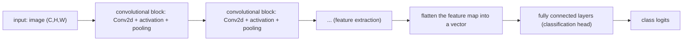

Language: **English (default)** | [Polski](lecture.md)

# Lecture 06: From pixels to features — convolutional neural networks

## Learning goals

After this lecture you should be able to:

1. write an image as a tensor in the NCHW convention and explain what each of the four dimensions means,
2. derive and compute by hand one value of a feature map for a convolution, and verify the result against `torch.nn.Conv2d`,
3. compute the output size of a convolutional layer (for a given kernel size, stride, padding) and its number of parameters — and compare it with a fully connected layer playing a comparable role,
4. distinguish translation equivariance from translation invariance and identify which of these properties convolution actually provides, and which pooling only partially provides,
5. build a simple CNN architecture (feature extraction → aggregation → classification head) and explain the role of each part,
6. interpret learned filters and feature maps without attributing more meaning to them than the data actually supports.

## Why this matters

So far, every model in this course has treated the input data as a vector of numbers with no built-in structure — an MLP does not "know" that two pixels sit next to each other, any more than it knows that two other pixels sit at opposite corners of the image. For images this is wasteful: the same pattern (an edge, a corner, a texture) can appear anywhere in the image, and a sensible model should recognize it wherever it appears, without learning it separately for every position. CNNs are the first architecture in this course where **the structure of the data** (the spatial neighborhood of pixels) directly shapes the network architecture, not just the choice of training hyperparameters.

## Intuition

### Why flattening an image is often inefficient

A $28\times28$ image flattened into a vector has $784$ elements — an MLP with a first hidden layer of $128$ neurons needs $784\times128 + 128 = 100{,}480$ parameters for that layer alone. Worse: the same pattern (e.g. a vertical edge) seen in the top-left corner and in the bottom-right corner is, for the flattened vector, a **completely different** set of input coordinates — the network has to learn to recognize this pattern **separately** at every possible location, because nothing in the architecture tells it that this is "the same" pattern, just shifted. Flattening also directly destroys the information about which pixels are neighbors in two dimensions — neighbors in a row of the image become neighbors in the vector, but neighbors in a column (`width` positions apart in the image) become `width` positions apart in the vector, with no privileging of "closeness" at all.

### Locality and weight sharing

A CNN builds two assumptions (*inductive biases*) about the structure of images directly into its architecture:

- **Locality**: whether there is an edge at a given location in the image depends on the pixels *in its immediate neighborhood*, not on pixels in the opposite corner of the image. That is why a convolutional filter only looks at a small, local window (e.g. $3\times3$), not the whole image at once.
- **Weight sharing**: the same filter (the same set of weights) is applied at **every** location in the image. If a filter has learned to detect a vertical edge in the top-left corner, it automatically detects it in the bottom-right corner too — because these are **literally the same numbers**, slid across the image, not separately learned copies.

This weight sharing is the source of a property called **translation equivariance**: if we shift the input pattern, the feature map shifts by *exactly the same amount* — convolution "does not know" where in the image it is looking, only what it sees locally.

❌ **This is not the same as translation invariance** — invariance would mean that the *output of the whole network* (e.g. a class prediction) does not change at all when the pattern is shifted. Convolution alone does not give you this — it only gives a shifted feature map. Pooling (section below) introduces some **local** tolerance to small shifts (because it aggregates a neighborhood into a single number), but this is not full, guaranteed invariance to large shifts — a deeper network with many pooling layers becomes *more* tolerant of shifts, not *fully* immune to them.

## Formal model

**An image as a tensor, the NCHW convention** (used by PyTorch): a tensor of shape $(N, C, H, W)$, where $N$ — batch size (number of images), $C$ — number of channels ($1$ for grayscale, $3$ for RGB), $H$ — height in pixels, $W$ — width in pixels. A single $32\times32$ RGB image in a batch of $64$ images is a tensor of shape $(64, 3, 32, 32)$.

**A convolutional layer** transforms a tensor $(N, C_{in}, H, W)$ into a tensor $(N, C_{out}, H', W')$ using $C_{out}$ filters, each of shape $(C_{in}, K, K)$ (assuming a square $K\times K$ filter) plus a bias. This is exactly `torch.nn.Conv2d(C_in, C_out, kernel_size=K, ...)`.

## Mathematics

### One feature-map value — the single-channel case

For an image $X$ (an $H\times W$ matrix) and a filter $K$ (a $k\times k$ matrix), the feature-map value at position $(i,j)$ is:

$$Y[i,j] = \sum_{p=0}^{k-1}\sum_{q=0}^{k-1} X[i+p,\, j+q]\cdot K[p,q] \;(+\, b)$$

— the **element-wise sum of products** between the patch of the image under the filter and the filter itself (plus a scalar bias $b$, if used), after which the filter "slides" by `stride` positions and we compute the next value.

### A note on terminology: convolution vs. cross-correlation

The formula above is **cross-correlation** — exactly what `torch.nn.Conv2d` computes (verified in the notebook: the manual formula with no filter flip agrees with `nn.Conv2d` within numerical tolerance, `torch.allclose(..., atol=1e-6)`). Mathematical **convolution** in the strict sense additionally requires flipping the filter: $Y[i,j] = \sum_{p,q} X[i-p,j-q]K[p,q]$. For training a network this difference is **practically irrelevant** — the network learns the filter weights from scratch anyway, so it would learn the flipped version if that were needed — but calling an operation that is, strictly speaking, cross-correlation a "convolutional layer" is a shorthand entrenched across the whole field, worth knowing explicitly.

### Output size: kernel size, stride, padding

For an input of size $H$ (analogously for $W$), filter size $K$, padding $P$ (number of zeros added on each side) and stride $S$ (the step by which the filter moves), standard convolution (no dilation) gives an output of size:

$$H' = \left\lfloor \frac{H + 2P - K}{S} \right\rfloor + 1$$

(verified in the test suite, `tests/test_lecture_06_notebook.py`, for $8$ fixed combinations of $H,K,S,P$ — matching `nn.Conv2d` to the pixel). Intuitions: a larger $K$ → a smaller output (the filter "eats" more of the border); $P>0$ → zeros added at the borders, to counteract the shrinking of the feature map (for $P=\lfloor K/2\rfloor$, $S=1$ the output has the same size as the input — so-called "same padding"); a larger $S$ → the filter "skips" pixels, giving a smaller output and fewer computations.

### Multiple input channels, multiple output filters

For $C_{in}>1$ input channels, a filter has shape $(C_{in}, k, k)$ — we also sum **over channels**:

$$Y[i,j] = \sum_{c=0}^{C_{in}-1}\sum_{p=0}^{k-1}\sum_{q=0}^{k-1} X[c, i+p, j+q]\cdot K[c,p,q] \;(+\, b)$$

A single filter always gives **one** output map, regardless of the number of input channels — to get $C_{out}$ output maps (i.e. $C_{out}$ output channels), you need $C_{out}$ independent filters, each of shape $(C_{in},k,k)$, each with its own bias.

### Number of parameters

$$\#\text{parameters} = \underbrace{(C_{in}\cdot k\cdot k)}_{\text{weights of one filter}} \cdot\, C_{out} \;+\; \underbrace{C_{out}}_{\text{biases}} = (C_{in} k^2 + 1)\, C_{out}$$

(verified in the test suite, `tests/test_lecture_06_notebook.py`, for $4$ configurations of $(C_{in},C_{out},k)$, including $k=5$ — matching `Conv2d` to the parameter). **Crucially, this formula does not depend on $H$ or $W$** — a convolutional layer has the same number of parameters regardless of whether the input image is $28\times28$ or $280\times280$ pixels (because the same small filter is just slid over a larger area). A fully connected layer (`Linear`) connecting a flattened image $C_{in}\times H\times W$ to $C_{out}$ outputs has $C_{in}\cdot H\cdot W\cdot C_{out} + C_{out}$ parameters — **growing directly in proportion to image size**. For a $28\times28\times1$ image and $32$ filters of size $3\times3$: the convolution has $(1\cdot9+1)\cdot32=320$ parameters; a `Linear` layer with the same number of outputs has $28\cdot28\cdot32+32=25{,}120$ parameters — **over $78\times$ more**.

❌ **This is not an automatic guarantee of better generalization.** Fewer parameters means a smaller model capacity (lecture 5) in this specific sense — but whether this helps or hurts generalization depends on whether the CNN's assumptions (locality, weight sharing) actually fit the structure of the data. For images they fit very well; for data with no spatial structure (e.g. the tabular features from module 5) convolution would have no justification at all.

### Intuition for gradient propagation through convolution

We fully derived the mechanics of the chain rule on a computational graph in lecture 3 — here only the intuition, not a repeat. Convolution is, for a fixed filter, a **linear** transformation of the input (a weighted sum, just like $Wx+b$) — so the gradient of the loss with respect to the filter weights is (analogously to lecture 3) a sum of products of the gradient flowing in from the feature map and the corresponding patches of the input, **over all the positions where this filter was used** (because the same weights participated in many computations — weight sharing forward means **summing** gradients backward, exactly as the bias summed over examples in lecture 3). The gradient with respect to the input propagates through an operation closely related to convolution with a flipped/transposed filter — `autograd` computes this automatically; you do not need to derive it by hand to use it correctly.

## Worked example

A $5\times5$ image, a $3\times3$ filter (a vertical-edge detector), stride $1$, no padding:

$$X = \begin{pmatrix}1&2&3&0&1\\0&1&2&3&1\\1&0&1&2&0\\2&1&0&1&3\\0&2&1&0&1\end{pmatrix}, \qquad K = \begin{pmatrix}1&0&-1\\1&0&-1\\1&0&-1\end{pmatrix}$$

The output has size $H'=\lfloor(5+0-3)/1\rfloor+1=3$, so $Y$ is a $3\times3$ matrix. Let's compute $Y[0,0]$ — the filter placed on the top-left corner of the image, the patch $X[0{:}3,0{:}3]=\begin{pmatrix}1&2&3\\0&1&2\\1&0&1\end{pmatrix}$:

$$Y[0,0] = (1\cdot1 + 2\cdot0 + 3\cdot(-1)) + (0\cdot1+1\cdot0+2\cdot(-1)) + (1\cdot1+0\cdot0+1\cdot(-1))$$
$$= (1+0-3) + (0+0-2) + (1+0-1) = -2 -2 + 0 = -4$$

Analogously for the remaining eight positions (full computation and verification in the notebook):

$$Y = \begin{pmatrix}-4&-2&4\\0&-4&-1\\1&0&-2\end{pmatrix}$$

— matching, within numerical tolerance (`atol=1e-6`), `torch.nn.Conv2d(1,1,kernel_size=3,bias=False)` after inserting the same filter as its weights.

## Experiment

Notebook [`examples.en.ipynb`](examples.en.ipynb), two experiments:

**A. Filters and feature maps** — a synthetic $12\times12$ image with a bright square on a dark background; manually defined filters (vertical/horizontal edge) show **what they actually detect** (verified numerically, not assumed) — a strong response exactly on the edges of the square, zero inside/outside; the effect of stride and padding on the output size; max pooling; comparison of a hand-designed filter with a filter learned during a short training run on a simple task.

**B. CNN vs. MLP on Fashion-MNIST** — a controlled comparison (the same data split, the same random seeds, a comparable training budget): a small MLP and a small CNN, reporting **accuracy, parameter count, and measured training/inference time together**, not accuracy alone. Selected first-layer filters and feature maps of the trained CNN, with an explicit comment on what can and cannot be inferred from them.

Both experiments run on CPU; the data (Fashion-MNIST, via `torchvision`) is downloaded automatically on first run (verified: ~5 seconds in this environment), and is never stored in the repository.

## What we observe

- A vertical-edge filter on a $6\times6$ square inside a $12\times12$ image gives a response of exactly zero inside and outside the square, and a strong (up to $\pm3$) response exactly on the left/right edge — opposite sign on each side. A horizontal-edge filter does the same for the top/bottom edge, zero on the left/right. This is not a coincidence — it is exactly what the formula predicts, and exactly what we measured, not what we assumed.
- On a controlled Fashion-MNIST comparison (8000 training images, 10 epochs, 3 random seeds): the CNN (about 20.5k parameters) reaches a test accuracy of $\approx0.85$–$0.86$; the MLP (about 118k parameters, **5.8× more**) reaches $\approx0.84$–$0.85$ — the CNN slightly but consistently better, with far fewer parameters.
- **But**: the CNN trains on CPU $\approx15\times$ **slower** than the MLP (about 12 s vs. about 0.8 s for 10 epochs on the same hardware) and does inference $\approx15$–$60\times$ slower on a single test batch — despite having fewer parameters. Fewer parameters **does not mean** fewer computations: each of the $320$ parameters of the first convolutional layer is **used many times** (once per filter position), while each parameter of a `Linear` layer is used once per example.
- The learned filters of the CNN's first layer **partially** resemble classic edge/contrast detectors known from hand-designed filters (not all of them — some have a less readable pattern) — this is an observation from one specific run, not a guarantee that it will always be the case.

## Common misconceptions

❌ A CNN "recognizes images" solely by applying hand-designed filters, such as the edge detectors from the example.

✅ The hand-designed filters (*Experiment* section) serve here **only to illustrate the mechanics** of convolution on a known, interpretable example. In a real, trained CNN, the weights of **all** filters are learned by gradient descent (lectures 3–4), just like MLP weights — the network finds filters useful for the task on its own, not necessarily ones with a simple, nameable interpretation.

❌ Weight sharing means that all filters in a given layer are identical.

✅ Weight sharing applies to **one** filter used at every spatial position in the image — but a convolutional layer usually has **many** filters ($C_{out}>1$), and each one has its **own, independently learned** set of weights. What is shared is the position in the image for one filter, not the identity of the filters among themselves.

❌ A larger kernel always gives better results (because it "sees more at once").

✅ A larger kernel sees a bigger local area at once, but at a cost: more parameters per filter ($k^2$ grows quadratically), more computation, and — paradoxically — sometimes a worse ability to detect small, local patterns that a smaller kernel captures better. Modern architectures often prefer **more layers of small kernels** (e.g. several $3\times3$ layers) instead of one layer with a large kernel, partly for this reason and partly because of the receptive field (below).

❌ Pooling is a mandatory component of every CNN.

✅ Pooling is one technique for reducing the size of the feature map (and gaining some local tolerance to shifts) — not the only one and not mandatory. Convolution with stride $>1$ does a similar size reduction without a separate pooling operation; some architectures (especially newer ones) drop pooling entirely in favor of stride.

❌ A larger number of filters guarantees better quality.

✅ More filters means more model capacity — as in lecture 5, more capacity can help, hurt (overfitting), or not change much, depending on the amount of data and the rest of the architecture. This needs experimental verification (the laboratory), it is not settled in advance.

❌ Feature maps clearly show named objects or concepts ("this filter detects cat ears").

✅ For the first layer, you can sometimes see recognizable patterns (edges, contrasts) — but already in deeper layers, feature maps respond to increasingly abstract, distributed combinations of the signal, which cannot be reliably labeled with a single caption without additional analytical tools (beyond the scope of this lecture). Looking at a feature map and "seeing" a familiar shape in it is often the observer's own projection, not a verified fact about what the network actually encodes.

❌ Lower parameter cost automatically means lower runtime.

✅ Measured directly: a CNN with $5.8\times$ fewer parameters than a comparable MLP trained on CPU $\approx15\times$ **slower**. Parameter count and the number of floating-point operations (FLOPs) are different measures — weight sharing means fewer parameters, but each of them is used many times, which increases, not decreases, the number of computations per example.

## Engineering implications

- **Memory for activations, not just parameters**: a CNN has few parameters, but its feature maps (intermediate activations) can be large — with $C_{out}=32$ filters on a $28\times28$ image that is $32\times28\times28\approx25{,}000$ numbers to store per example, for *every* layer, for the *whole* batch. For larger images/deeper networks this is often more of a memory bottleneck than the weights themselves.
- **Processing cost grows with image resolution faster than parameter count does**: convolution parameters do not depend on $H,W$ (*Mathematics* section), but the number of *operations* (and training/inference time) grows with the size of the feature map, i.e. roughly with $H\cdot W$ — doubling the image resolution in both dimensions is about $4\times$ more computation per convolutional layer.
- **Inference latency matters differently from parameter count**: the result measured in this lecture (the CNN being slower despite fewer parameters) is not an academic curiosity — it is a direct consequence for choosing an architecture with latency in mind, especially on CPU/edge devices.
- **The quality–size–cost trade-off is always three-dimensional, not one-dimensional**: a "better model" can mean higher accuracy, fewer parameters (memory), or shorter inference time (latency) — rarely all three at once, and the choice depends on what actually constrains a specific deployment.
- **Designing for constrained hardware**: for devices without a GPU (or with very limited memory), a deliberate choice of the number of filters, depth, and input resolution is a real engineering decision, not just a matter of maximizing accuracy at any cost.

## Receptive field — briefly

The **receptive field** of a neuron in a given layer is the region of the original input image that affects its value. For a single $3\times3$ layer, the receptive field is the $3\times3$ pixels of the input. After **two** consecutive $3\times3$ layers (stride 1), the receptive field grows to $5\times5$ (not $6\times6$ — each additional layer adds $k-1$ to each dimension, because neighboring neurons of the second layer overlap in the first). Deeper networks therefore have a larger receptive field without increasing the size of any single filter — this is one of the main reasons why CNNs are **deep** (many layers), rather than **wide** (large filters): a growing receptive field lets successive layers "see" an increasingly large context of the image, building representations from local edges (early layers) to increasingly global patterns (deeper layers).

## Classic CNN architecture

This scheme — alternating convolution/activation/pooling, several times, finishing with flattening and a few `Linear` layers — was already, in 1998, the **LeNet-5** architecture (LeCun et al.), one of the first practically useful CNNs, applied to recognizing handwritten digits. We do not develop a survey of architectures later than LeNet-5 here — pretrained models and transfer learning (including modern architectures) are the subject of lecture 7.

## What to remember

- Convolution = locality + weight sharing; the latter gives translation equivariance, not full invariance.
- `nn.Conv2d` computes cross-correlation, not mathematical convolution with a flipped filter — irrelevant for training, worth distinguishing terminologically.
- Output size: $\lfloor(H+2P-K)/S\rfloor+1$; parameter count: $(C_{in}k^2+1)C_{out}$ — independent of $H,W$, unlike `Linear`.
- Fewer parameters does not mean fewer computations — convolution shares weights, but performs more operations per example than a fully connected layer with a comparable number of weights.
- The receptive field grows with network depth — hence CNNs are usually deep, not just wide.
- Feature maps must be interpreted carefully — a visible pattern in the first layer does not automatically generalize to a "readable" interpretation of deeper layers.

## Questions for students

1. For a $32\times32\times3$ image and a `Conv2d(3, 16, kernel_size=5, stride=2, padding=2)` layer: what is the output shape, and how many parameters does this layer have? Compute it without running code, then verify.
2. Explain the difference between translation equivariance and invariance using this example: the same object appears once in the top-left corner of the image, once in the bottom-right corner. What exactly changes (and what does not) in the first convolutional layer's feature map?
3. The CNN in this lecture had fewer parameters than the MLP, but trained more slowly on CPU. Explain the mechanism, not just the fact.
4. Why is the receptive field after two $3\times3$ layers $5\times5$, not $6\times6$?

## References

- LeCun, Y., Bottou, L., Bengio, Y., Haffner, P. (1998). *Gradient-Based Learning Applied to Document Recognition*. Proceedings of the IEEE, 86(11), 2278–2324.
- Goodfellow, I., Bengio, Y., Courville, A. (2016). *Deep Learning*. MIT Press. https://www.deeplearningbook.org/ — chapter 9 (Convolutional Networks).
- Xiao, H., Rasul, K., Vollgraf, R. (2017). *Fashion-MNIST: a Novel Image Dataset for Benchmarking Machine Learning Algorithms*. arXiv:1708.07747.
- PyTorch Contributors. *torch.nn.Conv2d* — documentation. https://pytorch.org/docs/stable/generated/torch.nn.Conv2d.html

Full bibliographic entries: [`references/references.bib`](../../references/references.bib).
