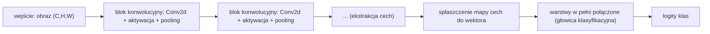

Język: [English](lecture.en.md) | **Polski**

# Wykład 06. Od pikseli do cech w konwolucyjnych sieciach neuronowych

## Cele wykładu

1. zapisać obraz jako tensor w konwencji NCHW i wyjaśnić, co oznacza każdy z czterech wymiarów,
2. wyprowadzić i ręcznie obliczyć jedną wartość mapy cech dla konwolucji oraz zweryfikować wynik względem `torch.nn.Conv2d`,
3. obliczyć wymiary wyjścia warstwy konwolucyjnej dla danego kernel size, stride i paddingu oraz porównać liczbę parametrów z warstwą w pełni połączoną,
4. rozróżnić równoważność względem przesunięcia (*translation equivariance*) od niezmienniczości (*translation invariance*) i wskazać, które z tych własności faktycznie zapewnia konwolucja, a które tylko częściowo pooling,
5. zbudować prostą architekturę CNN obejmującą ekstrakcję cech, agregację i głowicę klasyfikacyjną oraz wyjaśnić rolę każdej części,
6. zinterpretować wyuczone filtry i mapy cech, nie przypisując im więcej znaczenia, niż na to pozwalają dane.

## Dlaczego to jest ważne

Dotychczasowe modele traktowały wejście jako wektor liczb bez wbudowanej struktury. MLP nie rozróżnia pikseli sąsiadujących od leżących na przeciwnych krańcach obrazu. Tymczasem krawędź, róg lub tekstura mogą pojawić się w dowolnym miejscu i powinny być rozpoznawane bez osobnego uczenia dla każdej pozycji. CNN wprowadza do architektury informację o przestrzennym sąsiedztwie pikseli. Struktura danych wpływa więc bezpośrednio na budowę sieci.

## Intuicja

### Dlaczego spłaszczanie obrazu bywa nieefektywne

Obraz $28\times28$ spłaszczony do wektora ma $784$ elementy. Pierwsza warstwa MLP z $128$ neuronami wymaga $784\times128 + 128 = 100\,480$ parametrów. Ten sam wzorzec w różnych częściach obrazu odpowiada zupełnie innym współrzędnym wektora, więc sieć musi nauczyć się go osobno dla każdego położenia. Spłaszczanie usuwa także bezpośrednią informację o sąsiedztwie w dwóch wymiarach. Piksele sąsiadujące w kolumnie są oddalone w wektorze o `width` pozycji i nie otrzymują szczególnego traktowania.

### Lokalność i współdzielenie wag

CNN wbudowuje w architekturę dwa założenia (*inductive biases*) o strukturze obrazów:

- **Lokalność** (*locality*). Obecność krawędzi zależy przede wszystkim od pikseli w bezpośrednim sąsiedztwie. Filtr konwolucyjny analizuje więc małe lokalne okno, na przykład $3\times3$, zamiast całego obrazu naraz.
- **Współdzielenie wag** (*weight sharing*). Ten sam filtr jest stosowany w każdym położeniu obrazu. Filtr wykrywający pionową krawędź w jednym rogu wykrywa ją również w innym, ponieważ w każdym miejscu używany jest ten sam zestaw wag.

Współdzielenie wag prowadzi do **równoważności względem przesunięcia** (*translation equivariance*). Po przesunięciu wzorca wejściowego mapa cech przesuwa się w ten sam sposób. Konwolucja rozpoznaje lokalny układ niezależnie od jego położenia.

❌ **Nie jest to niezmienniczość względem przesunięcia** (*translation invariance*), która oznaczałaby brak zmiany wyjścia całej sieci po przesunięciu wzorca. Konwolucja daje jedynie przesuniętą mapę cech. Pooling wprowadza lokalną tolerancję na małe przesunięcia przez agregację sąsiedztwa, ale nie gwarantuje pełnej niezmienniczości. Głębsza sieć z wieloma warstwami poolingu może być bardziej tolerancyjna, lecz nie całkowicie odporna.

## Formalny model

**Obraz jako tensor w konwencji NCHW.** PyTorch używa kształtu $(N, C, H, W)$. $N$ oznacza liczbę obrazów w batchu, $C$ liczbę kanałów, $H$ wysokość, a $W$ szerokość. Skala szarości ma jeden kanał, a RGB trzy. Batch 64 obrazów RGB o rozmiarze $32\times32$ ma kształt $(64, 3, 32, 32)$.

**Warstwa konwolucyjna** przekształca tensor $(N, C_{in}, H, W)$ w tensor $(N, C_{out}, H', W')$ za pomocą $C_{out}$ filtrów, z których każdy ma kształt $(C_{in}, K, K)$ (zakładamy filtr kwadratowy $K\times K$) plus bias. To jest dokładnie `torch.nn.Conv2d(C_in, C_out, kernel_size=K, ...)`.

## Matematyka

### Jedna wartość mapy cech w przypadku jednokanałowym

Dla obrazu $X$ (macierz $H\times W$) i filtra $K$ (macierz $k\times k$), wartość mapy cech w pozycji $(i,j)$ to:

$$Y[i,j] = \sum_{p=0}^{k-1}\sum_{q=0}^{k-1} X[i+p,\, j+q]\cdot K[p,q] \;(+\, b)$$

Jest to **suma iloczynów element po elemencie** fragmentu obrazu i filtra, powiększona o skalarny bias $b$, jeśli jest używany. Następnie filtr przesuwa się o `stride` pozycji i obliczana jest kolejna wartość.

### Uwaga terminologiczna: konwolucja a korelacja wzajemna

Powyższy wzór opisuje **korelację wzajemną** (*cross-correlation*), czyli operację wykonywaną przez `torch.nn.Conv2d`. Notebook potwierdza zgodność ręcznego obliczenia bez odwracania filtra z `nn.Conv2d` przy `atol=1e-6`. Matematyczna konwolucja wymaga odwrócenia filtra i ma postać $Y[i,j] = \sum_{p,q} X[i-p,j-q]K[p,q]$. Różnica nie ma praktycznego znaczenia podczas uczenia, ponieważ wagi filtra są dopasowywane od zera. Określenie "warstwa konwolucyjna" pozostaje utrwalonym skrótem.

### Rozmiar wyjścia: kernel size, stride, padding

Dla wejścia o rozmiarze $H$ (analogicznie dla $W$), rozmiarze filtra $K$, paddingu $P$ (liczba dopisanych zer z każdej strony) i stride $S$ (krok przesunięcia filtra), standardowa konwolucja (bez dylatacji) daje wyjście o rozmiarze:

$$H' = \left\lfloor \frac{H + 2P - K}{S} \right\rfloor + 1$$

Testy w `tests/test_lecture_06_notebook.py` potwierdzają zgodność z `nn.Conv2d` dla ośmiu kombinacji $H,K,S,P$. Większy $K$ zmniejsza wyjście. Padding $P>0$ ogranicza kurczenie mapy cech, a dla $P=\lfloor K/2\rfloor$ i $S=1$ zachowuje rozmiar wejścia. Większy $S$ pomija część pozycji, zmniejszając wyjście i liczbę obliczeń.

### Wiele kanałów wejściowych, wiele filtrów wyjściowych

Dla $C_{in}>1$ kanałów wejściowych filtr ma kształt $(C_{in}, k, k)$, a suma obejmuje **także kanały**.

$$Y[i,j] = \sum_{c=0}^{C_{in}-1}\sum_{p=0}^{k-1}\sum_{q=0}^{k-1} X[c, i+p, j+q]\cdot K[c,p,q] \;(+\, b)$$

Jeden filtr zawsze daje jedną mapę wyjściową, niezależnie od liczby kanałów wejściowych. Uzyskanie $C_{out}$ map wymaga $C_{out}$ niezależnych filtrów o kształcie $(C_{in},k,k)$, każdy z własnym biasem.

### Liczba parametrów

$$\#\text{parametrów} = \underbrace{(C_{in}\cdot k\cdot k)}_{\text{wagi jednego filtra}} \cdot\, C_{out} \;+\; \underbrace{C_{out}}_{\text{biasy}} = (C_{in} k^2 + 1)\, C_{out}$$

Testy w `tests/test_lecture_06_notebook.py` potwierdzają wzór dla czterech konfiguracji, w tym $k=5$. **Liczba parametrów nie zależy od $H$ ani $W$**, ponieważ ten sam filtr jest przesuwany po całym obrazie. Warstwa `Linear` łącząca spłaszczony obraz $C_{in}\times H\times W$ z $C_{out}$ wyjściami ma $C_{in}\cdot H\cdot W\cdot C_{out} + C_{out}$ parametrów, więc jej rozmiar rośnie razem z obrazem. Dla obrazu $28\times28\times1$ i 32 filtrów $3\times3$ konwolucja ma 320 parametrów, a odpowiadająca warstwa `Linear` ma $25\,120$, czyli ponad $78\times$ więcej.

❌ **Nie gwarantuje to lepszej generalizacji.** Wpływ mniejszej liczby parametrów zależy od zgodności lokalności i współdzielenia wag ze strukturą danych. Założenia te dobrze pasują do obrazów, ale nie mają uzasadnienia dla cech tabularnych bez struktury przestrzennej.

### Intuicja propagacji gradientu przez konwolucję

Reguła łańcuchowa została wyprowadzona w wykładzie 3, dlatego tutaj wystarcza intuicja. Dla ustalonego filtra konwolucja jest liniowym przekształceniem wejścia. Gradient względem wag stanowi sumę iloczynów gradientu z mapy cech i odpowiednich fragmentów wejścia dla wszystkich pozycji użycia filtra. Współdzielenie wag w przód oznacza sumowanie gradientów w tył. Gradient wejścia korzysta z operacji związanej z konwolucją odwróconym lub transponowanym filtrem, a `autograd` oblicza go automatycznie.

## Przykład rozwiązany

Obraz $5\times5$, filtr $3\times3$ (detektor pionowej krawędzi), stride $1$, bez paddingu:

$$X = \begin{pmatrix}1&2&3&0&1\\0&1&2&3&1\\1&0&1&2&0\\2&1&0&1&3\\0&2&1&0&1\end{pmatrix}, \qquad K = \begin{pmatrix}1&0&-1\\1&0&-1\\1&0&-1\end{pmatrix}$$

Wyjście ma rozmiar $H'=\lfloor(5+0-3)/1\rfloor+1=3$, więc $Y$ jest macierzą $3\times3$. Dla filtra nałożonego na lewy górny róg fragment ma postać $X[0{:}3,0{:}3]=\begin{pmatrix}1&2&3\\0&1&2\\1&0&1\end{pmatrix}$.

$$Y[0,0] = (1\cdot1 + 2\cdot0 + 3\cdot(-1)) + (0\cdot1+1\cdot0+2\cdot(-1)) + (1\cdot1+0\cdot0+1\cdot(-1))$$
$$= (1+0-3) + (0+0-2) + (1+0-1) = -2 -2 + 0 = -4$$

Analogicznie dla pozostałych ośmiu pozycji (pełne wyliczenie i weryfikacja w notebooku):

$$Y = \begin{pmatrix}-4&-2&4\\0&-4&-1\\1&0&-2\end{pmatrix}$$

Wynik jest zgodny z `torch.nn.Conv2d(1,1,kernel_size=3,bias=False)` przy `atol=1e-6` po ustawieniu tych samych wag.

## Eksperyment

Notebook [`examples.ipynb`](examples.ipynb) zawiera dwa eksperymenty.

**A. Filtry i mapy cech.** Syntetyczny obraz $12\times12$ zawiera jasny kwadrat na ciemnym tle. Ręcznie zdefiniowane filtry pionowej i poziomej krawędzi pokazują silną odpowiedź na brzegach oraz zero wewnątrz i na zewnątrz. Eksperyment obejmuje też wpływ stride i paddingu na rozmiar wyjścia, max pooling oraz porównanie filtra ręcznego z wyuczonym.

**B. CNN kontra MLP na Fashion-MNIST.** Kontrolowane porównanie używa tego samego podziału danych, ziaren losowości i porównywalnego budżetu treningowego. Dla małego MLP i CNN raportowane są accuracy, liczba parametrów oraz zmierzony czas treningu i inferencji. Pokazane są również wybrane filtry pierwszej warstwy i mapy cech wraz z ograniczeniami ich interpretacji.

Oba eksperymenty działają na CPU. Dane Fashion-MNIST są pobierane przez `torchvision` przy pierwszym uruchomieniu i nie są przechowywane w repozytorium. W tym środowisku pobranie trwało około 5 sekund.

## Obserwacje

- Filtr pionowej krawędzi daje odpowiedź zero wewnątrz i na zewnątrz kwadratu oraz wartość do $\pm3$ na jego lewej i prawej krawędzi. Filtr poziomy zachowuje się analogicznie dla górnej i dolnej krawędzi. Wynik odpowiada wzorowi i został potwierdzony liczbowo.
- W porównaniu Fashion-MNIST obejmującym 8000 obrazów treningowych, 10 epok i 3 ziarna CNN z około 20,5 tys. parametrów osiąga accuracy $\approx0{,}85$–$0{,}86$. MLP z około 118 tys. parametrów, czyli **5,8× więcej**, osiąga $\approx0{,}84$–$0{,}85$. CNN jest nieznacznie, ale konsekwentnie lepsza.
- CNN trenuje się na CPU około $15\times$ wolniej niż MLP, odpowiednio około 12 s i 0,8 s, a inferencja na pojedynczym batchu jest $15$–$60\times$ wolniejsza. Mniejsza liczba parametrów nie oznacza mniejszej liczby operacji, ponieważ każda waga filtra jest używana w wielu położeniach.
- Część filtrów pierwszej warstwy przypomina klasyczne detektory krawędzi i kontrastu, ale nie wszystkie mają czytelny wzorzec. Jest to obserwacja z konkretnego przebiegu, a nie gwarancja.

## Częste błędne przekonania

❌ CNN "rozpoznaje obrazy", stosując wyłącznie ręcznie zaprojektowane filtry, takie jak detektory krawędzi z przykładu.

✅ Filtry ręczne służą wyłącznie do zilustrowania mechanizmu. W trenowanej CNN wagi wszystkich filtrów są uczone przez spadek gradientu, podobnie jak w MLP. Nie muszą mieć prostej interpretacji.

❌ Współdzielenie wag oznacza, że wszystkie filtry w danej warstwie są identyczne.

✅ Współdzielenie dotyczy jednego filtra używanego w każdej pozycji. Warstwa zwykle ma wiele filtrów i każdy z nich posiada własny niezależnie uczony zestaw wag.

❌ Większy kernel zawsze daje lepsze rezultaty (bo "widzi więcej naraz").

✅ Większy kernel obejmuje większy obszar, ale zwiększa liczbę parametrów i operacji oraz może gorzej wykrywać drobne wzorce. Dlatego często stosuje się kilka warstw $3\times3$ zamiast jednej warstwy z dużym kernelem.

❌ Pooling jest obowiązkowym elementem każdej CNN.

✅ Pooling jest jedną z metod redukcji mapy cech i zwiększenia lokalnej tolerancji na przesunięcia. Konwolucja ze stride $>1$ daje podobną redukcję, dlatego część architektur rezygnuje z osobnego poolingu.

❌ Większa liczba filtrów gwarantuje poprawę jakości.

✅ Więcej filtrów zwiększa pojemność modelu. Może to pomóc, zaszkodzić przez przeuczenie albo nie zmienić wyniku, dlatego wymaga sprawdzenia eksperymentalnego.

❌ Mapy cech pokazują jednoznacznie nazwane obiekty lub pojęcia ("ten filtr wykrywa uszy kota").

✅ W pierwszej warstwie bywają widoczne krawędzie i kontrasty. Głębsze mapy reagują na rozproszone, bardziej abstrakcyjne kombinacje sygnału i nie powinny otrzymywać jednoznacznych etykiet bez dodatkowej analizy.

❌ Niższy koszt parametrów oznacza automatycznie niższy czas wykonywania.

✅ CNN z $5{,}8\times$ mniejszą liczbą parametrów trenowała się na CPU około $15\times$ wolniej. Liczba parametrów i FLOPs to różne miary. Współdzielona waga jest używana wielokrotnie, co zwiększa liczbę operacji na przykład.

## Implikacje inżynierskie

- **Pamięć na aktywacje, nie tylko parametry.** CNN może mieć mało parametrów, a jednocześnie tworzyć duże mapy cech. Przy $C_{out}=32$ filtrach i obrazie $28\times28$ każda warstwa przechowuje około $32\times28\times28\approx25\,000$ liczb na jeden przykład. Dla większych obrazów, głębszych sieci i całego batcha aktywacje często zajmują więcej pamięci niż wagi.
- **Koszt obliczeń rośnie z rozdzielczością.** Liczba parametrów konwolucji nie zależy od $H,W$, ale liczba operacji rośnie w przybliżeniu wraz z $H\cdot W$. Podwojenie obu wymiarów obrazu oznacza około $4\times$ więcej obliczeń w warstwie konwolucyjnej.
- **Latencja i liczba parametrów opisują inne własności.** W przeprowadzonym eksperymencie CNN była wolniejsza mimo mniejszej liczby parametrów. Ma to bezpośrednie znaczenie przy wyborze architektury do pracy na CPU lub urządzeniu brzegowym.
- **Jakość, rozmiar i koszt tworzą osobne kryteria.** Lepszy model może osiągać wyższą accuracy, zajmować mniej pamięci albo działać szybciej. Rzadko poprawia wszystkie trzy miary jednocześnie, dlatego wybór zależy od ograniczeń wdrożenia.
- **Ograniczony sprzęt wpływa na projekt modelu.** Liczba filtrów, głębokość i rozdzielczość wejścia wymagają świadomego doboru, zwłaszcza na urządzeniach bez GPU lub z małą ilością pamięci.

## Pole recepcyjne

**Pole recepcyjne** (*receptive field*) neuronu obejmuje obszar obrazu wejściowego, który wpływa na jego wartość. Dla jednej warstwy $3\times3$ ma rozmiar $3\times3$. Po dwóch kolejnych warstwach $3\times3$ ze stride 1 rośnie do $5\times5$, a nie $6\times6$. Każda warstwa dodaje po $k-1$ w obu wymiarach, ponieważ sąsiednie neurony nakładają się na siebie.

Wraz z głębokością sieci pole recepcyjne rośnie bez zwiększania pojedynczego filtra. Kolejne warstwy mogą dzięki temu łączyć lokalne krawędzie w wzorce obejmujące coraz większą część obrazu. Jest to jeden z powodów stosowania wielu małych warstw zamiast pojedynczych dużych filtrów.

## Klasyczna architektura CNN

Taki układ zastosowano już w architekturze **LeNet-5** z 1998 roku (LeCun i in.), jednej z pierwszych praktycznie użytecznych CNN do rozpoznawania cyfr pisanych ręcznie. Bloki konwolucji, aktywacji i poolingu powtarzają się, a po nich następuje spłaszczenie i kilka warstw `Linear`. Nowsze architektury, modele pretrenowane i transfer learning są tematem wykładu 7.

## Co warto zapamiętać

- Konwolucja wykorzystuje lokalność i współdzielenie wag. Zapewnia równoważność względem przesunięcia, ale nie pełną niezmienniczość.
- `nn.Conv2d` oblicza korelację wzajemną, a nie matematyczną konwolucję z odwróconym filtrem. Nie zmienia to procesu uczenia, ale warto znać różnicę terminologiczną.
- Rozmiar wyjścia wynosi $\lfloor(H+2P-K)/S\rfloor+1$, a liczba parametrów $(C_{in}k^2+1)C_{out}$. W przeciwieństwie do `Linear` liczba parametrów nie zależy od $H,W$.
- Mniej parametrów nie musi oznaczać mniej obliczeń. Współdzielone wagi konwolucji są używane w wielu położeniach obrazu.
- Pole recepcyjne rośnie wraz z głębokością sieci. Pozwala to budować szerszy kontekst za pomocą małych filtrów.
- Interpretacja map cech wymaga ostrożności. Czytelny wzorzec w pierwszej warstwie nie oznacza równie prostej interpretacji warstw głębszych.

## Pytania dla studentów

1. Jaki kształt wyjścia i ile parametrów ma warstwa `Conv2d(3, 16, kernel_size=5, stride=2, padding=2)` dla obrazu $32\times32\times3$? Obliczenie należy wykonać bez uruchamiania kodu, a następnie zweryfikować.
2. Na czym polega różnica między równoważnością a niezmienniczością względem przesunięcia? Warto rozważyć ten sam obiekt umieszczony raz w lewym górnym, a raz w prawym dolnym rogu obrazu i określić zmiany na mapie cech pierwszej warstwy.
3. Z czego wynika wolniejszy trening CNN na CPU mimo mniejszej liczby parametrów niż w MLP?
4. Dlaczego pole recepcyjne po dwóch warstwach $3\times3$ wynosi $5\times5$, a nie $6\times6$?

## Bibliografia

- LeCun, Y., Bottou, L., Bengio, Y., Haffner, P. (1998). *Gradient-Based Learning Applied to Document Recognition*. Proceedings of the IEEE, 86(11), 2278–2324.
- Goodfellow, I., Bengio, Y., Courville, A. (2016). *Deep Learning*. MIT Press. https://www.deeplearningbook.org/, rozdział 9 (Convolutional Networks).
- Xiao, H., Rasul, K., Vollgraf, R. (2017). *Fashion-MNIST: a Novel Image Dataset for Benchmarking Machine Learning Algorithms*. arXiv:1708.07747.
- PyTorch Contributors. Dokumentacja *torch.nn.Conv2d*. https://pytorch.org/docs/stable/generated/torch.nn.Conv2d.html

Pełne wpisy bibliograficzne znajdują się w pliku [`references/references.bib`](../../references/references.bib).
