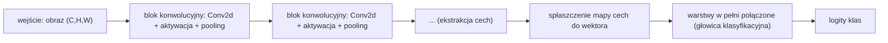

Język: [English](lecture.en.md) | **Polski**

# Wykład 06: Od pikseli do cech — konwolucyjne sieci neuronowe

## Cele wykładu

Po tym wykładzie powinieneś/powinnaś umieć:

1. zapisać obraz jako tensor w konwencji NCHW i wyjaśnić, co oznacza każdy z czterech wymiarów,
2. wyprowadzić i policzyć ręcznie jedną wartość mapy cech dla konwolucji, i zweryfikować wynik względem `torch.nn.Conv2d`,
3. policzyć wymiary wyjścia warstwy konwolucyjnej (dla danego kernel size, stride, paddingu) oraz liczbę jej parametrów — i porównać ją z warstwą w pełni połączoną o porównywalnej roli,
4. rozróżnić równoważność względem przesunięcia (*translation equivariance*) od niezmienniczości (*translation invariance*) i wskazać, które z tych własności faktycznie zapewnia konwolucja, a które tylko częściowo pooling,
5. zbudować prostą architekturę CNN (ekstrakcja cech → agregacja → głowica klasyfikacyjna) i wyjaśnić rolę każdej części,
6. zinterpretować wyuczone filtry i mapy cech, nie przypisując im więcej znaczenia, niż na to pozwalają dane.

## Dlaczego to jest ważne

Do tej pory każdy model w tym kursie traktował dane wejściowe jako wektor liczb bez wbudowanej struktury — MLP nie "wie", że dwa piksele leżą obok siebie, tak samo jak nie wie, że dwa inne piksele leżą na przeciwległych krańcach obrazu. Dla obrazów to marnotrawstwo: ten sam wzorzec (krawędź, róg, tekstura) może pojawić się w dowolnym miejscu obrazu, a sensowny model powinien rozpoznawać go tam, gdzie się pojawi, bez uczenia się go osobno dla każdej pozycji. CNN to pierwsza architektura w tym kursie, w której **struktura danych** (sąsiedztwo przestrzenne pikseli) bezpośrednio kształtuje architekturę sieci, a nie tylko dobór hiperparametrów treningu.

## Intuicja

### Dlaczego spłaszczanie obrazu bywa nieefektywne

Obraz $28\times28$ spłaszczony do wektora ma $784$ elementy — MLP z pierwszą warstwą ukrytą o $128$ neuronach potrzebuje na nią samą $784\times128 + 128 = 100\,480$ parametrów. Gorzej: ten sam wzorzec (np. pionowa krawędź) widziany w lewym górnym rogu i w prawym dolnym rogu to, dla spłaszczonego wektora, **zupełnie inne** zestawy współrzędnych wejściowych — sieć musi nauczyć się rozpoznawać ten wzorzec **osobno** w każdym możliwym położeniu, bo nic w architekturze nie mówi jej, że to "ten sam" wzorzec przesunięty. Spłaszczanie niszczy też bezpośrednio informację o tym, które piksele sąsiadują ze sobą w dwóch wymiarach — sąsiedzi w wierszu obrazu stają się sąsiadami w wektorze, ale sąsiedzi w kolumnie (odlegli o `width` pozycji w obrazie) stają się odlegli o `width` pozycji w wektorze, bez żadnego uprzywilejowania "bliskości".

### Lokalność i współdzielenie wag

CNN wbudowuje w architekturę dwa założenia (*inductive biases*) o strukturze obrazów:

- **Lokalność** (*locality*): to, czy w danym miejscu obrazu jest krawędź, zależy od pikseli *w jego bezpośrednim sąsiedztwie*, nie od pikseli w drugim rogu obrazu. Dlatego filtr konwolucyjny patrzy tylko na małe, lokalne okno (np. $3\times3$), nie na cały obraz naraz.
- **Współdzielenie wag** (*weight sharing*): ten sam filtr (ten sam zestaw wag) jest stosowany w **każdym** położeniu obrazu. Jeśli filtr nauczył się wykrywać pionową krawędź w lewym górnym rogu, automatycznie wykrywa ją też w prawym dolnym — bo to **dosłownie te same liczby**, przesuwane po obrazie, a nie osobno wyuczone kopie.

To współdzielenie wag jest źródłem własności zwanej **równoważnością względem przesunięcia** (*translation equivariance*): jeśli przesuniemy wzór wejściowy, mapa cech przesunie się *dokładnie tak samo* — konwolucja "nie wie", gdzie na obrazie patrzy, tylko co widzi lokalnie.

❌ **To nie jest to samo, co niezmienniczość względem przesunięcia** (*translation invariance*) — niezmienniczość oznaczałaby, że *wyjście całej sieci* (np. predykcja klasy) w ogóle się nie zmienia przy przesunięciu wzorca. Sama konwolucja tego nie daje — daje tylko przesuniętą mapę cech. Pooling (sekcja niżej) wprowadza pewną **lokalną** tolerancję na małe przesunięcia (bo agreguje sąsiedztwo do jednej liczby), ale to nie jest pełna, gwarantowana niezmienniczość na duże przesunięcia — głębsza sieć z wieloma warstwami poolingu staje się *bardziej* tolerancyjna na przesunięcia, nie *w pełni* odporna na nie.

## Formalny model

**Obraz jako tensor, konwencja NCHW** (używana przez PyTorch): tensor o kształcie $(N, C, H, W)$, gdzie $N$ — rozmiar batcha (liczba obrazów), $C$ — liczba kanałów ($1$ dla skali szarości, $3$ dla RGB), $H$ — wysokość w pikselach, $W$ — szerokość w pikselach. Pojedynczy obraz RGB $32\times32$ w batchu $64$ obrazów to tensor $(64, 3, 32, 32)$.

**Warstwa konwolucyjna** przekształca tensor $(N, C_{in}, H, W)$ w tensor $(N, C_{out}, H', W')$ za pomocą $C_{out}$ filtrów, z których każdy ma kształt $(C_{in}, K, K)$ (zakładamy filtr kwadratowy $K\times K$) plus bias. To jest dokładnie `torch.nn.Conv2d(C_in, C_out, kernel_size=K, ...)`.

## Matematyka

### Jedna wartość mapy cech — przypadek jednokanałowy

Dla obrazu $X$ (macierz $H\times W$) i filtra $K$ (macierz $k\times k$), wartość mapy cech w pozycji $(i,j)$ to:

$$Y[i,j] = \sum_{p=0}^{k-1}\sum_{q=0}^{k-1} X[i+p,\, j+q]\cdot K[p,q] \;(+\, b)$$

— **suma iloczynów element po elemencie** fragmentu obrazu pod filtrem i samego filtra (plus skalarny bias $b$, jeśli używany), po czym filtr "przesuwa się" o `stride` pozycji i liczymy kolejną wartość.

### Uwaga terminologiczna: konwolucja a korelacja wzajemna

Wzór powyżej to **korelacja wzajemna** (*cross-correlation*) — dokładnie to, co liczy `torch.nn.Conv2d` (zweryfikowane w notebooku: ręczny wzór bez odwracania filtra zgadza się z `nn.Conv2d` w granicach tolerancji numerycznej, `torch.allclose(..., atol=1e-6)`). Matematyczna **konwolucja** w ścisłym sensie wymaga dodatkowo odwrócenia filtra: $Y[i,j] = \sum_{p,q} X[i-p,j-q]K[p,q]$. Dla uczenia sieci ta różnica **nie ma znaczenia praktycznego** — sieć i tak uczy się wag filtra od zera, więc nauczy się ich odwróconej wersji, jeśli to by było potrzebne — ale nazwa "warstwa konwolucyjna" dla operacji, która w ścisłym sensie jest korelacją wzajemną, to utrwalony w całej dziedzinie skrót myślowy, wart znajomości wprost.

### Rozmiar wyjścia: kernel size, stride, padding

Dla wejścia o rozmiarze $H$ (analogicznie dla $W$), rozmiarze filtra $K$, paddingu $P$ (liczba dopisanych zer z każdej strony) i stride $S$ (krok przesunięcia filtra), standardowa konwolucja (bez dylatacji) daje wyjście o rozmiarze:

$$H' = \left\lfloor \frac{H + 2P - K}{S} \right\rfloor + 1$$

(zweryfikowane w zestawie testów, `tests/test_lecture_06_notebook.py`, dla $8$ ustalonych kombinacji $H,K,S,P$ — zgodne z `nn.Conv2d` co do piksela). Intuicje: większy $K$ → mniejsze wyjście (filtr "zjada" więcej brzegu); $P>0$ → dopisanie zer po brzegach, żeby przeciwdziałać kurczeniu się mapy cech (dla $P=\lfloor K/2\rfloor$, $S=1$ wyjście ma ten sam rozmiar co wejście — tzw. "same padding"); większy $S$ → filtr "przeskakuje" piksele, wyjście mniejsze, mniej obliczeń.

### Wiele kanałów wejściowych, wiele filtrów wyjściowych

Dla $C_{in}>1$ kanałów wejściowych filtr ma kształt $(C_{in}, k, k)$ — sumujemy **także po kanałach**:

$$Y[i,j] = \sum_{c=0}^{C_{in}-1}\sum_{p=0}^{k-1}\sum_{q=0}^{k-1} X[c, i+p, j+q]\cdot K[c,p,q] \;(+\, b)$$

Jeden filtr zawsze daje **jedną** mapę wyjściową, niezależnie od liczby kanałów wejściowych — żeby dostać $C_{out}$ map wyjściowych (czyli $C_{out}$ kanałów na wyjściu), potrzeba $C_{out}$ niezależnych filtrów, każdy o kształcie $(C_{in},k,k)$, każdy ze swoim biasem.

### Liczba parametrów

$$\#\text{parametrów} = \underbrace{(C_{in}\cdot k\cdot k)}_{\text{wagi jednego filtra}} \cdot\, C_{out} \;+\; \underbrace{C_{out}}_{\text{biasy}} = (C_{in} k^2 + 1)\, C_{out}$$

(zweryfikowane w zestawie testów, `tests/test_lecture_06_notebook.py`, dla $4$ konfiguracji $(C_{in},C_{out},k)$, w tym $k=5$ — zgodne z `Conv2d` co do parametru). **Kluczowe: ten wzór nie zależy od $H$ ani $W$** — warstwa konwolucyjna ma tyle samo parametrów niezależnie od tego, czy obraz wejściowy ma $28\times28$ czy $280\times280$ pikseli (bo ten sam mały filtr jest tylko przesuwany po większym obszarze). Warstwa w pełni połączona (`Linear`) łącząca spłaszczony obraz $C_{in}\times H\times W$ z $C_{out}$ wyjściami ma $C_{in}\cdot H\cdot W\cdot C_{out} + C_{out}$ parametrów — **rośnie wprost proporcjonalnie do rozmiaru obrazu**. Dla obrazu $28\times28\times1$ i $32$ filtrów $3\times3$: konwolucja ma $(1\cdot9+1)\cdot32=320$ parametrów; warstwa `Linear` o tej samej liczbie wyjść ma $28\cdot28\cdot32+32=25\,120$ parametrów — **ponad $78\times$ więcej**.

❌ **To nie jest automatyczna gwarancja lepszej generalizacji.** Mniej parametrów oznacza mniejszą pojemność modelu (wykład 5) w tym konkretnym sensie — ale to, czy to pomaga czy szkodzi generalizacji, zależy od tego, czy założenia CNN (lokalność, współdzielenie wag) faktycznie pasują do struktury danych. Dla obrazów pasują bardzo dobrze; dla danych bez struktury przestrzennej (np. tabularnych cech z modułu 5) konwolucja nie miałaby żadnego uzasadnienia.

### Intuicja propagacji gradientu przez konwolucję

Mechanikę reguły łańcuchowej na grafie obliczeniowym w pełni wyprowadziliśmy w wykładzie 3 — tu tylko intuicja, nie powtórka. Konwolucja jest, dla ustalonego filtra, przekształceniem **liniowym** wejścia (sumą ważoną, tak jak $Wx+b$) — więc gradient straty względem wag filtra to (analogicznie do wykładu 3) suma iloczynów gradientu napływającego z mapy cech i odpowiadających mu fragmentów wejścia, **po wszystkich pozycjach, w których ten filtr był użyty** (bo te same wagi uczestniczyły w wielu obliczeniach — współdzielenie wag w przód oznacza **sumowanie** gradientów w tył, dokładnie tak, jak bias sumował się po przykładach w wykładzie 3). Gradient względem wejścia propaguje się przez operację blisko spokrewnioną z konwolucją z odwróconym/transponowanym filtrem — `autograd` liczy to automatycznie; nie musisz wyprowadzać tego ręcznie, żeby poprawnie z tego korzystać.

## Przykład rozwiązany

Obraz $5\times5$, filtr $3\times3$ (detektor pionowej krawędzi), stride $1$, bez paddingu:

$$X = \begin{pmatrix}1&2&3&0&1\\0&1&2&3&1\\1&0&1&2&0\\2&1&0&1&3\\0&2&1&0&1\end{pmatrix}, \qquad K = \begin{pmatrix}1&0&-1\\1&0&-1\\1&0&-1\end{pmatrix}$$

Wyjście ma rozmiar $H'=\lfloor(5+0-3)/1\rfloor+1=3$, więc $Y$ jest macierzą $3\times3$. Policzmy $Y[0,0]$ — filtr nałożony na lewy górny róg obrazu, fragment $X[0{:}3,0{:}3]=\begin{pmatrix}1&2&3\\0&1&2\\1&0&1\end{pmatrix}$:

$$Y[0,0] = (1\cdot1 + 2\cdot0 + 3\cdot(-1)) + (0\cdot1+1\cdot0+2\cdot(-1)) + (1\cdot1+0\cdot0+1\cdot(-1))$$
$$= (1+0-3) + (0+0-2) + (1+0-1) = -2 -2 + 0 = -4$$

Analogicznie dla pozostałych ośmiu pozycji (pełne wyliczenie i weryfikacja w notebooku):

$$Y = \begin{pmatrix}-4&-2&4\\0&-4&-1\\1&0&-2\end{pmatrix}$$

— zgodne w granicach tolerancji numerycznej (`atol=1e-6`) z `torch.nn.Conv2d(1,1,kernel_size=3,bias=False)` po wstawieniu tego samego filtra jako wag.

## Eksperyment

Notebook [`examples.ipynb`](examples.ipynb), dwa eksperymenty:

**A. Filtry i mapy cech** — syntetyczny obraz $12\times12$ z jasnym kwadratem na ciemnym tle; ręcznie zdefiniowane filtry (pionowa/pozioma krawędź) pokazują, **co faktycznie wykrywają** (zweryfikowane liczbowo, nie założone) — silna odpowiedź dokładnie na krawędziach kwadratu, zero wewnątrz/na zewnątrz; wpływ stride i paddingu na rozmiar wyjścia; max pooling; porównanie filtra ręcznego z filtrem wyuczonym podczas krótkiego treningu na prostym zadaniu.

**B. CNN kontra MLP na Fashion-MNIST** — kontrolowane porównanie (ten sam podział danych, te same ziarna losowości, porównywalny budżet treningowy): mały MLP i mała CNN, z raportowaniem **accuracy, liczby parametrów i zmierzonego czasu treningu/inferencji razem**, nie samej accuracy. Wybrane filtry pierwszej warstwy i mapy cech wytrenowanej CNN, z jawnym komentarzem, co można, a czego nie można z nich wnioskować.

Oba eksperymenty działają na CPU; dane (Fashion-MNIST, przez `torchvision`) pobierane są automatycznie przy pierwszym uruchomieniu (zweryfikowane: ~5 sekund w tym środowisku), nigdy nie są przechowywane w repozytorium.

## Co obserwujemy

- Filtr pionowej krawędzi na kwadracie $6\times6$ wewnątrz obrazu $12\times12$ daje odpowiedź dokładnie zero wewnątrz i na zewnątrz kwadratu, i silną (do $\pm3$) odpowiedź dokładnie na lewej/prawej krawędzi — przeciwny znak po każdej stronie. Filtr poziomej krawędzi robi to samo dla górnej/dolnej krawędzi, zero na lewej/prawej. To nie jest przypadek — dokładnie to przewiduje wzór, i dokładnie to zmierzyliśmy, nie założyliśmy.
- Na kontrolowanym porównaniu Fashion-MNIST (8000 obrazów treningowych, 10 epok, 3 ziarna losowości): CNN (ok. 20,5 tys. parametrów) osiąga dokładność testową $\approx0{,}85$–$0{,}86$; MLP (ok. 118 tys. parametrów, **5,8× więcej**) osiąga $\approx0{,}84$–$0{,}85$ — CNN nieznacznie, ale konsekwentnie lepsza, przy znacznie mniejszej liczbie parametrów.
- **Ale**: CNN trenuje się na CPU $\approx15\times$ **wolniej** niż MLP (ok. 12 s vs. ok. 0,8 s dla 10 epok na tym samym sprzęcie) i wnioskuje $\approx15$–$60\times$ wolniej na pojedynczym batchu testowym — mimo mniejszej liczby parametrów. Mniej parametrów **nie oznacza** mniej obliczeń: każdy z $320$ parametrów pierwszej warstwy konwolucyjnej jest **używany wielokrotnie** (raz na każde położenie filtra), podczas gdy każdy parametr warstwy `Linear` jest użyty raz na przykład.
- Wyuczone filtry pierwszej warstwy CNN **częściowo** przypominają klasyczne detektory krawędzi/kontrastu znane z ręcznie projektowanych filtrów (nie wszystkie — część ma mniej czytelny wzorzec) — to obserwacja z konkretnego przebiegu, nie gwarancja, że tak będzie zawsze.

## Częste błędne przekonania

❌ CNN "rozpoznaje obrazy", stosując wyłącznie ręcznie zaprojektowane filtry, takie jak detektory krawędzi z przykładu.

✅ Ręcznie zaprojektowane filtry (sekcja *Eksperyment*) służą tu wyłącznie do **zilustrowania mechanizmu** konwolucji na znanym, interpretowalnym przykładzie. W rzeczywistej, trenowanej CNN wagi **wszystkich** filtrów są uczone przez spadek gradientu (wykład 3–4), tak jak wagi MLP — sieć sama znajduje filtry użyteczne dla zadania, niekoniecznie takie, które mają prostą, nazywalną interpretację.

❌ Współdzielenie wag oznacza, że wszystkie filtry w danej warstwie są identyczne.

✅ Współdzielenie wag dotyczy **jednego** filtra używanego w każdej pozycji przestrzennej obrazu — ale warstwa konwolucyjna ma zwykle **wiele** filtrów ($C_{out}>1$), i każdy z nich ma **własny, niezależnie wyuczony** zestaw wag. To, co jest współdzielone, to pozycja w obrazie dla jednego filtra, nie tożsamość filtrów między sobą.

❌ Większy kernel zawsze daje lepsze rezultaty (bo "widzi więcej naraz").

✅ Większy kernel widzi większy lokalny obszar za jednym razem, ale kosztem: więcej parametrów na filtr ($k^2$ rośnie kwadratowo), więcej obliczeń, i — paradoksalnie — czasem gorszą zdolność wykrywania drobnych, lokalnych wzorców, które lepiej uchwyci mniejszy kernel. Współczesne architektury często preferują **więcej warstw małych kerneli** (np. kilka warstw $3\times3$) zamiast jednej warstwy dużego kernela, częściowo z tego powodu i częściowo z powodu pola recepcyjnego (niżej).

❌ Pooling jest obowiązkowym elementem każdej CNN.

✅ Pooling to jedna z technik redukcji rozmiaru mapy cech (i uzyskania pewnej lokalnej tolerancji na przesunięcia) — nie jedyna i nie obowiązkowa. Konwolucja ze stride $>1$ robi podobną redukcję rozmiaru bez osobnej operacji poolingu; niektóre architektury (zwłaszcza nowsze) w ogóle rezygnują z poolingu na rzecz stride.

❌ Większa liczba filtrów gwarantuje poprawę jakości.

✅ Więcej filtrów to większa pojemność modelu — jak w wykładzie 5, większa pojemność może pomóc, zaszkodzić (przeuczenie) albo nie zmienić wiele, zależnie od ilości danych i reszty architektury. To wymaga sprawdzenia eksperymentalnego (laboratorium), nie jest z góry przesądzone.

❌ Mapy cech pokazują jednoznacznie nazwane obiekty lub pojęcia ("ten filtr wykrywa uszy kota").

✅ Dla pierwszej warstwy czasem widać rozpoznawalne wzorce (krawędzie, kontrasty) — ale już w głębszych warstwach mapy cech reagują na coraz bardziej abstrakcyjne, rozproszone kombinacje sygnału, których nie da się wiarygodnie podpisać jedną etykietą bez dodatkowych narzędzi analitycznych (poza zakresem tego wykładu). Patrzenie na mapę cech i "widzenie" w niej znanego kształtu to często projekcja obserwatora, nie zweryfikowany fakt o tym, co sieć faktycznie koduje.

❌ Niższy koszt parametrów oznacza automatycznie niższy czas wykonywania.

✅ Zmierzone wprost: CNN z $5{,}8\times$ mniejszą liczbą parametrów niż porównywalny MLP trenowała się na CPU $\approx15\times$ **wolniej**. Liczba parametrów i liczba operacji zmiennoprzecinkowych (FLOPs) to różne miary — współdzielenie wag oznacza mniej parametrów, ale każdy z nich jest używany wielokrotnie, co zwiększa, nie zmniejsza, liczbę obliczeń na przykład.

## Implikacje inżynierskie

- **Pamięć na aktywacje, nie tylko parametry**: CNN ma mało parametrów, ale mapy cech (aktywacje pośrednie) mogą być duże — przy $C_{out}=32$ filtrach na obrazie $28\times28$ to $32\times28\times28\approx25\,000$ liczb do zapamiętania na jeden przykład, dla *każdej* warstwy, dla *całego* batcha. Przy większych obrazach/głębszych sieciach to częściej wąskie gardło pamięciowe niż same wagi.
- **Koszt przetwarzania rośnie z rozdzielczością obrazu szybciej niż liczba parametrów**: parametry konwolucji nie zależą od $H,W$ (sekcja *Matematyka*), ale liczba *operacji* (i czas treningu/inferencji) rośnie z rozmiarem mapy cech, czyli w przybliżeniu z $H\cdot W$ — podwojenie rozdzielczości obrazu w obu wymiarach to ok. $4\times$ więcej obliczeń na warstwę konwolucyjną.
- **Latencja inferencji ma znaczenie inne niż liczba parametrów**: zmierzony w tym wykładzie wynik (CNN wolniejsza mimo mniejszej liczby parametrów) to nie ciekawostka akademicka — to bezpośrednia konsekwencja dla wyboru architektury pod kątem opóźnienia w produkcji, szczególnie na CPU/urządzeniach brzegowych.
- **Kompromis jakość–rozmiar–koszt** jest zawsze trójwymiarowy, nie jednowymiarowy: "lepszy model" może oznaczać wyższą accuracy, mniej parametrów (pamięć), albo krótszy czas inferencji (latencja) — rzadko wszystkie trzy naraz, i wybór zależy od tego, co faktycznie ogranicza konkretne wdrożenie.
- **Projektowanie pod ograniczony sprzęt**: dla urządzeń bez GPU (albo z bardzo ograniczoną pamięcią) świadomy dobór liczby filtrów, głębokości i rozdzielczości wejścia to realna decyzja inżynierska, nie tylko kwestia maksymalizacji accuracy za wszelką cenę.

## Pole recepcyjne — krótko

**Pole recepcyjne** (*receptive field*) neuronu w danej warstwie to obszar oryginalnego obrazu wejściowego, który wpływa na jego wartość. Dla jednej warstwy $3\times3$ pole recepcyjne to $3\times3$ piksele wejścia. Po **dwóch** kolejnych warstwach $3\times3$ (stride 1) pole recepcyjne rośnie do $5\times5$ (nie $6\times6$ — każda kolejna warstwa dodaje $k-1$ do każdego wymiaru, bo sąsiednie neurony drugiej warstwy nakładają się na siebie w pierwszej). Głębsze sieci mają więc większe pole recepcyjne bez zwiększania rozmiaru pojedynczego filtra — to jeden z głównych powodów, dla których CNN są **głębokie** (wiele warstw), a nie **szerokie** (duże filtry): rosnące pole recepcyjne pozwala kolejnym warstwom "widzieć" coraz większy kontekst obrazu, budując reprezentacje od lokalnych krawędzi (wczesne warstwy) do coraz bardziej globalnych wzorców (głębsze warstwy).

## Klasyczna architektura CNN

Ten schemat — na przemian konwolucja/aktywacja/pooling, kilka razy, a na końcu spłaszczenie i kilka warstw `Linear` — to już w 1998 roku architektura **LeNet-5** (LeCun i in.), jedna z pierwszych praktycznie użytecznych CNN, zastosowana do rozpoznawania cyfr pisanych ręcznie. Nie rozwijamy tu przeglądu architektur późniejszych od LeNet-5 — modele pretrenowane i transfer learning (w tym nowoczesne architektury) są tematem wykładu 7.

## Co warto zapamiętać

- Konwolucja = lokalność + współdzielenie wag; to drugie daje równoważność względem przesunięcia, nie pełną niezmienniczość.
- `nn.Conv2d` liczy korelację wzajemną, nie matematyczną konwolucję z odwróconym filtrem — dla uczenia to bez znaczenia, terminologicznie warto to rozróżniać.
- Rozmiar wyjścia: $\lfloor(H+2P-K)/S\rfloor+1$; liczba parametrów: $(C_{in}k^2+1)C_{out}$ — niezależna od $H,W$, w przeciwieństwie do `Linear`.
- Mniej parametrów nie znaczy mniej obliczeń — konwolucja współdzieli wagi, ale wykonuje więcej operacji na przykład niż warstwa w pełni połączona o porównywalnej liczbie wag.
- Pole recepcyjne rośnie z głębokością sieci — stąd CNN są zwykle głębokie, nie tylko szerokie.
- Mapy cech trzeba interpretować ostrożnie — widoczny wzorzec w pierwszej warstwie nie uogólnia się automatycznie na "zrozumiałą" interpretację głębszych warstw.

## Pytania dla studentów

1. Dla obrazu $32\times32\times3$ i warstwy `Conv2d(3, 16, kernel_size=5, stride=2, padding=2)`: jaki jest kształt wyjścia i ile ta warstwa ma parametrów? Policz bez uruchamiania kodu, potem zweryfikuj.
2. Wyjaśnij różnicę między równoważnością a niezmienniczością względem przesunięcia na przykładzie: ten sam obiekt pojawia się raz w lewym górnym rogu obrazu, raz w prawym dolnym. Co dokładnie zmienia się (i co nie) na mapie cech pierwszej warstwy konwolucyjnej?
3. CNN z tego wykładu miała mniej parametrów niż MLP, ale trenowała się wolniej na CPU. Wyjaśnij mechanizm, nie tylko fakt.
4. Dlaczego pole recepcyjne po dwóch warstwach $3\times3$ wynosi $5\times5$, a nie $6\times6$?

## Bibliografia

- LeCun, Y., Bottou, L., Bengio, Y., Haffner, P. (1998). *Gradient-Based Learning Applied to Document Recognition*. Proceedings of the IEEE, 86(11), 2278–2324.
- Goodfellow, I., Bengio, Y., Courville, A. (2016). *Deep Learning*. MIT Press. https://www.deeplearningbook.org/ — rozdział 9 (Convolutional Networks).
- Xiao, H., Rasul, K., Vollgraf, R. (2017). *Fashion-MNIST: a Novel Image Dataset for Benchmarking Machine Learning Algorithms*. arXiv:1708.07747.
- PyTorch Contributors. *torch.nn.Conv2d* — dokumentacja. https://pytorch.org/docs/stable/generated/torch.nn.Conv2d.html

Pełne wpisy bibliograficzne: [`references/references.bib`](../../references/references.bib).
